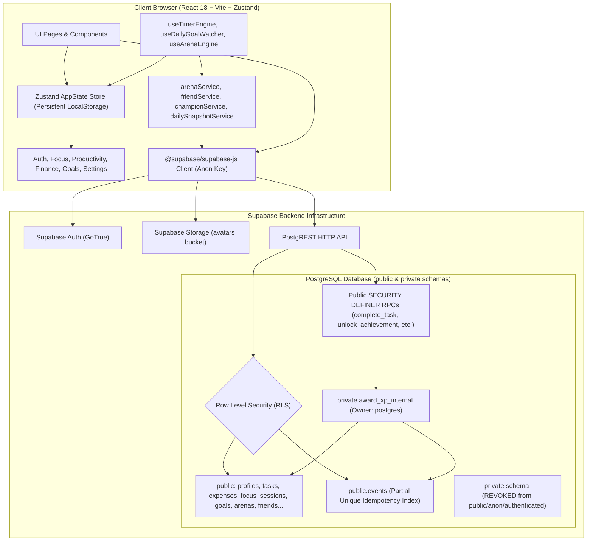
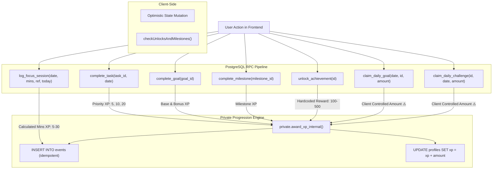

# FOCUSFORGE — PHASE 1: COMPREHENSIVE PRODUCTION SECURITY AUDIT REPORT

> **Document Version:** 1.0.0  
> **Date:** November 6, 2026  
> **Auditor Role:** Senior Application Security Engineer, Supabase/PostgreSQL Security Auditor, and React/TypeScript Software Architect  
> **Audit Classification:** Safe Read-Only Comprehensive Audit  
> **Project Target:** FocusForge / Focus Finance Tracker  
> **Repository Directory:** `d:\SWE Project\FocusForge Ad`

---

## 1. Executive Summary

This report delivers the findings of a comprehensive, evidence-based security and data-integrity audit of the FocusForge application. The audit was conducted strictly in **read-only mode** with zero modifications made to source code, migrations, database objects, or production records.

FocusForge implements a dual-paradigm student productivity and personal finance platform combining React, TypeScript, Zustand, and Supabase (GoTrue Authentication, PostgreSQL with Row-Level Security, Storage, and PostgREST RPCs). Over the codebase's evolution (spanning 42 migration files and ~35,000 lines of frontend/backend code), significant architectural efforts were introduced—notably server-authoritative progression, idempotency indexes, and aggregate RPCs.

However, our audit revealed **critical architectural vulnerabilities and logic defects** that undermine the platform's security boundaries, gamification economy, and regulatory privacy compliance:

1. **Direct Profile Modification & Gamification Bypass:** Despite server-authoritative XP functions (`private.award_xp_internal`, `complete_task`, `unlock_achievement`), the `public.profiles` table retains a blanket `UPDATE` policy for all authenticated users with **zero column-level restrictions**. Any user can directly overwrite `xp`, `streak`, `level`, and `badges` with arbitrary numbers via standard PostgREST client calls.
2. **Ledger Tampering & Infinite XP Re-Awarding:** The append-only event ledger (`public.events`) grants authenticated users full `DELETE` and `UPDATE` permissions. By uncompleting a task or goal, deleting the idempotency record from `public.events`, and re-completing the task, a user can earn limitless XP.
3. **Swapped RPC Arguments & Unique Constraint Crashes:** In `claim_daily_goal` and `claim_daily_challenge`, arguments to `private.award_xp_internal` are transposed (`v_reference_id` is passed as `p_event_type`, and a static string `'goal_completed'` is passed as `p_reference_id`). This corrupts ledger event categorization and causes legitimate duplicate claims to throw an unhandled database exception (`23505 unique_violation`) rather than returning graceful status objects.
4. **Arbitrary XP Inflation in Daily Goals and Challenges:** Both `claim_daily_goal` and `claim_daily_challenge` accept `p_amount` directly from the client and perform no server-side task, focus, or expense verification. A client can claim 10,000 XP instantly without performing any work.
5. **Client-Controlled Arena Scores and Unrestricted Hall of Fame:** Arena points and leaderboard standings are calculated client-side in `useArenaEngine.ts` and upserted directly by users. Furthermore, `public.hall_of_fame` has an `INSERT` policy with `CHECK (true)`, allowing any authenticated user to archive arbitrary users or themselves as champions.
6. **Non-Functional Account Deletion (GDPR/Privacy Risk):** Account deletion in `Settings.tsx` attempts `supabase.from('profiles').delete().eq('id', user.id)`. However, `profiles` lacks a `DELETE` policy, causing the call to fail silently. Even if permitted, deleting a profile does not delete the user from `auth.users`, leaving credentials and all underlying data orphaned and persistent in production.
7. **Social Engineering & Forced Friendships:** The `public.friends` table allows direct client `INSERT` if `auth.uid() = user_id OR auth.uid() = friend_id`, enabling any user to force friendship upon any other user without their consent. The `friend_requests` `UPDATE` policy allows senders to mark their own requests as `'accepted'`.
8. **Public Exposure of User Metadata:** `public.profiles` has a SELECT policy with `USING (auth.uid() IS NOT NULL)`, allowing any signed-in user to harvest the profiles, friend codes, activity dates, and challenge claim history of all registered users.

### Summary of Audit Findings by Severity

| Severity | Confirmed | Potential | Unknown | Total |
| :--- | :---: | :---: | :---: | :---: |
| **Critical** | 3 | 0 | 0 | **3** |
| **High** | 5 | 0 | 0 | **5** |
| **Medium** | 5 | 0 | 0 | **5** |
| **Low** | 2 | 0 | 0 | **2** |
| **Total** | **15** | **0** | **0** | **15** |

---

## 2. Architecture Overview

### System Architecture Diagram



### Component Trust Boundaries & Threat Model

1. **Client Browser Boundary:** The client environment (Zustand stores, localStorage, React components, and DevTools) is entirely untrusted. All calculations performed in JavaScript (such as timer intervals, productivity score formulas, and bonus rewards) can be manipulated or invoked with custom parameters.
2. **PostgREST API Boundary:** The Supabase anon key is publicly embedded in the frontend bundle (`.env`). Any authenticated JWT token enables arbitrary SQL queries against any table or RPC where RLS and grants permit.
3. **Database RLS & Schema Boundary:** Security Definer functions running as `postgres` bypass RLS. Helper functions in `private` schema are properly secured from direct invocation, but public RPC wrappers must strictly validate parameters, enforce business rules, and guard ledger integrity.

---

## 3. Critical Vulnerabilities

### FINDING-SEC-01: Direct Profile Modification Bypassing Progression and Gamification Logic
- **Finding ID:** `FINDING-SEC-01`
- **Classification:** **CONFIRMED**
- **Severity:** **CRITICAL**
- **Database Object / File:**
  - Database Policy: `public.profiles` policy `"Users can update own profile"`
  - SQL Migrations: [`20260525174459_create_spendwise_tables.sql#L46-L49`](file:///d:/SWE%20Project/FocusForge%20Ad/supabase/migrations/20260525174459_create_spendwise_tables.sql#L46-L49), [`20260729000000_friends_bootstrap.sql#L253-L254`](file:///d:/SWE%20Project/FocusForge%20Ad/supabase/migrations/20260729000000_friends_bootstrap.sql#L253-L254)
  - Frontend Call Site: [`src/store/storeUtils.ts#L14-L31`](file:///d:/SWE%20Project/FocusForge%20Ad/src/store/storeUtils.ts#L14-L31) (`saveProfile`)
- **Evidence:**
  In `20260729000000_friends_bootstrap.sql` lines 253-254:
  ```sql
  DROP POLICY IF EXISTS "Users can update own profile" ON public.profiles;
  CREATE POLICY "Users can update own profile" ON public.profiles FOR UPDATE USING (auth.uid() = id);
  ```
  No column privileges or `WITH CHECK` restrictions exist on `public.profiles`.
  In `src/store/storeUtils.ts` lines 14-31:
  ```typescript
  export const saveProfile = async (userId: string, data: Partial<Profile>) => {
    const profileUpdate: any = { id: userId, updated_at: new Date().toISOString() };
    for (const [key, value] of Object.entries(data)) {
      if (value !== undefined) profileUpdate[key] = value;
    }
    await supabase.from('profiles').upsert(profileUpdate);
  };
  ```
- **Exploit Scenario:**
  An authenticated attacker opens the browser console and executes:
  ```javascript
  await supabase.from('profiles').update({
    xp: 500000,
    streak: 365,
    level: 50,
    badges: [{ id: 'legendary', name: 'Grandmaster', icon: '👑', unlockedAt: new Date().toISOString() }]
  }).eq('id', (await supabase.auth.getUser()).data.user.id);
  ```
  PostgREST executes the update immediately because `auth.uid() = id` evaluates to true. The entire server-authoritative progression engine (`private.award_xp_internal`, `complete_task`, `unlock_achievement`) is completely bypassed.
- **Business Impact:**
  Complete collapse of gamification integrity, competitive leaderboards, unlockable rewards, and user trust.
- **Recommended Fix:**
  1. Revoke blanket UPDATE privileges on `public.profiles` from `authenticated`.
  2. Grant UPDATE only on user-editable presentation columns:
     ```sql
     REVOKE UPDATE ON public.profiles FROM authenticated;
     GRANT UPDATE (display_name, avatar_url, updated_at) ON public.profiles TO authenticated;
     ```
  3. Or create a `BEFORE UPDATE` trigger on `public.profiles` preventing changes to `xp`, `streak`, `level`, `badges`, `friend_code`, and `daily_challenge_claims` unless called by `postgres` or trusted RPCs.
- **Dependencies:** `saveProfile` in `src/store/storeUtils.ts` and `src/components/ProfileModal.tsx`.
- **Suggested Validation Test:**
  Issue an `UPDATE profiles SET xp = 99999 WHERE id = auth.uid()` as an authenticated user; verify that PostgREST returns `403 Forbidden` or `42501 permission denied for column xp`.

---

### FINDING-SEC-02: Ledger Tampering & Infinite XP Re-Awarding via Direct Event DELETE/UPDATE
- **Finding ID:** `FINDING-SEC-02`
- **Classification:** **CONFIRMED**
- **Severity:** **CRITICAL**
- **Database Object / File:**
  - Database Policies: `public.events` policies `"Users can delete own events"` & `"Users can update own events"`
  - SQL Migration: [`20260703185015_create_events_table.sql#L27-L36`](file:///d:/SWE%20Project/FocusForge%20Ad/supabase/migrations/20260703185015_create_events_table.sql#L27-L36)
  - Target Functions: `complete_task`, `complete_goal`, `complete_milestone`, `unlock_achievement`
- **Evidence:**
  In `20260703185015_create_events_table.sql` lines 27-36:
  ```sql
  CREATE POLICY "Users can update own events" ON events FOR UPDATE TO authenticated USING (auth.uid() = user_id) WITH CHECK (auth.uid() = user_id);
  CREATE POLICY "Users can delete own events" ON events FOR DELETE TO authenticated USING (auth.uid() = user_id);
  ```
  In `complete_task` ([`20260711123000_task_completion_xp_pipeline.sql#L219-L225`](file:///d:/SWE%20Project/FocusForge%20Ad/supabase/migrations/20260711123000_task_completion_xp_pipeline.sql#L219-L225)):
  ```sql
  PERFORM 1 FROM public.events 
  WHERE user_id = v_user_id AND type = 'task_completed' AND reference_id = v_reference_id AND metadata ? 'xp_earned';
  IF FOUND THEN
    v_xp_earned := 0;
  ELSE
    v_total_xp := private.award_xp_internal(...);
  END IF;
  ```
- **Exploit Scenario:**
  1. A user completes a high-priority task via `complete_task` RPC. The server awards +20 XP and writes an event with `reference_id = 'task_<id>'`.
  2. The user re-opens the task via `uncomplete_task` RPC. The task's status becomes `pending`. The earned XP is kept per business rules.
  3. The user executes:
     ```javascript
     await supabase.from('events').delete().eq('reference_id', `task_${taskId}`);
     ```
     The RLS policy `"Users can delete own events"` permits this deletion.
  4. The user invokes `complete_task` again. Because the ledger record in `events` is gone, the idempotency check fails, `award_xp_internal` executes, and another +20 XP is awarded.
  5. The attacker repeats steps 2–4 thousands of times in a script, generating arbitrary XP and inflating their level.
- **Business Impact:**
  Destroyed auditability, unconstrained XP farming, and spoofing of achievement prerequisites (e.g. inserting 12 fake `payment_completed` events to claim `ach_12_months_on_time`).
- **Recommended Fix:**
  1. Drop `"Users can update own events"` and `"Users can delete own events"` policies.
  2. Revoke blanket `INSERT` on `public.events` from `authenticated`. All event records awarding XP or recording system actions must be inserted solely by trusted `SECURITY DEFINER` functions.
  3. For non-XP telemetry, restrict INSERT to an explicit whitelist of client event categories.
- **Dependencies:** `logEvent` in `src/lib/events.ts`.
- **Suggested Validation Test:**
  Attempt `supabase.from('events').delete().eq('id', eventId)` from an authenticated session; verify that PostgREST rejects the query with RLS violation.

---

### FINDING-SEC-03: Swapped Argument Order in `claim_daily_goal` & `claim_daily_challenge` Causing Ledger Corruption & Unique Constraint Crashes
- **Finding ID:** `FINDING-SEC-03`
- **Classification:** **CONFIRMED**
- **Severity:** **CRITICAL**
- **Database Object / File:**
  - Functions: `public.claim_daily_goal` and `public.claim_daily_challenge`
  - SQL Migrations: [`20260715120000_server_authoritative_daily_claims.sql#L68-L80`](file:///d:/SWE%20Project/FocusForge%20Ad/supabase/migrations/20260715120000_server_authoritative_daily_claims.sql#L68-L80), [`20260715120000_server_authoritative_daily_claims.sql#L142-L154`](file:///d:/SWE%20Project/FocusForge%20Ad/supabase/migrations/20260715120000_server_authoritative_daily_claims.sql#L142-L154)
- **Evidence:**
  `private.award_xp_internal` signature ([`20260711120000_progression_xp_foundation.sql#L46-L53`](file:///d:/SWE%20Project/FocusForge%20Ad/supabase/migrations/20260711120000_progression_xp_foundation.sql#L46-L53)):
  ```sql
  CREATE OR REPLACE FUNCTION private.award_xp_internal(
    p_user_id UUID,          -- Arg 1
    p_xp_amount INTEGER,     -- Arg 2
    p_event_type TEXT,       -- Arg 3
    p_event_category TEXT,   -- Arg 4
    p_reference_id TEXT,     -- Arg 5
    p_metadata JSONB         -- Arg 6
  )
  ```
  Invocation in `claim_daily_goal` lines 68-79:
  ```sql
  v_xp_awarded := private.award_xp_internal(
      v_user_id,             -- Arg 1 (Correct)
      p_amount,              -- Arg 2 (Correct)
      v_reference_id,        -- Arg 3 (WRONG: passes 'daily_goal_focus_2026-11-06' as p_event_type)
      'daily_goal',          -- Arg 4 (passes 'daily_goal' as p_event_category)
      'goal_completed',      -- Arg 5 (WRONG: passes static literal 'goal_completed' as p_reference_id!)
      jsonb_build_object(...)
  );
  ```
  And in `claim_daily_challenge` lines 142-154:
  ```sql
  v_xp_awarded := private.award_xp_internal(
      v_user_id,
      p_amount,
      v_reference_id,        -- WRONG: passed as p_event_type
      'daily_challenge',     -- passed as p_event_category
      'challenge_completed', -- WRONG: passed as p_reference_id!
      jsonb_build_object(...)
  );
  ```
- **Exploit / Failure Scenario:**
  1. The idempotency check at line 51-55 in `claim_daily_goal` executes:
     ```sql
     SELECT EXISTS (SELECT 1 FROM events WHERE user_id = v_user_id AND reference_id = v_reference_id)
     ```
  2. Because `award_xp_internal` recorded `reference_id = 'goal_completed'`, no record exists with `reference_id = v_reference_id`.
  3. On duplicate user clicks or subsequent claims, `v_already_claimed` evaluates to `FALSE`.
  4. The function attempts to insert into `events` again with:
     - `type` = `v_reference_id`
     - `reference_id` = `'goal_completed'`
  5. The partial unique index `events_xp_idempotency_idx ON events(user_id, type, reference_id)` triggers a database exception:
     `ERROR: duplicate key value violates unique constraint "events_xp_idempotency_idx" (SQLSTATE 23505)`.
  6. Instead of returning `{ claimed: false, already_claimed: true, xp_earned: 0 }`, the RPC crashes with an uncaught 500/PGRST error.
- **Business Impact:**
  Frontend RPC calls fail with unhandled exceptions. Daily goal and challenge claim flows become flaky or crash the UI. Event telemetry categorization is permanently inverted.
- **Recommended Fix:**
  Redeclare `claim_daily_goal` and `claim_daily_challenge` with the exact parameter order expected by `award_xp_internal`:
  ```sql
  v_xp_awarded := private.award_xp_internal(
      v_user_id,
      p_amount,
      'goal_completed',   -- p_event_type
      'daily_goal',       -- p_event_category
      v_reference_id,     -- p_reference_id
      jsonb_build_object(...)
  );
  ```
- **Dependencies:** `useDailyGoalWatcher.ts` and `src/pages/Achievements.tsx`.
- **Suggested Validation Test:**
  Call `supabase.rpc('claim_daily_goal', ...)` twice in succession; verify the second call returns `{ already_claimed: true, claimed: false }` with HTTP 200 without throwing SQLSTATE 23505.

---

## 4. High-Severity Vulnerabilities

### FINDING-SEC-04: Client-Controlled XP Amounts in Daily Goals and Challenges
- **Finding ID:** `FINDING-SEC-04`
- **Classification:** **CONFIRMED**
- **Severity:** **HIGH**
- **Database Object / File:**
  - SQL Migrations: [`20260715120000_server_authoritative_daily_claims.sql#L19-L23`](file:///d:/SWE Project\FocusForge Ad\supabase\migrations\20260715120000_server_authoritative_daily_claims.sql#L19-L23), [`20260715120000_server_authoritative_daily_claims.sql#L97-L101`](file:///d:/SWE Project\FocusForge Ad\supabase\migrations\20260715120000_server_authoritative_daily_claims.sql#L97-L101)
  - Frontend Hook: [`src/hooks/useDailyGoalWatcher.ts#L153-L156`](file:///d:/SWE Project\FocusForge Ad\src\hooks\useDailyGoalWatcher.ts#L153-L156), [`src/hooks/useDailyGoalWatcher.ts#L190-L194`](file:///d:/SWE Project\FocusForge Ad\src\hooks\useDailyGoalWatcher.ts#L190-L194)
  - Frontend Store: [`src/store/useDailyGoalsStore.ts#L186`](file:///d:/SWE Project\FocusForge Ad\src\store\useDailyGoalsStore.ts#L186) (`completionBonusXP`)
  - Frontend Page: [`src/pages/Achievements.tsx#L85-L89`](file:///d:/SWE Project\FocusForge Ad\src\pages\Achievements.tsx#L85-L89)
- **Evidence:**
  `claim_daily_goal` signature:
  ```sql
  CREATE OR REPLACE FUNCTION public.claim_daily_goal(
      p_goal_date date,
      p_goal_id text DEFAULT 'all',
      p_amount int DEFAULT 10
  )
  ```
  `claim_daily_challenge` signature:
  ```sql
  CREATE OR REPLACE FUNCTION public.claim_daily_challenge(
      p_challenge_id text,
      p_challenge_date date,
      p_amount int DEFAULT 20
  )
  ```
  In `useDailyGoalsStore.ts`: `completionBonusXP` is stored in localStorage and read directly by `useDailyGoalWatcher.ts` to pass as `p_amount`.
- **Exploit Scenario:**
  An attacker runs:
  ```javascript
  await supabase.rpc('claim_daily_goal', {
    p_goal_date: new Date().toISOString().split('T')[0],
    p_goal_id: 'focus',
    p_amount: 10000
  });
  ```
  Because `award_xp_internal` permits `p_xp_amount <= 10000`, the server awards 10,000 XP in a single request.
- **Business Impact:**
  Instant gamification inflation.
- **Recommended Fix:**
  Remove `p_amount` parameter from both RPC signatures. Enforce XP amounts entirely server-side (10 XP for individual goals, 25 XP for 'all', 20 XP for daily challenges).
- **Dependencies:** `useDailyGoalsStore.ts`, `useDailyGoalWatcher.ts`, `Achievements.tsx`.
- **Suggested Validation Test:**
  Attempt invoking `claim_daily_goal` with `p_amount = 5000`; verify the function rejects the parameter or awards only the server-governed amount (10 XP).

---

### FINDING-SEC-05: Missing Server-Side Completion Verification for Daily Goals & Daily Challenges
- **Finding ID:** `FINDING-SEC-05`
- **Classification:** **CONFIRMED**
- **Severity:** **HIGH**
- **Database Object / File:**
  - SQL Migration: [`20260715120000_server_authoritative_daily_claims.sql#L18-L91`](file:///d:/SWE Project\FocusForge Ad\supabase\migrations\20260715120000_server_authoritative_daily_claims.sql#L18-L91), [`20260715120000_server_authoritative_daily_claims.sql#L97-L183`](file:///d:/SWE Project\FocusForge Ad\supabase\migrations\20260715120000_server_authoritative_daily_claims.sql#L97-L183)
- **Evidence:**
  Neither `claim_daily_goal` nor `claim_daily_challenge` contains any queries against `tasks`, `focus_sessions`, or `expenses` to verify that the claimed goal was completed on `p_goal_date`.
- **Exploit Scenario:**
  A newly created account with 0 tasks, 0 focus minutes, and 0 expenses invokes `claim_daily_goal` for `'goal_focus'`, `'goal_tasks'`, `'goal_budget'`, and `'all'`. The RPC awards XP for all of them immediately.
- **Business Impact:**
  Automated farming of progression rewards without user activity.
- **Recommended Fix:**
  Add validation logic in `claim_daily_goal`:
  - For `goal_focus`: verify `focus_sessions.minutes >= 120` for that date.
  - For `goal_tasks`: verify count of completed tasks for that date.
  - For `all`: verify all component goals meet their criteria.
- **Dependencies:** `focus_sessions`, `tasks`, `expenses` tables.
- **Suggested Validation Test:**
  Call `claim_daily_goal` on an account with zero activity; verify that the RPC returns an error indicating that the goal was not completed.

---

### FINDING-SEC-06: Unrestricted Read Policy on `public.profiles` Exposing All User Profiles
- **Finding ID:** `FINDING-SEC-06`
- **Classification:** **CONFIRMED**
- **Severity:** **HIGH**
- **Database Object / File:**
  - Database Policy: `public.profiles` policy `"Profiles are viewable by authenticated users"`
  - SQL Migration: [`20260729000000_friends_bootstrap.sql#L250-L251`](file:///d:/SWE Project\FocusForge Ad\supabase\migrations\20260729000000_friends_bootstrap.sql#L250-L251)
- **Evidence:**
  ```sql
  DROP POLICY IF EXISTS "Profiles are viewable by authenticated users" ON public.profiles;
  CREATE POLICY "Profiles are viewable by authenticated users" ON public.profiles FOR SELECT USING (auth.uid() IS NOT NULL);
  ```
- **Exploit Scenario:**
  Any authenticated user can run:
  ```javascript
  const { data: allUsers } = await supabase.from('profiles').select('*');
  ```
  This returns all users' IDs, display names, avatar URLs, friend codes, XP, streaks, last active dates, and full daily challenge claim history. If schema drift left `monthly_budget` and `total_savings` on `profiles`, private financial numbers are also leaked.
- **Business Impact:**
  Mass user enumeration, user tracking, privacy compliance exposure.
- **Recommended Fix:**
  1. Restrict direct SELECT on `public.profiles` to own record: `USING (auth.uid() = id)`.
  2. Create a secure public view or search function for friend discovery:
     ```sql
     CREATE VIEW public.public_profiles AS
     SELECT id, display_name, avatar_url, level, friend_code FROM public.profiles;
     ```
- **Dependencies:** `useFriends.ts`, `friendService.ts`, `useArenaLeaderboard.ts`.
- **Suggested Validation Test:**
  As User A, query `supabase.from('profiles').select('*').neq('id', auth.uid())`; verify that 0 rows are returned.

---

### FINDING-SEC-07: Client-Controlled Arena Scores and Unrestricted Arbitrary Insertion into `hall_of_fame`
- **Finding ID:** `FINDING-SEC-07`
- **Classification:** **CONFIRMED**
- **Severity:** **HIGH**
- **Database Object / File:**
  - Database Policies: `public.arena_scores` & `public.hall_of_fame`
  - SQL Migrations: [`20260802000000_consolidated_schema_sync.sql#L198-L210`](file:///d:/SWE Project\FocusForge Ad\supabase\migrations\20260802000000_consolidated_schema_sync.sql#L198-L210), [`20260802100000_arena_member_self_join.sql#L26-L30`](file:///d:/SWE Project\FocusForge Ad\supabase\migrations\20260802100000_arena_member_self_join.sql#L26-L30)
  - Frontend Services: [`src/hooks/useArenaEngine.ts#L254-L261`](file:///d:/SWE Project\FocusForge Ad\src\hooks\useArenaEngine.ts#L254-L261), [`src/services/championService.ts#L55-L73`](file:///d:/SWE Project\FocusForge Ad\src\services\championService.ts#L55-L73)
- **Evidence:**
  In `20260802100000_arena_member_self_join.sql`:
  ```sql
  CREATE POLICY "Arena owners or self can upsert scores" ON public.arena_scores
    FOR INSERT WITH CHECK (user_id = auth.uid() OR arena_id IN (SELECT id FROM public.arenas WHERE owner_id = auth.uid()));
  ```
  In `20260802000000_consolidated_schema_sync.sql`:
  ```sql
  CREATE POLICY "Users can update their own score components" ON public.arena_scores
    FOR UPDATE USING (auth.uid() = user_id);
  CREATE POLICY "Authenticated users can archive champions" ON public.hall_of_fame
    FOR INSERT TO authenticated WITH CHECK (true);
  ```
- **Exploit Scenario:**
  1. An attacker executes `supabase.from('arena_scores').update({ focus_points: 999999, task_points: 999999, streak_bonus: 999999 }).eq('user_id', auth.uid())`. The generated `total_score` column recalculates to ~3,000,000 points.
  2. When Monday arrives (or by invoking `championService.archiveChampion`), the attacker's client inserts their own record directly into `hall_of_fame`. Because the check is `WITH CHECK (true)`, any data can be inserted.
- **Business Impact:**
  Productivity Arena leaderboards and historical Hall of Fame records can be trivially fabricated.
- **Recommended Fix:**
  1. Revoke INSERT and UPDATE on `arena_scores` and `hall_of_fame` from `authenticated`.
  2. Implement an aggregate RPC or database trigger that calculates arena scores server-side from verified `focus_sessions` and `task_completions`.
  3. Archive champions via a scheduled Edge Function or cron job with service-role permissions.
- **Dependencies:** `useArenaEngine.ts`, `arenaService.ts`, `championService.ts`.
- **Suggested Validation Test:**
  Attempt `supabase.from('hall_of_fame').insert(...)` as an authenticated user; verify PostgREST rejects the request with 403 Forbidden.

---

### FINDING-SEC-08: Non-Functional Account Deletion (Silent Failure & Privacy Compliance Defect)
- **Finding ID:** `FINDING-SEC-08`
- **Classification:** **CONFIRMED**
- **Severity:** **HIGH**
- **Database Object / File:**
  - Database Table: `public.profiles`
  - Frontend Page: [`src/pages/Settings.tsx#L83-L94`](file:///d:/SWE Project\FocusForge Ad\src\pages\Settings.tsx#L83-L94)
- **Evidence:**
  In `src/pages/Settings.tsx` lines 83-94:
  ```typescript
  const handleDeleteAccount = async () => {
    if (window.confirm('WARNING: Are you absolutely sure you want to delete your account? ...')) {
      if (user) {
        await supabase.from('profiles').delete().eq('id', user.id);
        await supabase.auth.signOut();
        window.location.reload();
      }
    }
  };
  ```
  `public.profiles` has **NO DELETE policy** (only SELECT, INSERT, UPDATE exist across all 42 migration files). Furthermore, `profiles.id REFERENCES auth.users(id) ON DELETE CASCADE` only cascades from `auth.users` to `profiles`, not the reverse.
- **Failure Scenario:**
  A user clicks "Delete Account" and confirms. PostgREST rejects the DELETE because no policy grants DELETE on `profiles`. The error is unhandled. The user is logged out. Their user account in `auth.users`, along with all tasks, expenses, focus sessions, and profile records, remain 100% active in the database.
- **Business Impact:**
  Failure to fulfill user data deletion requests under GDPR/CCPA; misleading security promises.
- **Recommended Fix:**
  Create a `SECURITY DEFINER` RPC:
  ```sql
  CREATE OR REPLACE FUNCTION public.delete_own_account()
  RETURNS void
  LANGUAGE plpgsql
  SECURITY DEFINER
  SET search_path = pg_catalog, public
  AS $$
  BEGIN
    DELETE FROM auth.users WHERE id = auth.uid();
  END;
  $$;
  REVOKE ALL ON FUNCTION public.delete_own_account() FROM PUBLIC, anon;
  GRANT EXECUTE ON FUNCTION public.delete_own_account() TO authenticated;
  ```
  Update `Settings.tsx` to call `supabase.rpc('delete_own_account')`.
- **Dependencies:** `Settings.tsx`, `auth.users` cascading delete constraints.
- **Suggested Validation Test:**
  Create a test account, invoke the account deletion flow, and verify that the user record is removed from both `auth.users` and all dependent tables.

---

## 5. Medium-Severity Vulnerabilities

### FINDING-SEC-09: Unverified Focus Timer Sessions & Client-Controlled Minutes
- **Finding ID:** `FINDING-SEC-09`
- **Classification:** **CONFIRMED**
- **Severity:** **MEDIUM**
- **Database Object / File:**
  - Function: `public.log_focus_session` in [`supabase/migrations/20260708180000_fix_events_index_and_constraint.sql#L27-L164`](file:///d:/SWE Project\FocusForge Ad\supabase\migrations\20260708180000_fix_events_index_and_constraint.sql#L27-L164)
  - Frontend Hook: [`src/hooks/useTimerEngine.ts#L138-L143`](file:///d:/SWE Project\FocusForge Ad\src\hooks\useTimerEngine.ts#L138-L143)
- **Evidence:**
  `log_focus_session` accepts `p_minutes` (1–120) and `p_reference_id` directly from the client. No server-side timer state or elapsed-time validation exists.
- **Exploit Scenario:**
  A client executes a loop calling `supabase.rpc('log_focus_session', { p_session_date: today, p_minutes: 120, p_reference_id: 'focus_' + Math.random(), p_today: today })` 100 times. Each call immediately logs 120 focus minutes, increments streak, and awards 30 XP.
- **Business Impact:**
  Trivial fabrication of study hours, focus analytics, and XP.
- **Recommended Fix:**
  Introduce a daily focus minutes ceiling (e.g. max 720 minutes/day) or track timer sessions with `start_time` and `end_time` validation.

---

### FINDING-SEC-10: Insecure Friendship Creation and Friend Request Self-Approval
- **Finding ID:** `FINDING-SEC-10`
- **Classification:** **CONFIRMED**
- **Severity:** **MEDIUM**
- **Database Object / File:**
  - SQL Migration: [`20260729000000_friends_bootstrap.sql#L263-L277`](file:///d:/SWE Project\FocusForge Ad\supabase\migrations\20260729000000_friends_bootstrap.sql#L263-L277)
  - Frontend Service: [`src/services/friendService.ts#L32-L77`](file:///d:/SWE Project\FocusForge Ad\src\services\friendService.ts#L32-L77)
- **Evidence:**
  `CREATE POLICY "Users can add friends" ON public.friends FOR INSERT WITH CHECK (auth.uid() = user_id OR auth.uid() = friend_id);`
  `CREATE POLICY "Users can update friend requests they sent or received" ON public.friend_requests FOR UPDATE USING (auth.uid() = sender_id OR auth.uid() = receiver_id);`
- **Exploit Scenario:**
  1. User A can insert directly into `public.friends` with `user_id = auth.uid()` and `friend_id = <User B UUID>` without sending a request.
  2. Alternatively, User A sends a friend request to User B and immediately issues `UPDATE friend_requests SET status = 'accepted'` because the policy allows `sender_id = auth.uid()`.
  3. The trigger `on_friendship_created` fires, automatically adding both users to the Global Productivity Arena.
- **Business Impact:**
  Forced social relationships, unsolicited leaderboard sharing, and harassment potential.
- **Recommended Fix:**
  Revoke direct INSERT on `public.friends`. Restrict `friend_requests` UPDATE to `auth.uid() = receiver_id`. Require an atomic RPC `accept_friend_request(p_request_id)`.

---

### FINDING-SEC-11: Public Visibility of All Arenas and Insecure Self-Enrollment
- **Finding ID:** `FINDING-SEC-11`
- **Classification:** **CONFIRMED**
- **Severity:** **MEDIUM**
- **Database Object / File:**
  - SQL Migrations: [`20260815000000_arena_rls_security_definer_patch.sql#L50-L52`](file:///d:/SWE Project\FocusForge Ad\supabase\migrations\20260815000000_arena_rls_security_definer_patch.sql#L50-L52), [`20260802100000_arena_member_self_join.sql#L16-L20`](file:///d:/SWE Project\FocusForge Ad\supabase\migrations\20260802100000_arena_member_self_join.sql#L16-L20)
- **Evidence:**
  `CREATE POLICY "arenas_select_policy" ON public.arenas FOR SELECT TO authenticated USING (true);`
  `CREATE POLICY "Arena owners or self can join" ON public.arena_members FOR INSERT WITH CHECK (user_id = auth.uid() OR arena_id IN (...));`
- **Exploit Scenario:**
  Any user can query the names and descriptions of all arenas (including private ones) and self-enroll into any arena by inserting into `arena_members` with `user_id = auth.uid()`, bypassing invitations.
- **Business Impact:**
  Breach of private arena exclusivity and unintended data leakage.
- **Recommended Fix:**
  Enforce arena visibility rules: private arenas should only be visible and joinable by users who possess an invitation or are friends with the owner.

---

### FINDING-SEC-12: SECURITY DEFINER Functions with Missing or Unsafe `search_path`
- **Finding ID:** `FINDING-SEC-12`
- **Classification:** **CONFIRMED**
- **Severity:** **MEDIUM**
- **Database Object / File:**
  - `public.handle_friendship_arena_enrollment`: missing `SET search_path` entirely ([`20260802000000_consolidated_schema_sync.sql#L277-L311`](file:///d:/SWE Project\FocusForge Ad\supabase\migrations\20260802000000_consolidated_schema_sync.sql#L277-L311))
  - `public.log_focus_session`: `SET search_path = public` ([`20260708180000_fix_events_index_and_constraint.sql#L46`](file:///d:/SWE Project\FocusForge Ad\supabase\migrations\20260708180000_fix_events_index_and_constraint.sql#L46))
  - `public.calculate_streak`: `SET search_path = public` ([`20260707120000_streak_calculation_repair.sql#L14`](file:///d:/SWE Project\FocusForge Ad\supabase\migrations\20260707120000_streak_calculation_repair.sql#L14))
  - `public.get_current_streak`: `SET search_path = public` ([`20260707120000_streak_calculation_repair.sql#L228`](file:///d:/SWE Project\FocusForge Ad\supabase\migrations\20260707120000_streak_calculation_repair.sql#L228))
  - `public.handle_new_user`: `SET search_path = public` ([`20260729000000_friends_bootstrap.sql#L129`](file:///d:/SWE Project\FocusForge Ad\supabase\migrations\20260729000000_friends_bootstrap.sql#L129))
- **Evidence:**
  `SECURITY DEFINER` functions execute with the privileges of their owner (`postgres`). When `search_path` is omitted or does not pin `pg_catalog` first, PostgreSQL searches schemas according to session settings, introducing potential search_path hijacking risks.
- **Business Impact:**
  Theoretical privilege escalation risk under specific schema configuration changes.
- **Recommended Fix:**
  Add `SET search_path = pg_catalog, public, private` to all `SECURITY DEFINER` functions.

---

### FINDING-SEC-13: Schema Drift & Column Inconsistency Between Migrations and Application Code
- **Finding ID:** `FINDING-SEC-13`
- **Classification:** **CONFIRMED**
- **Severity:** **MEDIUM**
- **Database Object / File:**
  - Migrations: [`20260801010000_secure_financial_profiles.sql`](file:///d:/SWE Project\FocusForge Ad\supabase\migrations\20260801010000_secure_financial_profiles.sql), [`20260802000000_consolidated_schema_sync.sql#L14-L19`](file:///d:/SWE Project\FocusForge Ad\supabase\migrations\20260802000000_consolidated_schema_sync.sql#L14-L19)
  - Application Code: [`src/lib/supabase.ts#L19-L20`](file:///d:/SWE Project\FocusForge Ad\src\lib\supabase.ts#L19-L20), [`src/store/useStore.ts#L85`](file:///d:/SWE Project\FocusForge Ad\src\store\useStore.ts#L85), [`src/pages/Finance.tsx#L126`](file:///d:/SWE Project\FocusForge Ad\src\pages\Finance.tsx#L126)
- **Evidence:**
  Migration `20260801010000` dropped `monthly_budget` and `total_savings` from `profiles` to create `user_financial_settings`. However, migration `20260802000000` recorded that in the live database, `user_financial_settings` did not exist and `profiles.monthly_budget` still existed. The entire frontend codebase continues to query and write `profiles.monthly_budget` directly and never references `user_financial_settings`.
- **Business Impact:**
  Applying migration `20260801010000` on a new staging/production environment breaks the Finance page and store hydration (`profiles.monthly_budget` column not found).
- **Recommended Fix:**
  Formally align database and code: either complete the migration of the frontend to `user_financial_settings` or safely retire `user_financial_settings` and keep columns on `profiles` with column-level security.

---

## 6. Low-Severity Findings

### FINDING-SEC-14: Browser LocalStorage State Persistence Without User Isolation
- **Finding ID:** `FINDING-SEC-14`
- **Classification:** **CONFIRMED**
- **Severity:** **LOW**
- **File:** [`src/store/useStore.ts#L34-L53`](file:///d:/SWE Project\FocusForge Ad\src\store\useStore.ts#L34-L53), [`src/store/useDailyGoalsStore.ts#L180-L196`](file:///d:/SWE Project\FocusForge Ad\src\store\useDailyGoalsStore.ts#L180-L196)
- **Evidence:**
  Both Zustand stores persist to unpartitioned `localStorage` keys (`spendwise-storage` and `daily-goals-storage`). `goalConfigs` is not cleared on logout.
- **Exploit / Impact:**
  On shared machines, the next user who opens the browser can view previously configured custom daily goals and timer settings.
- **Recommended Fix:**
  Prefix storage keys with the authenticated `user.id` or execute a full cleanup on logout.

---

### FINDING-SEC-15: Committed Supabase Anonymous Credentials in `.env`
- **Finding ID:** `FINDING-SEC-15`
- **Classification:** **CONFIRMED**
- **Severity:** **LOW**
- **File:** [`.env`](file:///d:/SWE Project\FocusForge Ad\.env), [`scratch/fetch_schema.mjs`](file:///d:/SWE Project\FocusForge Ad\scratch\fetch_schema.mjs)
- **Evidence:**
  `VITE_SUPABASE_URL` and `VITE_SUPABASE_ANON_KEY` are stored in committed files. While Supabase anonymous keys are public by design, committing active keys hinders key rotation and environment segregation.
- **Recommended Fix:**
  Add `.env` and `scratch/` credentials to `.gitignore`, provide `.env.example`, and inject values via environment secrets.

---

## 7. XP and Achievement Integrity Analysis

FocusForge's progression system was audited across all grant paths:



### Path-by-Path Verification Matrix

| Function / RPC | Server Verification? | Client Controls XP? | Idempotent? | Finding ID |
| :--- | :---: | :---: | :---: | :---: |
| `complete_task` | ✅ Yes (checks ownership, priority) | ❌ No (fixed 5/10/20) | ✅ Yes (partial index) | Ledger delete flaw (SEC-02) |
| `complete_goal` | ✅ Yes (progress pct / milestones) | ❌ No (fixed base/bonus) | ✅ Yes (base + early bonus) | Hardened in 20261013 |
| `complete_milestone`| ✅ Yes (parent goal actionable) | ❌ No (column grant restricted) | ✅ Yes | Hardened in 20261013 |
| `unlock_achievement`| ✅ Yes (server condition evaluated)| ❌ No (hardcoded case map) | ✅ Yes (checks legacy & canonical)| Secure |
| `claim_daily_goal` | ❌ **NO** (no criteria checked) | ⚠️ **YES** (`p_amount` accepted) | ❌ **BROKEN** (swapped args crash) | SEC-03, SEC-04, SEC-05 |
| `claim_daily_challenge`| ❌ **NO** (no challenge checked) | ⚠️ **YES** (`p_amount` accepted) | ❌ **BROKEN** (swapped args crash) | SEC-03, SEC-04, SEC-05 |
| `log_focus_session`| ⚠️ Weak (checks date tolerance) | ❌ No (calculated from minutes)| ⚠️ Weak (client ref_id) | SEC-09 |
| Direct `profiles` UPDATE| ❌ **NONE** | ⚠️ **YES** (arbitrary update) | ❌ N/A | SEC-01 |

---

## 8. Profile Privacy and RLS Analysis

### Table RLS Configuration Summary

| Table | RLS Enabled | SELECT Policy | INSERT Policy | UPDATE Policy | DELETE Policy |
| :--- | :---: | :--- | :--- | :--- | :--- |
| `profiles` | ✅ Yes | `auth.uid() IS NOT NULL` ⚠️ | `auth.uid() = id` | `auth.uid() = id` (Blanket ⚠️) | ❌ **Missing** ⚠️ |
| `events` | ✅ Yes | `auth.uid() = user_id` | `auth.uid() = user_id` ⚠️ | `auth.uid() = user_id` ⚠️ | `auth.uid() = user_id` ⚠️ |
| `expenses` | ✅ Yes | `auth.uid() = user_id` | `auth.uid() = user_id` | `auth.uid() = user_id` | `auth.uid() = user_id` |
| `tasks` | ✅ Yes | `auth.uid() = user_id` | `auth.uid() = user_id` | `auth.uid() = user_id` | `auth.uid() = user_id` |
| `focus_sessions`| ✅ Yes | `auth.uid() = user_id` | `auth.uid() = user_id` | `auth.uid() = user_id` | `auth.uid() = user_id` |
| `savings_goals` | ✅ Yes | `auth.uid() = user_id` | `auth.uid() = user_id` | `auth.uid() = user_id` | `auth.uid() = user_id` |
| `custom_categories`| ✅ Yes | `auth.uid() = user_id` | `auth.uid() = user_id` | `auth.uid() = user_id` | `auth.uid() = user_id` |
| `recurring_expenses`| ✅ Yes | `auth.uid() = user_id` | `auth.uid() = user_id` | `auth.uid() = user_id` | `auth.uid() = user_id` |
| `splits` | ✅ Yes | `auth.uid() = user_id` | `auth.uid() = user_id` | `auth.uid() = user_id` | `auth.uid() = user_id` |
| `goals` | ✅ Yes | `auth.uid() = user_id` | Restricted Columns ✅ | Restricted Columns ✅ | `auth.uid() = user_id` |
| `goal_milestones`| ✅ Yes | `auth.uid() = user_id` | Restricted Columns ✅ | Restricted Columns ✅ | `auth.uid() = user_id` |
| `arenas` | ✅ Yes | `true` (All auth users ⚠️) | `owner_id = auth.uid()` | `owner_id = auth.uid()` | `owner_id = auth.uid()` |
| `arena_members` | ✅ Yes | Member/Owner view | Owner or self-join ⚠️ | `auth.uid() = user_id` | ❌ **Missing** |
| `arena_scores` | ✅ Yes | Member/Owner view | Owner or self-upsert ⚠️ | `auth.uid() = user_id` ⚠️ | ❌ **Missing** |
| `hall_of_fame` | ✅ Yes | `true` | `WITH CHECK (true)` ⚠️ | ❌ **Missing** | ❌ **Missing** |
| `arena_activity`| ✅ Yes | Member/Owner view | Member insert | ❌ **Missing** | Member delete |
| `friends` | ✅ Yes | Member view | `user_id OR friend_id` ⚠️ | Member update | Member delete |
| `friend_requests`| ✅ Yes | Sender/Receiver view | `auth.uid() = sender_id` | Sender OR Receiver ⚠️ | Sender/Receiver delete |
| `user_preferences`| ✅ Yes| `auth.uid() = user_id` | `auth.uid() = user_id` | `auth.uid() = user_id` | ❌ **Missing** |
| `daily_progress_snapshots`| ✅ Yes| `auth.uid() = user_id` | `auth.uid() = user_id` | `auth.uid() = user_id` | ❌ **Missing** |

---

## 9. Focus Timer and Streak Analysis

### Timer Completion & Persistence Workflow
In `src/hooks/useTimerEngine.ts`:
- The timer maintains a target completion deadline `timerDeadline = Date.now() + durationSeconds` in Zustand, synced to localStorage.
- When `now >= deadline`, `handleTimerComplete(deadline)` is invoked.
- For authenticated users, it calls `supabase.rpc('log_focus_session')` passing `referenceId = 'focus_' + deadline`.
- The database function `log_focus_session`:
  1. Validates `p_minutes` between 1 and 120.
  2. Validates `p_session_date` is within +/- 1 day of `CURRENT_DATE`.
  3. Inserts an event with `reference_id = p_reference_id`.
  4. Increments `xp` on `public.profiles`.
  5. Upserts into `public.focus_sessions` on `(user_id, session_date)` adding minutes and incrementing `sessions_count`.
  6. Invokes `calculate_streak(user_id, p_today)` and writes the result to `profiles.streak`.

### Streak Calculation Defect
`calculate_streak` loops backwards over calendar days checking exclusively:
```sql
SELECT 1 FROM public.focus_sessions WHERE user_id = p_user_id AND session_date = v_check_date
```
**Defect:** If a user completes 10 tasks in a day but does not run a Pomodoro timer, `calculate_streak` treats that day as inactive and resets their streak to 0. In contrast, the frontend's offline `computeStreak()` checks `last_active_date`. This divergence creates confusing streak resets when switching between tasks and timer activities.

---

## 10. Storage and API Security

### Supabase Storage (`avatars` Bucket)
- **Bucket Configuration:** Bucket is `public: true`, 5MB limit, restricted to image MIME types (`image/jpeg`, `image/png`, `image/webp`, `image/gif`).
- **RLS Policies:**
  - `SELECT`: Public access.
  - `INSERT/UPDATE/DELETE`: Restricted by folder name matching user ID:
    ```sql
    auth.uid()::text = (storage.foldername(name))[1]
    ```
- **Finding:** Storage RLS policies for avatars are properly configured and follow Supabase best practices. Cache busting is handled safely in the client with timestamp queries.

---

## 11. Migration and Schema Drift Risks

1. **Drift in Financial Settings Table:**
   - Migration `20260801010000_secure_financial_profiles.sql` created `user_financial_settings` and dropped `monthly_budget` from `profiles`.
   - Migration `20260802000000_consolidated_schema_sync.sql` noted that `user_financial_settings` was missing in live production and preserved `profiles.monthly_budget`.
   - **Risk:** New automated migrations or test databases will experience divergent states depending on whether `20260801010000` is executed or bypassed.
2. **PostgREST Schema Reload Dependency:**
   - Multiple migrations execute `NOTIFY pgrst, 'reload schema'`. In self-hosted or pooled Supabase environments, schema cache reloads can lag, leading to temporary RPC lookup failures if frontend code deploys before PostgREST completes schema reload.

---

## 12. Frontend Security and Data Integrity

1. **Optimistic Updates & Rollback Consistency:**
   - In `src/store/goalsStoreUtils.ts` and `src/store/storeUtils.ts`, optimistic updates for tasks, goals, and milestones properly catch errors and restore previous state (`store.removeGoalLocal`, `store.addTaskLocal(original)`).
   - In `src/pages/Finance.tsx`, category deletion and expense additions do not consistently roll back local state if the network request fails, leaving the UI out of sync until reload.
2. **Silent Failure in Daily Snapshots:**
   - `saveDailySnapshot` in `src/services/dailySnapshotService.ts` catches all errors and silently logs them to console without surfacing errors to the user or retrying.
3. **RPC Response Parsing:**
   - The frontend handles array vs single-object RPC responses defensively across `useTimerEngine.ts` and `useStore.ts` (`Array.isArray(data) ? data[0] : data`), mitigating PostgREST array vs scalar variations.

---

## 13. Feature Regression Risks

Remediating these security vulnerabilities carries specific regression risks that must be planned for in Phase 2:

| Vulnerability Remediated | Potential Regression Area | Impact Mitigation |
| :--- | :--- | :--- |
| **SEC-01 (Profile UPDATE restriction)** | Profile settings save, avatar update, theme settings sync | Ensure allowed column grant includes `display_name`, `avatar_url`, `updated_at`. Ensure preferences remain on `user_preferences`. |
| **SEC-02 (Event DELETE restriction)** | Task uncompletion & re-completion flow | Update `complete_task` RPC to verify task record rather than solely relying on event ledger presence; preserve non-deductible XP rules. |
| **SEC-03 (Daily Goal arg swap fix)** | `useDailyGoalWatcher.ts` completion notifications | Test return payload JSON structure (`claimed`, `already_claimed`, `xp_earned`, `total_xp`) to ensure store updates correctly. |
| **SEC-06 (Profiles SELECT restriction)** | Friends list, Leaderboard display, Arena activity feed | Provide a dedicated secure view `public_profiles` containing non-sensitive profile columns for social features. |
| **SEC-07 (Arena score write revocation)** | Realtime leaderboard updates in `useArenaEngine.ts` | Replace direct upsert with a server-side recalculation RPC invoked upon task and focus completion. |
| **SEC-08 (Account deletion fix)** | Settings page "Delete Account" button | Verify full cascading deletion across all 22 public tables without foreign key constraint violation. |
| **SEC-10 (Friends RLS hardening)** | Friend invite and request acceptance flow | Update `friendService.ts` to call `accept_friend_request` RPC instead of performing direct table writes. |

---

## 14. Prioritized Remediation Roadmap

```mermaid
flowchart LR
    subgraph P0 ["Phase 2A: Immediate Critical Hotfixes"]
        F1["SEC-01: Revoke profiles UPDATE"]
        F2["SEC-02: Revoke events DELETE/UPDATE"]
        F3["SEC-03: Fix RPC Arg Swap"]
    end

    subgraph P1 ["Phase 2B: High Severity Security Patches"]
        F4["SEC-04 & 05: Server-Authoritative Daily Claims"]
        F6["SEC-06: Restrict Profile Reads"]
        F7["SEC-07: Server-Side Arena Scores"]
        F8["SEC-08: Account Deletion RPC"]
    end

    subgraph P2 ["Phase 2C: Medium & Data Integrity Hardening"]
        F9["SEC-09: Timer Daily Cap"]
        F10["SEC-10: Friendship RPC Pipeline"]
        F11["SEC-11: Arena Access Controls"]
        F12["SEC-12: search_path Hardening"]
        F13["SEC-13: Schema Drift Alignment"]
    end

    P0 --> P1 --> P2
```



### Remediation Action Plan

#### Priority 0: Immediate Critical Hotfixes (Day 1)
1. **Apply Column Grants on `profiles` (SEC-01):**
   Revoke blanket UPDATE; allow updates exclusively on safe fields (`display_name`, `avatar_url`, `updated_at`).
2. **Make `events` Strictly Append-Only (SEC-02):**
   Drop UPDATE and DELETE policies on `public.events`.
3. **Correct Parameter Ordering in Daily Claim RPCs (SEC-03):**
   Deploy migration re-declaring `claim_daily_goal` and `claim_daily_challenge` with proper parameter mapping.

#### Priority 1: High Severity Authoritative Controls (Days 2–3)
4. **Harden Daily Claims (SEC-04, SEC-05):**
   Remove `p_amount` from RPCs; enforce server-side XP rewards and completion verification.
5. **Implement Privacy-Safe Profile View (SEC-06):**
   Restrict `profiles` SELECT to `auth.uid() = id`; expose `public_profiles` view for friends and arena leaderboards.
6. **Protect Arena Scoring (SEC-07):**
   Revoke direct INSERT/UPDATE on `arena_scores` and `hall_of_fame`; calculate scores server-side.
7. **Deploy Account Deletion RPC (SEC-08):**
   Add `delete_own_account()` SECURITY DEFINER function to properly remove users from `auth.users`.

#### Priority 2: Hardening & Cleanup (Days 4–5)
8. **Friendship Security (SEC-10):**
   Enforce approval workflow via `accept_friend_request()` RPC.
9. **Pin `search_path` (SEC-12):**
   Ensure all `SECURITY DEFINER` functions specify `SET search_path = pg_catalog, public, private`.
10. **Resolve Financial Table Drift (SEC-13):**
    Harmonize migration history and codebase around a single consistent schema.

---

## 15. Required Manual Actions

The following tasks cannot be performed purely through migrations and require manual developer/administrator action:

1. **Supabase Dashboard Authentication Settings:**
   - Verify that "Enable Email Confirmations" matches product requirements.
   - Ensure "Secure password policy" is enabled (minimum 8 characters, numbers/symbols recommended).
   - Configure Site URL and Redirect URLs in Supabase Auth Settings to prevent OAuth open-redirect vulnerabilities.
2. **Environment Variable Hygiene:**
   - Rotate the existing anonymous API key in the Supabase Dashboard if the repository was ever shared publicly.
   - Remove hardcoded credentials from `scratch/fetch_schema.mjs`.
   - Ensure `.env` is omitted from production deployment packages and tracked in `.gitignore`.
3. **Data Ledger Integrity Verification:**
   - Execute a read-only SQL check to detect any orphaned or duplicate events prior to applying the Phase 2 parameter ordering migration.

---

## 16. Testing Recommendations

Before deploying remediations, execute the following test suites:

1. **Security Policy Unit Tests:**
   - Use Supabase CLI local testing (`supabase test db`) with `pgTAP`.
   - Test that an authenticated user cannot update `profiles.xp` directly.
   - Test that an authenticated user cannot delete any row in `public.events`.
   - Test that non-members cannot join private arenas.
2. **Progression Integration Tests:**
   - Execute task completion and re-opening lifecycle; verify XP is awarded once and cannot be duplicated.
   - Execute Pomodoro focus session completion; verify streak calculation and aggregate session updates.
   - Claim all daily goals twice; verify the second invocation returns `already_claimed: true` without errors.
3. **Social & Arena Flow Tests:**
   - Send, accept, and reject friend requests between two test accounts.
   - Verify that arena leaderboards update without direct client writes to `arena_scores`.
4. **Account Lifecycle Test:**
   - Invoke account deletion on a test account; verify that records in `auth.users`, `profiles`, `tasks`, and `expenses` are removed.

---

## 17. Final Security Assessment

FocusForge has established a solid base of modern features, performant queries, and client-side design. However, the database layer currently trusts the client to uphold business rules that must be enforced by PostgreSQL.

By executing the prioritized remediation roadmap—beginning with column-level update restrictions on `profiles`, revoking event deletion, fixing the daily claim RPC parameter alignment, and making arena leaderboards server-authoritative—the application can transition to a **production-ready, secure, and exploit-resistant** posture.

---

*End of Phase 1 Comprehensive Security Audit Report.*
