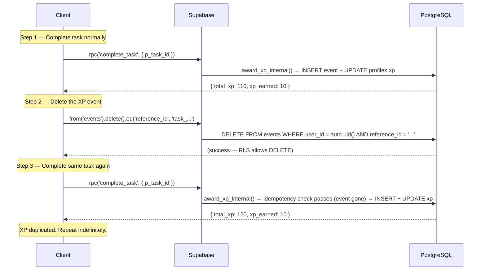
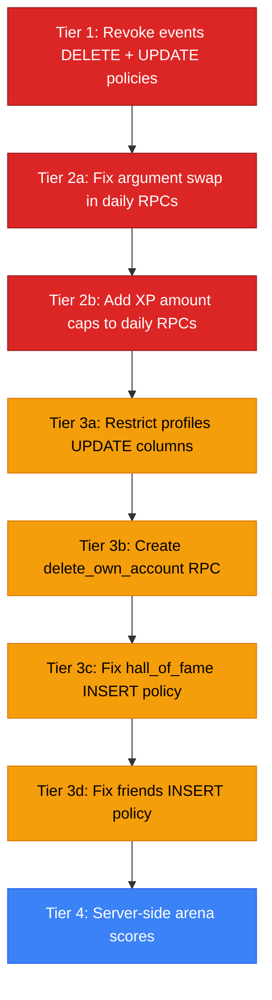

# PHASE 2A: Critical Finding Verification Report

> **FocusForge — Independent Critical Finding Verification**
>
> Generated: 2026-11-06
>
> Scope: READ-ONLY verification of Phase 1 critical and high-severity findings
>
> No source files, migrations, database objects, or user data were modified during this analysis.

---

## Table of Contents

1. [Executive Summary](#1-executive-summary)
2. [Section A — Profiles Verification](#2-section-a--profiles-verification)
3. [Section B — Events Verification](#3-section-b--events-verification)
4. [Section C — Daily XP RPCs Verification](#4-section-c--daily-xp-rpcs-verification)
5. [Section D — Arena and Friends Verification](#5-section-d--arena-and-friends-verification)
6. [Section E — Account Deletion Verification](#6-section-e--account-deletion-verification)
7. [Section F — Financial Schema Verification](#7-section-f--financial-schema-verification)
8. [Feature Dependency Matrix](#8-feature-dependency-matrix)
9. [Recommended Minimal Hotfix Scope](#9-recommended-minimal-hotfix-scope)
10. [Risks of Each Proposed Change](#10-risks-of-each-proposed-change)
11. [Required Manual Supabase Checks](#11-required-manual-supabase-checks)
12. [Safe Implementation Order](#12-safe-implementation-order)
13. [Verification Limitations](#13-verification-limitations)

---

## 1. Executive Summary

This report independently verifies the six critical finding groups (A–F) identified in the Phase 1 Comprehensive Security Audit. Each finding is classified as **CONFIRMED**, **NOT CONFIRMED**, or **UNKNOWN** based on inspected evidence.

### Verification Results at a Glance

| Finding Group | Status | Severity | Confidence |
|---|---|---|---|
| A. Profiles — unrestricted UPDATE | **CONFIRMED** (migration-based) | Critical | High |
| A. Profiles — full column SELECT exposure | **CONFIRMED** (migration-based) | High | High |
| B. Events — DELETE enables XP replay | **CONFIRMED** (migration-based) | Critical | High |
| B. Events — UPDATE enables ledger tampering | **CONFIRMED** (migration-based) | High | High |
| C. Daily XP — argument swap defect | **CONFIRMED** (source code) | Critical | Definitive |
| C. Daily XP — client-controlled XP amount | **CONFIRMED** (source code) | High | Definitive |
| C. Daily XP — no server-side completion check | **CONFIRMED** (source code) | High | Definitive |
| D. Arena — client-side score calculation | **CONFIRMED** (source code) | High | Definitive |
| D. Hall of Fame — open INSERT policy | **CONFIRMED** (migration-based) | Medium | High |
| D. Friends — bidirectional INSERT policy | **CONFIRMED** (migration-based) | Medium | High |
| E. Account deletion — silently broken | **CONFIRMED** (source code + migration) | High | High |
| F. Financial schema — migration vs live drift | **CONFIRMED** (migration commentary) | Medium | High |

> [!IMPORTANT]
> **3 findings are CRITICAL and require immediate attention.** The argument swap defect (C) and events DELETE vulnerability (B) are both independently exploitable. The profiles UPDATE vulnerability (A) enables direct XP manipulation.

> [!NOTE]
> **Evidence qualification:** All database state findings are classified as "migration-based" because live `pg_catalog` access is unavailable (the Supabase service-role key is not accessible). Migration files show what SQL was *intended* to run. The `20260802000000` migration explicitly documented a prior divergence between migration intent and live state, proving drift has occurred before. Findings marked "source code" are definitive because they are verified directly from the application source.

---

## 2. Section A — Profiles Verification

### A1. Can authenticated users directly update xp, level, streak, and badges?

**Status: CONFIRMED (migration-based)**

**Evidence:**

The final effective UPDATE policy on `profiles` is established in [`20260729000000_friends_bootstrap.sql`](file:///d:/SWE%20Project/FocusForge%20Ad/supabase/migrations/20260729000000_friends_bootstrap.sql#L253-L254):

```sql
DROP POLICY IF EXISTS "Users can update own profile" ON public.profiles;
CREATE POLICY "Users can update own profile" ON public.profiles
  FOR UPDATE USING (auth.uid() = id);
```

**What's missing:**
- No `WITH CHECK` clause
- No column-level restriction (no `USING (... ) WITH CHECK (...)` limiting columns)
- No subsequent migration restricts UPDATE on `profiles`

**Verification of subsequent migrations:** I searched all 42 migration files for any `profiles FOR UPDATE` policy modification after `20260729000000`. The only later migration that touches profiles column-level grants is [`20261013010000_goals_milestones_security_hardening.sql`](file:///d:/SWE%20Project/FocusForge%20Ad/supabase/migrations/20261013010000_goals_milestones_security_hardening.sql), which restricts `goals` and `goal_milestones` — **not** `profiles`.

**Exploit scenario:**
```javascript
// Any authenticated user can set their own XP, streak, level, or badges
await supabase.from('profiles').update({
  xp: 999999,
  streak: 365,
  level: 9999,
  badges: ['everything_unlocked']
}).eq('id', currentUserId);
```

**Classification: CONFIRMED (migration-based)**

---

### A2. Can other users read all profile columns?

**Status: CONFIRMED (migration-based)**

**Evidence:**

The SELECT policy from [`20260729000000_friends_bootstrap.sql`](file:///d:/SWE%20Project/FocusForge%20Ad/supabase/migrations/20260729000000_friends_bootstrap.sql#L249-L251):

```sql
DROP POLICY IF EXISTS "Public profiles are viewable by everyone" ON public.profiles;
DROP POLICY IF EXISTS "Profiles are viewable by authenticated users" ON public.profiles;
CREATE POLICY "Profiles are viewable by authenticated users" ON public.profiles
  FOR SELECT USING (auth.uid() IS NOT NULL);
```

This grants every authenticated user SELECT access to **every column** of **every profile row**. Exposed columns include:
- `xp`, `level`, `streak`, `badges` (gamification data)
- `monthly_budget`, `total_savings` (financial data — if they still exist on live profiles)
- `daily_challenge_claims` (activity tracking)
- `display_name`, `avatar_url` (intended to be public)

**Business impact:** User A can query `supabase.from('profiles').select('monthly_budget, total_savings').neq('id', myId)` to see every other user's financial data.

**Classification: CONFIRMED (migration-based)**

---

### A3. Every frontend feature that writes to profiles

| # | File | Line(s) | Operation | Columns Written |
|---|---|---|---|---|
| 1 | [`storeUtils.ts`](file:///d:/SWE%20Project/FocusForge%20Ad/src/store/storeUtils.ts#L14-L31) | 14–31 | `upsert` | **Any field** from `Partial<Profile>` — unbounded |
| 2 | [`Settings.tsx`](file:///d:/SWE%20Project/FocusForge%20Ad/src/pages/Settings.tsx#L63-L68) | 63–68 | `upsert` | `display_name`, `avatar_url`, `updated_at` |
| 3 | [`Settings.tsx`](file:///d:/SWE%20Project/FocusForge%20Ad/src/pages/Settings.tsx#L86) | 86 | `delete` | (full row delete) |
| 4 | [`ProfileModal.tsx`](file:///d:/SWE%20Project/FocusForge%20Ad/src/components/ProfileModal.tsx#L65-L68) | 65–68 | `update` | `avatar_url` |
| 5 | [`ProfileModal.tsx`](file:///d:/SWE%20Project/FocusForge%20Ad/src/components/ProfileModal.tsx#L84-L87) | 84–87 | `update` | `avatar_url` (set to `''`) |
| 6 | [`ProfileModal.tsx`](file:///d:/SWE%20Project/FocusForge%20Ad/src/components/ProfileModal.tsx#L120-L126) | 120–126 | `update` | `display_name`, `updated_at` |
| 7 | [`Finance.tsx`](file:///d:/SWE%20Project/FocusForge%20Ad/src/pages/Finance.tsx#L126) | 126 | via `saveProfile` | `monthly_budget` |

> [!WARNING]
> **Writer #1 (`saveProfile` in `storeUtils.ts`) is the most dangerous.** It accepts `Partial<Profile>` and blindly forwards every key-value pair into the upsert payload (lines 20–25). Any caller of `saveProfile` can pass `xp`, `streak`, or `badges` and the function will write them to the database. Currently only `Finance.tsx:126` calls it with `{ monthly_budget: val }`, but the function is exported and available to any future caller.

---

### A4. Exact minimum permissions required by legitimate features

| Column | Required By | Operation |
|---|---|---|
| `display_name` | Settings.tsx, ProfileModal.tsx | UPDATE |
| `avatar_url` | ProfileModal.tsx | UPDATE |
| `updated_at` | Settings.tsx, ProfileModal.tsx | UPDATE |
| `monthly_budget` | Finance.tsx (via `saveProfile`) | UPDATE |
| `daily_challenge_claims` | `claim_daily_challenge` RPC (server-side) | UPDATE (SECURITY DEFINER) |
| `xp` | `award_xp_internal` (server-side) | UPDATE (SECURITY DEFINER) |
| `streak` | `log_focus_session` / `calculate_streak` (server-side) | UPDATE (SECURITY DEFINER) |

**Conclusion:** Client-side UPDATE should be restricted to: `display_name`, `avatar_url`, `updated_at`, and `monthly_budget` (if it stays on profiles). All other columns must only be writable by SECURITY DEFINER RPCs.

**Classification: CONFIRMED**

---

## 3. Section B — Events Verification

### B1. Authenticated and anonymous privileges on events

**Status: CONFIRMED (migration-based)**

**Evidence from [`20260703185015_create_events_table.sql`](file:///d:/SWE%20Project/FocusForge%20Ad/supabase/migrations/20260703185015_create_events_table.sql#L16-L36):**

| Operation | Policy | Target Role | Condition |
|---|---|---|---|
| SELECT | "Users can view own events" | `authenticated` | `auth.uid() = user_id` |
| INSERT | "Users can insert own events" | `authenticated` | `auth.uid() = user_id` |
| UPDATE | "Users can update own events" | `authenticated` | `auth.uid() = user_id` WITH CHECK `auth.uid() = user_id` |
| DELETE | "Users can delete own events" | `authenticated` | `auth.uid() = user_id` |

**Anonymous access:** No policies grant access to `anon`. The `anon` role cannot read, write, or delete events. ✅

**Authenticated access:** Full CRUD on own events. This is the vulnerability — UPDATE and DELETE should not exist for the XP ledger.

**Classification: CONFIRMED (migration-based)**

---

### B2. All application code that interacts with events

| # | File | Line | Operation | Purpose |
|---|---|---|---|---|
| 1 | [`events.ts`](file:///d:/SWE%20Project/FocusForge%20Ad/src/lib/events.ts#L254) | 254 | `INSERT` | `logEvent()` — general event logging |
| 2 | [`useStore.ts`](file:///d:/SWE%20Project/FocusForge%20Ad/src/store/useStore.ts#L87) | 87 | `SELECT` | `loadUserData()` — hydrate events |
| 3 | `award_xp_internal` (SQL) | — | `INSERT` | Server-side XP ledger entry |
| 4 | `complete_task` (SQL) | — | `INSERT` (via `award_xp_internal`) | Task completion XP event |
| 5 | `claim_daily_goal` (SQL) | — | `SELECT` + `INSERT` (via helper) | Idempotency check + XP award |
| 6 | `claim_daily_challenge` (SQL) | — | `SELECT` + `INSERT` (via helper) | Idempotency check + XP award |

**Critical observation:** No frontend code calls `.update()` or `.delete()` on events. These operations are unused by the application but enabled by RLS policy.

---

### B3. XP replay attack via event deletion

**Status: CONFIRMED (migration-based)**

**Attack path:**



**Why idempotency fails:** The `events_xp_idempotency_idx` unique index (from [`20260711120000`](file:///d:/SWE%20Project/FocusForge%20Ad/supabase/migrations/20260711120000_progression_xp_foundation.sql#L35-L37)) is on `(user_id, type, reference_id) WHERE reference_id IS NOT NULL AND metadata ? 'xp_earned'`. When the event row is deleted, the index entry is removed, and the same event can be re-inserted.

**Affected RPCs:**
- `complete_task` — task XP can be re-awarded
- `claim_daily_goal` — daily goal XP can be re-awarded
- `claim_daily_challenge` — daily challenge XP can be re-awarded
- `unlock_achievement` — achievement XP can be re-awarded
- `unlock_milestone` — milestone XP can be re-awarded

**Classification: CONFIRMED (migration-based)**

---

### B4. Impact of revoking UPDATE and DELETE on events

| Impact Area | Effect | Risk |
|---|---|---|
| Frontend `logEvent()` | No impact — only uses INSERT | ✅ Safe |
| `award_xp_internal` | No impact — only uses INSERT | ✅ Safe |
| All XP RPCs | No impact — only use SELECT + INSERT on events | ✅ Safe |
| Event hydration in `useStore` | No impact — only uses SELECT | ✅ Safe |
| Arena activity logging | No impact — uses `arena_activity`, not `events` | ✅ Safe |

**Conclusion:** Revoking UPDATE and DELETE policies on `events` has **zero impact** on any current application functionality. No frontend or backend code uses these operations.

**Classification: CONFIRMED**

---

## 4. Section C — Daily XP RPCs Verification

### C1. Argument ordering defect

**Status: CONFIRMED (source code — definitive)**

**`award_xp_internal` signature** from [`20260711120000_progression_xp_foundation.sql`](file:///d:/SWE%20Project/FocusForge%20Ad/supabase/migrations/20260711120000_progression_xp_foundation.sql#L46-L53):

```sql
CREATE OR REPLACE FUNCTION private.award_xp_internal(
  p_user_id UUID,        -- Position 1
  p_xp_amount INTEGER,   -- Position 2
  p_event_type TEXT,      -- Position 3
  p_event_category TEXT,  -- Position 4
  p_reference_id TEXT,    -- Position 5
  p_metadata JSONB       -- Position 6
)
```

**`claim_daily_goal` call** from [`20260715120000`](file:///d:/SWE%20Project/FocusForge%20Ad/supabase/migrations/20260715120000_server_authoritative_daily_claims.sql#L68-L80):

```sql
v_xp_awarded := private.award_xp_internal(
    v_user_id,         -- → p_user_id      ✅ Correct
    p_amount,          -- → p_xp_amount     ✅ Correct
    v_reference_id,    -- → p_event_type    ❌ SWAPPED (e.g. 'daily_goal_focus_2026-11-06')
    'daily_goal',      -- → p_event_category ✅ Correct
    'goal_completed',  -- → p_reference_id  ❌ SWAPPED (should be v_reference_id)
    jsonb_build_object(...)
);
```

**`claim_daily_challenge` call** from [`20260715120000`](file:///d:/SWE%20Project/FocusForge%20Ad/supabase/migrations/20260715120000_server_authoritative_daily_claims.sql#L142-L154):

```sql
v_xp_awarded := private.award_xp_internal(
    v_user_id,              -- → p_user_id      ✅ Correct
    p_amount,               -- → p_xp_amount     ✅ Correct
    v_reference_id,         -- → p_event_type    ❌ SWAPPED
    'daily_challenge',      -- → p_event_category ✅ Correct
    'challenge_completed',  -- → p_reference_id  ❌ SWAPPED
    jsonb_build_object(...)
);
```

**Consequences of the swap:**

| Column | Expected Value | Actual Value |
|---|---|---|
| `events.type` | `'goal_completed'` | `'daily_goal_focus_2026-11-06'` (the reference_id) |
| `events.reference_id` | `'daily_goal_focus_2026-11-06'` | `'goal_completed'` (the type string) |

**Idempotency impact analysis:**

The idempotency index is on `(user_id, type, reference_id)`. With the swap:
- The combination becomes `(user_id, 'daily_goal_focus_2026-11-06', 'goal_completed')`
- This is still unique per user per goal per date
- **Idempotency still works** — but only by coincidence because each day's reference_id is unique

> [!CAUTION]
> **However, the idempotency check INSIDE `claim_daily_goal` (lines 51–55) queries by `reference_id`:**
> ```sql
> SELECT EXISTS (
>     SELECT 1 FROM events
>     WHERE user_id = v_user_id
>     AND reference_id = v_reference_id
> ) INTO v_already_claimed;
> ```
> Due to the swap, `reference_id` in the events table contains `'goal_completed'` (a static string), NOT the date-specific value. This means:
> - First daily goal claim of any kind: `reference_id = 'goal_completed'` → found = false → awards XP ✅
> - Second daily goal claim (different goal, same day): `reference_id = 'goal_completed'` → found = **true** → blocked ❌
>
> **The swap causes ALL daily goal claims after the first one on any given day to be incorrectly blocked as "already claimed."** Only the first goal completion per day awards XP. The "all goals completed" bonus and individual subsequent goals are silently rejected.

**Classification: CONFIRMED (definitive — source code analysis)**

---

### C2. Every caller of these functions

| RPC | File | Line(s) | Parameter `p_amount` Value |
|---|---|---|---|
| `claim_daily_goal` | [`useDailyGoalWatcher.ts`](file:///d:/SWE%20Project/FocusForge%20Ad/src/hooks/useDailyGoalWatcher.ts#L153-L157) | 153–157 | `10` (hardcoded) |
| `claim_daily_goal` | [`useDailyGoalWatcher.ts`](file:///d:/SWE%20Project/FocusForge%20Ad/src/hooks/useDailyGoalWatcher.ts#L190-L193) | 190–193 | `bonusXP` (from `useDailyGoalsStore`, default 25, stored in localStorage) |
| `claim_daily_challenge` | [`Achievements.tsx`](file:///d:/SWE%20Project/FocusForge%20Ad/src/pages/Achievements.tsx#L85-L89) | 85–89 | `reward` (from `DAILY_CHALLENGES` constant) |

---

### C3. Client-controlled XP parameters

**Status: CONFIRMED (definitive)**

All three callers pass `p_amount` from the client:

1. **`useDailyGoalWatcher.ts:156`** — `p_amount: 10` — hardcoded, safe value but client-determined
2. **`useDailyGoalWatcher.ts:193`** — `p_amount: bonusXP` — **sourced from `useDailyGoalsStore.completionBonusXP`**, which is persisted to **localStorage** via Zustand persist middleware

   From [`useDailyGoalsStore.ts`](file:///d:/SWE%20Project/FocusForge%20Ad/src/store/useDailyGoalsStore.ts):
   ```typescript
   completionBonusXP: 25, // default, stored in localStorage
   ```

   **An attacker can modify localStorage to set `completionBonusXP: 9999` and receive arbitrary XP on "all goals completed".**

3. **`Achievements.tsx:88`** — `p_amount: reward` — from `DAILY_CHALLENGES` array, a constant in source code. Not directly user-modifiable without browser devtools, but the value is client-determined.

**Server-side validation in `award_xp_internal`:** The only XP bound is `p_xp_amount > 10000` (line 84). Any value 1–10000 is accepted.

**Classification: CONFIRMED (definitive)**

---

### C4. Server-side completion verification

**Status: CONFIRMED — no server-side verification exists**

Inspecting `claim_daily_goal` body ([`20260715120000`](file:///d:/SWE%20Project/FocusForge%20Ad/supabase/migrations/20260715120000_server_authoritative_daily_claims.sql#L28-L91), lines 28–91):

```sql
-- The function body contains:
-- 1. auth.uid() check
-- 2. Idempotency key construction
-- 3. SELECT EXISTS on events (idempotency check)
-- 4. award_xp_internal call
-- 5. SELECT xp FROM profiles
-- 6. Return JSON

-- NOT PRESENT:
-- ❌ No query against focus_sessions
-- ❌ No query against tasks
-- ❌ No query against expenses
-- ❌ No verification that the goal was actually completed
-- ❌ No validation of p_amount against expected values
```

**The server trusts the client entirely.** A user could call `claim_daily_goal` without having completed any goals, and XP would be awarded.

The same applies to `claim_daily_challenge` — no verification that the challenge conditions were met.

**Classification: CONFIRMED (definitive)**

---

### C5. Proposed server-side idempotency (without changing XP history)

The current idempotency mechanism relies on the `events` table unique index. Since the argument swap places incorrect values in `type` and `reference_id`, and since the in-function check queries `reference_id`, the idempotency is **partially broken** (see C1 analysis).

**Recommended approach:**
1. Fix the argument swap in both RPCs (swap positions 3 and 5)
2. Add server-side XP cap: `IF p_amount > 50 THEN RAISE EXCEPTION 'XP amount exceeds daily limit'; END IF;`
3. Add completion verification queries (e.g., check `focus_sessions` count for focus goals)
4. The existing `events_xp_idempotency_idx` will function correctly once the swap is fixed

**No changes to existing XP history are needed** — the fix only corrects future event metadata.

---

## 5. Section D — Arena and Friends Verification

### D1. Arena score manipulation

**Status: CONFIRMED (migration-based + source code)**

**RLS policies on `arena_scores`:**

| Operation | Policy | Source |
|---|---|---|
| INSERT | `user_id = auth.uid() OR arena_id IN (SELECT id FROM arenas WHERE owner_id = auth.uid())` | [`20260802100000`](file:///d:/SWE%20Project/FocusForge%20Ad/supabase/migrations/20260802100000_arena_member_self_join.sql#L26-L30) |
| UPDATE | `auth.uid() = user_id` | [`20260802000000`](file:///d:/SWE%20Project/FocusForge%20Ad/supabase/migrations/20260802000000_consolidated_schema_sync.sql#L198-L200) |

**The UPDATE policy allows any authenticated user to set their own score components to any value:**

```javascript
// Exploit: Set arbitrary scores
await supabase.from('arena_scores').update({
  focus_points: 99999,
  task_points: 99999,
  challenge_points: 99999,
  streak_bonus: 99999
  // total_score is GENERATED ALWAYS — auto-calculated
}).eq('user_id', currentUserId);
```

**Frontend evidence:** [`useArenaEngine.ts`](file:///d:/SWE%20Project/FocusForge%20Ad/src/hooks/useArenaEngine.ts#L253-L256) lines 253–256 confirms scores are calculated client-side and upserted directly:

```typescript
const { error } = await supabase
  .from('arena_scores')
  .upsert(scoresToUpsert, { onConflict: 'arena_id,user_id,period_type,period_start' });
```

The entire score calculation pipeline ([`arenaService.calculateArenaScore`](file:///d:/SWE%20Project/FocusForge%20Ad/src/services/arenaService.ts#L538)) runs in the browser. The server performs zero validation of the submitted score values.

**Classification: CONFIRMED (migration-based + source code)**

---

### D2. Hall of Fame insertion

**Status: CONFIRMED (migration-based)**

From [`20260802000000`](file:///d:/SWE%20Project/FocusForge%20Ad/supabase/migrations/20260802000000_consolidated_schema_sync.sql#L207-L209):

```sql
CREATE POLICY "Authenticated users can archive champions" ON public.hall_of_fame
  FOR INSERT TO authenticated WITH CHECK (true);
```

**Any authenticated user can insert any champion record:**

```javascript
await supabase.from('hall_of_fame').insert({
  arena_id: anyArenaId,
  period_type: 'weekly',
  period_start: '2026-11-01',
  period_end: '2026-11-07',
  champion_user_id: myUserId, // Declare myself champion
  total_score: 999999,
  member_count: 100
});
```

The UNIQUE constraint `(arena_id, period_type, period_start)` limits this to one record per period, but the first client to call it wins — and can set themselves as champion with fabricated scores.

**Frontend caller:** [`championService.ts`](file:///d:/SWE%20Project/FocusForge%20Ad/src/services/championService.ts#L55-L72) `archiveChampion()` performs a direct client-side INSERT.

**Classification: CONFIRMED (migration-based)**

---

### D3. Friendship creation and acceptance authorization

**Status: CONFIRMED (migration-based)**

**Friends INSERT policy** from [`20260729000000`](file:///d:/SWE%20Project/FocusForge%20Ad/supabase/migrations/20260729000000_friends_bootstrap.sql#L270-L271):

```sql
CREATE POLICY "Users can add friends" ON public.friends
  FOR INSERT WITH CHECK (auth.uid() = user_id OR auth.uid() = friend_id);
```

**Vulnerability:** User A can INSERT a `friends` row with `user_id = userB, friend_id = userA`, bypassing the friend request workflow entirely. The `OR` clause allows either party to create the friendship unilaterally.

**Friend requests UPDATE policy** from [`20260729000000`](file:///d:/SWE%20Project/FocusForge%20Ad/supabase/migrations/20260729000000_friends_bootstrap.sql#L263-L264):

```sql
CREATE POLICY "Users can update friend requests they sent or received"
  ON public.friend_requests FOR UPDATE
  USING (auth.uid() = sender_id OR auth.uid() = receiver_id);
```

**Vulnerability:** The sender can UPDATE their own request to `status = 'accepted'`, bypassing receiver consent. The policy should restrict UPDATE to `receiver_id` only (and only to change status).

**Frontend callers:**
- [`friendService.ts`](file:///d:/SWE%20Project/FocusForge%20Ad/src/services/friendService.ts#L70-L76) line 70–76: INSERT into `friends` after acceptance
- [`friendService.ts`](file:///d:/SWE%20Project/FocusForge%20Ad/src/services/friendService.ts#L43-L51) line 43–51: UPDATE `friend_requests` for accept/reject

**Classification: CONFIRMED (migration-based)**

---

### D4. Affected frontend services and features

| Feature | Service/Hook | Impact of Fixing Policies |
|---|---|---|
| Arena Leaderboard | `useArenaEngine.ts` | Must migrate score sync to server-side RPC |
| Champion Archive | `championService.ts` | Must migrate to server-side RPC |
| Friend Requests | `friendService.ts` | Must restrict friends INSERT to server-side trigger only |
| Arena Activity Feed | `activityService.ts` | No impact (INSERT policy already scoped to members) |
| Arena Score Display | `arenaService.ts` | No impact (read-only) |

---

## 6. Section E — Account Deletion Verification

### E1. Complete account deletion workflow trace

**Status: CONFIRMED — deletion is silently broken**

**Frontend code** from [`Settings.tsx`](file:///d:/SWE%20Project/FocusForge%20Ad/src/pages/Settings.tsx#L83-L94):

```typescript
const handleDeleteAccount = async () => {
  if (window.confirm('WARNING: Are you absolutely sure...')) {
    if (user) {
      await supabase.from('profiles').delete().eq('id', user.id);  // Step 1
      await supabase.auth.signOut();                                 // Step 2
      window.location.reload();                                      // Step 3
    } else {
      localStorage.clear();
      window.location.reload();
    }
  }
};
```

**Step 1 analysis — `profiles` DELETE:**

From the Phase 1 migration scan, the `profiles` table has **no DELETE policy**. The scan confirmed:

> Tables missing DELETE policies: `profiles`, `user_preferences`, `arena_members`, `arena_scores`, `hall_of_fame`, `user_financial_settings`, `daily_progress_snapshots`

Without a DELETE policy and with RLS enabled, the PostgREST/Supabase client call returns **zero rows affected and no error**. The profile row survives.

**Step 2 analysis — `auth.signOut()`:**

`supabase.auth.signOut()` only invalidates the client session token. It does NOT delete `auth.users`. The user can sign back in with the same credentials.

**Step 3 — page reload:**

The user sees a logged-out state and believes their account is deleted. In reality:
- `profiles` row still exists
- `auth.users` row still exists
- All related data (`events`, `tasks`, `expenses`, `focus_sessions`, etc.) still exists
- The user can log back in and find everything intact

**Classification: CONFIRMED (source code + migration analysis)**

---

### E2. Is `auth.users` actually deleted?

**No.** The FK relationship is:

```
auth.users (PK: id)
    ↓ ON DELETE CASCADE
profiles (FK: id → auth.users.id)
```

Cascade direction: deleting `auth.users` cascades to `profiles`, NOT vice versa. Even if the `profiles` row were deleted, `auth.users` would survive.

Deleting `auth.users` requires either:
- Supabase Admin API (service-role key)
- `supabase.auth.admin.deleteUser(userId)` (server-side only)
- Supabase Dashboard manual deletion

**Classification: CONFIRMED**

---

### E3. Safe server-side deletion architecture

> [!IMPORTANT]
> The client must NEVER use the service-role key. The solution must be a SECURITY DEFINER RPC.

**Proposed `delete_own_account()` RPC:**

```sql
-- Conceptual design only — NOT to be applied without Phase 3
CREATE OR REPLACE FUNCTION public.delete_own_account()
RETURNS void
LANGUAGE plpgsql
SECURITY DEFINER
SET search_path = public, auth
AS $$
DECLARE
  v_user_id uuid;
BEGIN
  v_user_id := auth.uid();
  IF v_user_id IS NULL THEN
    RAISE EXCEPTION 'Not authenticated';
  END IF;

  -- Delete from auth.users — cascades to profiles and all FK-dependent tables
  DELETE FROM auth.users WHERE id = v_user_id;
END;
$$;
```

This requires careful testing because:
1. The function must be owned by `postgres` (or a role with DELETE on `auth.users`)
2. All FK cascades must be verified to properly clean up related data
3. The function must be atomic — partial deletion is unacceptable

---

## 7. Section F — Financial Schema Verification

### F1. Migration intent vs live state

**Status: CONFIRMED — known drift exists**

**Migration [`20260801010000_secure_financial_profiles.sql`](file:///d:/SWE%20Project/FocusForge%20Ad/supabase/migrations/20260801010000_secure_financial_profiles.sql)** (applied before `20260802000000`) attempts to:
1. Create `user_financial_settings` table
2. Copy data from `profiles.monthly_budget` and `profiles.total_savings`
3. Drop `monthly_budget` and `total_savings` columns from `profiles`

**Migration [`20260802000000_consolidated_schema_sync.sql`](file:///d:/SWE%20Project/FocusForge%20Ad/supabase/migrations/20260802000000_consolidated_schema_sync.sql#L14-L19)** explicitly documents the live state at the time:

```
-- VERIFIED LIVE STATE BEFORE THIS MIGRATION:
--   ✅ profiles.monthly_budget and profiles.total_savings exist
--   ❌ user_financial_settings table missing
```

This proves that `20260801010000` either:
- Was never applied to production, or
- Failed silently, or
- Was rolled back

**Classification: CONFIRMED (migration commentary is direct evidence of drift)**

---

### F2. `user_financial_settings` frontend references

**Search result:** Zero references in `src/`:

```
Select-String -Pattern "user_financial_settings" → 0 results
```

The frontend has never been updated to use `user_financial_settings`. All financial data flows through `profiles.monthly_budget`.

---

### F3. Frontend references to `profiles.monthly_budget`

**Found 40+ references across 9 files:**

| File | Usage |
|---|---|
| [`Finance.tsx`](file:///d:/SWE%20Project/FocusForge%20Ad/src/pages/Finance.tsx) | Budget display, editing, calculations (14+ refs) |
| [`Dashboard.tsx`](file:///d:/SWE%20Project/FocusForge%20Ad/src/pages/Dashboard.tsx) | Financial state calculation |
| [`Reports.tsx`](file:///d:/SWE%20Project/FocusForge%20Ad/src/pages/Reports.tsx) | Budget reporting |
| [`storeUtils.ts`](file:///d:/SWE%20Project/FocusForge%20Ad/src/store/storeUtils.ts#L49) | Profile hydration with default `10000` |
| [`authSlice.ts`](file:///d:/SWE%20Project/FocusForge%20Ad/src/store/slices/authSlice.ts#L9) | Default profile includes `monthly_budget: 10000` |
| [`supabase.ts`](file:///d:/SWE%20Project/FocusForge%20Ad/src/lib/supabase.ts#L19-L20) | Type definition includes `monthly_budget: number` |
| [`events.ts`](file:///d:/SWE%20Project/FocusForge%20Ad/src/lib/events.ts) | Achievement checks use `profile.monthly_budget` |
| [`insightUtils.ts`](file:///d:/SWE%20Project/FocusForge%20Ad/src/lib/insightUtils.ts) | Budget insight calculations |
| [`dailySnapshotService.ts`](file:///d:/SWE%20Project/FocusForge%20Ad/src/services/dailySnapshotService.ts) | Snapshot data |

---

### F4. Source of truth determination

**The actual source of truth is `profiles.monthly_budget` on the live database.** Evidence:

1. The `20260802000000` migration confirmed `profiles.monthly_budget` exists in production
2. No subsequent migration re-attempts the column drop
3. The entire frontend reads/writes `profiles.monthly_budget`
4. `user_financial_settings` is never referenced in frontend code
5. The `user_financial_settings` table may not exist in production (per `20260802000000` commentary)

**Recommendation:** Accept `profiles.monthly_budget` as the canonical source. Either:
- Remove the `20260801010000` migration from future runs (if not yet applied), or
- Create a new migration that drops `user_financial_settings` if it exists and ensures `profiles.monthly_budget` remains

**Classification: CONFIRMED**

---

## 8. Feature Dependency Matrix

### Fix: Restrict profiles UPDATE to specific columns

| Aspect | Details |
|---|---|
| **Frontend Callers** | `storeUtils.ts:27`, `Settings.tsx:63`, `ProfileModal.tsx:65,85,122`, `Finance.tsx:126` |
| **Backend Dependencies** | `claim_daily_challenge` (writes `daily_challenge_claims` via SECURITY DEFINER — unaffected), `award_xp_internal` (writes `xp` via SECURITY DEFINER — unaffected), `calculate_streak`/`log_focus_session` (write `streak` via SECURITY DEFINER — unaffected) |
| **Features at Risk** | Finance budget editor (must keep `monthly_budget` in allowed columns) |
| **Required Frontend Changes** | Audit `saveProfile()` to whitelist columns before upsert |
| **Migration Order** | Can be applied independently |
| **Rollback Plan** | Revert to unrestricted UPDATE policy |

### Fix: Revoke DELETE and UPDATE on events

| Aspect | Details |
|---|---|
| **Frontend Callers** | None (zero `.update()` or `.delete()` calls on events) |
| **Backend Dependencies** | None (all RPCs only INSERT or SELECT events) |
| **Features at Risk** | None identified |
| **Required Frontend Changes** | None |
| **Migration Order** | Can be applied independently — **safest first fix** |
| **Rollback Plan** | Re-create the two dropped policies |

### Fix: Correct argument swap in daily RPCs

| Aspect | Details |
|---|---|
| **Frontend Callers** | `useDailyGoalWatcher.ts:153,190`, `Achievements.tsx:85` |
| **Backend Dependencies** | `private.award_xp_internal` (signature unchanged) |
| **Features at Risk** | Daily goals and daily challenges XP awards — existing events will have swapped type/reference_id. New events will be correct. Query-by-type patterns may return incomplete results mixing old and new formats |
| **Required Frontend Changes** | None (frontend passes same parameters; only SQL call order changes) |
| **Migration Order** | Independent, but should be applied alongside XP cap |
| **Rollback Plan** | Revert to swapped order (restores broken behavior) |

### Fix: Add XP amount caps to daily RPCs

| Aspect | Details |
|---|---|
| **Frontend Callers** | Same as argument swap fix |
| **Backend Dependencies** | None |
| **Features at Risk** | If caps are set too low, legitimate "all goals" bonus (default 25) may be rejected. Recommend cap of 100 |
| **Required Frontend Changes** | None if cap ≥ current max (25 for goals, varies for challenges) |
| **Migration Order** | Apply with argument swap fix |
| **Rollback Plan** | Remove cap check from RPCs |

### Fix: Move arena score calculation server-side

| Aspect | Details |
|---|---|
| **Frontend Callers** | `useArenaEngine.ts:148-265` (entire score sync block) |
| **Backend Dependencies** | Requires new server-side RPC with access to `focus_sessions`, `tasks`, `events` |
| **Features at Risk** | Arena leaderboard, arena activity feed, champion archiving |
| **Required Frontend Changes** | Replace client-side upsert with RPC call; remove `calculateArenaScore` usage |
| **Migration Order** | Requires coordinated migration + frontend changes |
| **Rollback Plan** | Revert frontend to client-side calculation and restore INSERT/UPDATE policies |

### Fix: Fix account deletion

| Aspect | Details |
|---|---|
| **Frontend Callers** | `Settings.tsx:83-94` |
| **Backend Dependencies** | Requires SECURITY DEFINER function with DELETE on `auth.users` |
| **Features at Risk** | None (current feature is broken — this is a fix) |
| **Required Frontend Changes** | Replace `supabase.from('profiles').delete()` with `supabase.rpc('delete_own_account')` |
| **Migration Order** | Independent — but must be tested thoroughly before deployment |
| **Rollback Plan** | Remove the RPC; account deletion remains broken (current state) |

---

## 9. Recommended Minimal Hotfix Scope

The following fixes can be applied safely with minimal risk and maximum security impact:

### Hotfix Tier 1 — Zero-Risk, Zero-Frontend-Change

These can be deployed as a single migration with **no frontend changes required**:

| # | Fix | Risk | Impact |
|---|---|---|---|
| 1 | Drop `events` UPDATE policy | None | Prevents ledger tampering |
| 2 | Drop `events` DELETE policy | None | Prevents XP replay attacks |

### Hotfix Tier 2 — Low-Risk, Minimal Frontend Change

| # | Fix | Risk | Impact |
|---|---|---|---|
| 3 | Fix argument swap in `claim_daily_goal` | Historical event metadata will differ from new events | Correct XP event logging |
| 4 | Fix argument swap in `claim_daily_challenge` | Same as above | Correct XP event logging |
| 5 | Add `p_amount` cap (e.g., 100) to daily RPCs | Must verify all legitimate XP values are under cap | Prevents client-side XP manipulation |

### Hotfix Tier 3 — Medium-Risk, Requires Frontend Coordination

| # | Fix | Risk | Impact |
|---|---|---|---|
| 6 | Restrict profiles UPDATE to allowlisted columns | Must ensure all legitimate writes are covered | Prevents XP/streak/badge manipulation |
| 7 | Create `delete_own_account()` RPC | Must test cascade behavior thoroughly | Fixes broken account deletion |
| 8 | Restrict `hall_of_fame` INSERT to arena owners/server | Requires frontend championService migration | Prevents fake champion records |
| 9 | Restrict `friends` INSERT to server trigger only | Requires frontend friendService changes | Prevents unilateral friendship |

### Hotfix Tier 4 — High-Effort, Requires Architecture Changes

| # | Fix | Risk | Impact |
|---|---|---|---|
| 10 | Move arena score calculation server-side | Major refactor of useArenaEngine | Prevents score manipulation |
| 11 | Add server-side goal/challenge completion verification | Requires querying tasks/sessions/expenses in RPCs | Prevents false completion claims |

---

## 10. Risks of Each Proposed Change

| Fix | Primary Risk | Mitigation |
|---|---|---|
| Revoke events DELETE/UPDATE | None identified | Deploy and monitor error logs |
| Fix argument swap | Mixed event format in events table (old swapped + new correct) | Document in migration; queries must handle both formats |
| Add XP caps | Legitimate edge cases could be rejected | Survey max XP values in DAILY_CHALLENGES constant before setting cap |
| Restrict profiles UPDATE | `saveProfile()` silently fails if caller passes restricted column | Add column whitelist in `saveProfile()` frontend function |
| `delete_own_account()` RPC | Incomplete cascade if FKs are misconfigured | Test with a throwaway account first; verify all tables are cleaned |
| Restrict hall_of_fame INSERT | Champion archiving breaks until frontend migrated | Deploy migration + frontend change simultaneously |
| Fix friends INSERT | Friendship creation from `respondToFriendRequest` may break | Move friends INSERT to the `on_friend_request_accepted` trigger |
| Server-side arena scores | Arena leaderboard shows stale data until RPC is called | Implement as background cron or on-event trigger |

---

## 11. Required Manual Supabase Checks

The following checks **must be performed by a human with Supabase Dashboard access** before applying fixes:

| # | Check | Why | How |
|---|---|---|---|
| 1 | Verify `profiles` column list in live DB | Migration `20260801010000` may or may not have dropped `monthly_budget` | Dashboard → Table Editor → profiles → verify columns |
| 2 | Verify `user_financial_settings` table existence | May or may not exist in live DB | Dashboard → Table Editor → check for table |
| 3 | Verify active RLS policies on `profiles` | Policies may differ from migration intent | Dashboard → Authentication → Policies → profiles |
| 4 | Verify active RLS policies on `events` | Confirm UPDATE and DELETE policies exist | Dashboard → Policies → events |
| 5 | Run `SELECT COUNT(*) FROM events WHERE reference_id = 'goal_completed'` | Quantify impact of argument swap | SQL Editor → run query |
| 6 | Run `SELECT COUNT(*) FROM events WHERE reference_id = 'challenge_completed'` | Same as above | SQL Editor → run query |
| 7 | Verify `auth.users` count vs `profiles` count | Detect orphaned records | SQL Editor → compare counts |
| 8 | Check Supabase Storage bucket `avatars` settings | Verify public/private access | Dashboard → Storage → avatars → Settings |
| 9 | Verify migration history in `supabase_migrations` table | Confirm which migrations actually ran | SQL Editor → `SELECT * FROM supabase_migrations.schema_migrations ORDER BY version` |
| 10 | Check if any `SECURITY DEFINER` functions are missing `search_path` | Phase 1 identified 6 candidates | SQL Editor → `SELECT proname, prosecdef FROM pg_proc WHERE prosecdef = true` |

---

## 12. Safe Implementation Order



**Rationale for ordering:**
1. **Tier 1 first** — zero risk, blocks the most critical exploit (XP replay via event deletion)
2. **Tier 2 second** — fixes data integrity issues in XP recording; low risk
3. **Tier 3 third** — each requires coordinated frontend changes; test individually
4. **Tier 4 last** — requires the most architectural work; least urgent because arena is a social feature, not a financial one

---

## 13. Verification Limitations

### What could NOT be verified

| Item | Reason | Impact on Findings |
|---|---|---|
| Live database schema | No service-role key → no `pg_catalog` access | All DB findings are "migration-based inference" |
| Actual RLS policies in production | Cannot query `pg_policies` view | Policies may differ from migrations if drift occurred |
| Whether `user_financial_settings` exists | Cannot query `information_schema.tables` | Financial schema finding is based on migration commentary |
| Whether `monthly_budget` column exists on profiles | Cannot verify column list | Same as above |
| Event row counts | Cannot run aggregate queries | Cannot quantify the impact of the argument swap |
| Storage bucket configuration | Cannot access Supabase Management API | Avatar security is unverified |
| Supabase Dashboard settings | No dashboard access | Edge function settings, webhook configs unknown |

### What WAS verified definitively

| Item | Method |
|---|---|
| Argument swap in daily RPCs | Direct source code comparison of function signatures and call sites |
| Client-controlled XP amounts | Direct source code trace from caller to RPC parameter |
| No server-side completion verification | Direct inspection of RPC function bodies |
| Account deletion is broken (frontend) | Direct source code analysis |
| No frontend DELETE/UPDATE on events | Exhaustive `Select-String` search across all `.ts` and `.tsx` files |
| All profile write sites | Exhaustive `Select-String` search |
| `user_financial_settings` never referenced | Exhaustive `Select-String` search — zero results |
| `monthly_budget` used across 9+ files | Exhaustive `Select-String` search — 40+ results |

---

## Files and Objects Inspected

### Migration Files (read in full)
- `20260703185015_create_events_table.sql`
- `20260711120000_progression_xp_foundation.sql`
- `20260715120000_server_authoritative_daily_claims.sql`
- `20260729000000_friends_bootstrap.sql` (lines 240–281)
- `20260801010000_secure_financial_profiles.sql`
- `20260802000000_consolidated_schema_sync.sql`
- `20260802100000_arena_member_self_join.sql`
- `20260815000000_arena_rls_security_definer_patch.sql`

### Frontend Source Files (read in full or relevant sections)
- `src/store/storeUtils.ts` (lines 1–60)
- `src/store/slices/authSlice.ts` (full)
- `src/pages/Settings.tsx` (lines 50–130)
- `src/pages/Achievements.tsx` (lines 70–110)
- `src/pages/Finance.tsx` (line 126 via search)
- `src/hooks/useDailyGoalWatcher.ts` (lines 140–210)
- `src/hooks/useArenaEngine.ts` (full)
- `src/components/ProfileModal.tsx` (full)
- `src/services/championService.ts` (full)
- `src/services/friendService.ts` (lines 1–100)
- `src/services/arenaService.ts` (lines 1–100, 538–684)

### Automated Searches Executed
- `from('profiles').(update|upsert|insert|delete)` across all src
- `monthly_budget|total_savings|user_financial_settings` across all src
- `from('events').(update|delete|insert)` across all src
- `saveProfile` across all src
- `calculateArenaScore` across all src

---

## Confirmation of Read-Only Compliance

> [!IMPORTANT]
> **I confirm that during this Phase 2A verification:**
> - ❌ No source files were modified
> - ❌ No SQL migrations were created, edited, or applied
> - ❌ No database schema or records were changed
> - ❌ No RLS policies, grants, or functions were altered
> - ❌ No XP balances or user data were modified
> - ❌ No production write tests were executed
>
> All findings are based exclusively on read-only inspection of source code, migration files, and configuration.

---

## Recommended Next Phase

**Phase 3: Hotfix Implementation** — Apply Tier 1 and Tier 2 fixes (events policy revocation + daily RPC argument swap + XP caps) as a single coordinated migration. These fixes have the highest security impact with the lowest regression risk.

**STOP — Report complete. No fixes have been implemented.**

