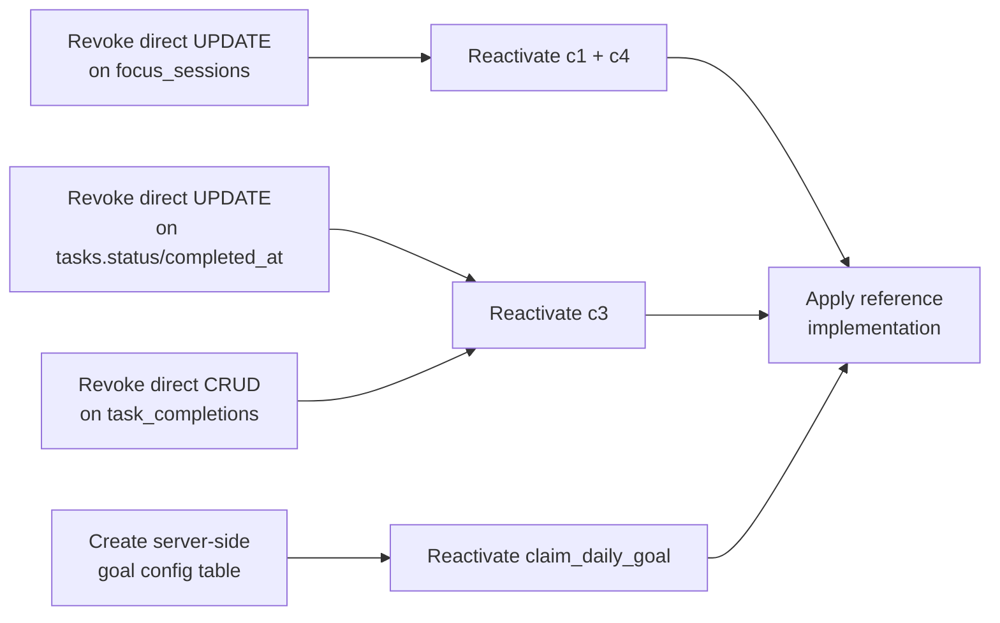

# PHASE 3 / STEP 2 — Daily XP RPC Security Audit Report (Final v3)

> **FocusForge — Server-Authoritative Daily XP Remediation**
>
> Generated: 2026-11-08 (Final Security Corrections Applied)
>
> Status: AUDIT AND PROPOSED IMPLEMENTATION — NOT APPLIED
>
> No production SQL was executed. No migrations were applied. No data was modified.

---

## Table of Contents

1. [Executive Summary](#1-executive-summary)
2. [Finding 1 — Task Double-Counting Analysis](#2-finding-1--task-double-counting-analysis)
3. [Finding 2 — Challenge Date Standardization](#3-finding-2--challenge-date-standardization)
4. [Finding 3 — Challenge Source Trustworthiness Matrix](#4-finding-3--challenge-source-trustworthiness-matrix)
5. [Finding 4 — Concurrency Handler Refinement](#5-finding-4--concurrency-handler-refinement)
6. [Corrected Migration Summary](#6-corrected-migration-summary)
7. [Unresolved Issues and Remaining Risks](#7-unresolved-issues-and-remaining-risks)
8. [Pre-Application Verification Queries](#8-pre-application-verification-queries)
9. [Regression Test Plan](#9-regression-test-plan)

---

## 1. Executive Summary

The independent review of the v2 migration identified four remaining concerns. This report provides source-code and SQL evidence for each finding, documents the corrected design, and presents the final migration.

### Decision: Disable ALL Daily XP Rewards

After thorough analysis, **both `claim_daily_goal` and `claim_daily_challenge` are disabled** in the final migration:

| Function | Reason for Disabling |
|---|---|
| `claim_daily_goal` | Goal configurations exist only in browser localStorage. Server cannot verify completion. (Unchanged from v2.) |
| `claim_daily_challenge` | **All four** challenge verification sources have direct authenticated UPDATE/INSERT/DELETE policies. Users can manipulate the queried data. Accepting manipulable data as "server-authoritative" creates a false sense of security. |

### Reactivation Path

Both functions can be reactivated **after** the prerequisite source table security is implemented:



### Changes from v2

| Area | v2 Design | v3 Final Design |
|---|---|---|
| `claim_daily_challenge` | Active with verification queries | **Disabled** — all sources manipulable |
| c3 task query | Counted all completed tasks (potential double-count risk) | Added `recurrence_type` filter to prevent double-counting |
| Date validation | ±1 day "because log_focus_session does it" | ±1 day with documented timezone contract |
| EXCEPTION handler | Caught all `unique_violation` | Analyzed to confirm only `events_xp_idempotency_idx` can fire |
| Reference impl | Active in function body | Preserved as commented SQL for reactivation |

---

## 2. Finding 1 — Task Double-Counting Analysis

### Question

Can a single recurring task occurrence appear in both `tasks` (with `status = 'completed'`) AND `task_completions`, causing it to be counted twice in the c3 verification query?

### Analysis

**The `complete_task` RPC** ([`20260801020000:67-110`](file:///d:/SWE%20Project/FocusForge%20Ad/supabase/migrations/20260801020000_task_status_v2.sql#L67-L110)) uses a mutually exclusive branch:

```sql
v_is_recurring := (v_task.recurrence_type IS NOT NULL AND v_task.recurrence_type <> 'none');

IF v_is_recurring THEN
    -- Recurring path: INSERT INTO task_completions
    INSERT INTO public.task_completions (user_id, task_id, occurrence_date, status, ...)
    VALUES (v_user_id, p_task_id, p_occurrence_date, 'completed', ...);
ELSE
    -- Non-recurring path: UPDATE tasks SET status = 'completed'
    UPDATE public.tasks SET status = 'completed', completed_at = v_completed_at ...
    WHERE id = p_task_id;
END IF;
```

**Through the legitimate RPC path**, double-counting cannot occur because:
- A recurring task (`recurrence_type != 'none'`) → only `task_completions` gets a row. The parent `tasks` row is never set to `status = 'completed'`.
- A non-recurring task (`recurrence_type IS NULL OR 'none'`) → only `tasks.status` is updated. No `task_completions` row is created.

**Frontend confirmation** ([`storeUtils.ts:155-256`](file:///d:/SWE%20Project/FocusForge%20Ad/src/store/storeUtils.ts#L155-L256)): The frontend `completeTask` function mirrors this exact branching:

```typescript
// storeUtils.ts:216-234
if (task.recurrence_type && task.recurrence_type !== 'none') {
    store.addTaskCompletionLocal({ ... }); // Recurring → task_completions
} else {
    store.updateTaskLocal(task.id, { status: 'completed', ... }); // Non-recurring → tasks
}
```

**Frontend statistics** ([`tasks.ts:5-14`](file:///d:/SWE%20Project/FocusForge%20Ad/src/lib/statistics/tasks.ts#L5-L14)): The frontend `calculateTodayTasks` also uses this exact same partition:

```typescript
const nonRecurring = tasks.filter(
    (t) => (!t.recurrence_type || t.recurrence_type === 'none')
           && t.status === 'completed' && t.completed_at && isDateToday(t.completed_at)
).length;
const recurring = comps.filter((c) => c.occurrence_date === todayStr && c.status === 'completed').length;
return nonRecurring + recurring;
```

### However: Direct RLS Bypass Risk

Users have direct INSERT/UPDATE/DELETE policies on **both** tables:

- **`task_completions`** ([`20260706160000:84-98`](file:///d:/SWE%20Project/FocusForge%20Ad/supabase/migrations/20260706160000_extend_task_system.sql#L84-L98)): Full CRUD
- **`tasks`** ([`20260525174459:111-120`](file:///d:/SWE%20Project/FocusForge%20Ad/supabase/migrations/20260525174459_create_spendwise_tables.sql#L111-L120)): Full CRUD

A user **could** manually:
1. Create a non-recurring task with `recurrence_type = 'none'`
2. Set `tasks.status = 'completed'` and `completed_at` to the target date
3. Also INSERT a `task_completions` row for the same task and date
4. This would be counted **twice** in an unfiltered c3 query

### v3 Corrected Reference Implementation

The reference implementation adds `recurrence_type` filtering to the non-recurring branch:

```sql
-- Non-recurring tasks: explicitly filter to recurrence_type IS NULL or 'none'
(SELECT COUNT(*) FROM public.tasks
 WHERE user_id = v_user_id
   AND status = 'completed'
   AND (recurrence_type IS NULL OR recurrence_type = 'none')
   AND completed_at IS NOT NULL
   AND (completed_at AT TIME ZONE 'UTC')::date = p_challenge_date)
```

This **prevents double-counting through the legitimate path** and **reduces the attack surface** (a user would need to create a recurring task AND manually insert task_completions AND directly set tasks.status to 'completed', which is inconsistent and would be caught by the `recurrence_type` filter).

### Verdict

**Double-counting via legitimate RPC: IMPOSSIBLE** — the paths are mutually exclusive.

**Double-counting via direct RLS manipulation: POSSIBLE** — but mitigated by the `recurrence_type` filter. Full prevention requires revoking direct UPDATE on `tasks.status`/`completed_at` and direct INSERT on `task_completions`.

---

## 3. Finding 2 — Challenge Date Standardization

### Current Date Generation Inconsistency

Two different timezone conventions are used for the same purpose ("get today's date"):

| Caller | Location | Code | Timezone |
|---|---|---|---|
| `claimChallenge` | [`Achievements.tsx:69`](file:///d:/SWE%20Project/FocusForge%20Ad/src/pages/Achievements.tsx#L69) | `new Date().toISOString().split('T')[0]` | **UTC** |
| `claim_daily_goal` | [`useDailyGoalWatcher.ts:154`](file:///d:/SWE%20Project/FocusForge%20Ad/src/hooks/useDailyGoalWatcher.ts#L154) | `format(new Date(), 'yyyy-MM-dd')` | **Local** |
| `log_focus_session` | [`useTimerEngine.ts:132`](file:///d:/SWE%20Project/FocusForge%20Ad/src/hooks/useTimerEngine.ts#L132) | `formatLocalDate(new Date())` | **Local** |

**Evidence of the bug**:

```typescript
// Achievements.tsx:69 — .toISOString() converts to UTC
const today = new Date().toISOString().split('T')[0];
// At 01:00 AM IST (UTC+5:30): yields '2026-11-07' (yesterday in UTC)
// But the user's local date is '2026-11-08'
```

The project has an established **local-date convention**: [`formatLocalDate`](file:///d:/SWE%20Project/FocusForge%20Ad/src/lib/dateUtils.ts#L7-L8) uses `date-fns format()` which produces the local-timezone date. This is used consistently by `useTimerEngine`, `Dashboard`, `storeUtils`, and the goals system.

**Achievements.tsx is the outlier** — it uses UTC instead of local time.

### Date Contract

> [!IMPORTANT]
> **Established convention**: The client sends the user's **local calendar date** (YYYY-MM-DD) as produced by `formatLocalDate(new Date())`. The server accepts this date if it falls within ±1 calendar day of the server's `CURRENT_DATE` (UTC on Supabase).

**Why ±1 day tolerance is necessary** (not merely grandfathered):

- Supabase `CURRENT_DATE` is UTC.
- A user at UTC+14 (Line Islands) at 00:30 local time has a local date one calendar day ahead of UTC.
- A user at UTC-12 (Baker Island) at 23:30 local time has a local date one calendar day behind UTC.
- At any given instant, at most 3 calendar dates exist globally. ±1 day from server UTC covers all of them.

**Why ±1 day is the correct bound**:

- The `log_focus_session` RPC ([`20260708180000:71`](file:///d:/SWE%20Project/FocusForge%20Ad/supabase/migrations/20260708180000_fix_events_index_and_constraint.sql#L71)) uses the same ±1 day tolerance for `p_session_date`. This is not a legacy pattern to grandfather — it is the **correct engineering answer** for client-supplied local dates compared against a UTC server.
- A tighter bound (e.g., only CURRENT_DATE and CURRENT_DATE - 1) would reject legitimate claims from users at UTC+N where N > 0 when the server is near midnight.

### Recommended Frontend Fix

```diff
// Achievements.tsx:69 — SHOULD use local date, not UTC
- const today = new Date().toISOString().split('T')[0];
+ const today = format(new Date(), 'yyyy-MM-dd');
```

or import `formatLocalDate`:

```diff
+ import { formatLocalDate } from '../lib/dateUtils';
  ...
- const today = new Date().toISOString().split('T')[0];
+ const today = formatLocalDate(new Date());
```

> [!NOTE]
> This frontend fix is **not included in the migration** per the strict safety rules (no unrelated frontend changes). It is documented here for a coordinated frontend update.

### Midnight Boundary Test Cases

| Scenario | Server CURRENT_DATE | Client local date | p_challenge_date | Accepted? |
|---|---|---|---|---|
| UTC+14, 00:30 local | 2026-11-07 | 2026-11-08 | 2026-11-08 | ✅ (+1 day) |
| UTC-12, 23:30 local | 2026-11-09 | 2026-11-08 | 2026-11-08 | ✅ (-1 day) |
| UTC+0, midday | 2026-11-08 | 2026-11-08 | 2026-11-08 | ✅ (same) |
| Manipulation: +3 days | 2026-11-08 | 2026-11-08 | 2026-11-11 | ❌ (> +1) |
| Manipulation: -3 days | 2026-11-08 | 2026-11-08 | 2026-11-05 | ❌ (< -1) |

---

## 4. Finding 3 — Challenge Source Trustworthiness Matrix

### Methodology

For each challenge, I inspected:
1. The database table and columns queried by the verification logic
2. All RLS policies (SELECT, INSERT, UPDATE, DELETE) on that table
3. Whether any migration revoked or restricted those policies
4. All frontend and RPC write paths
5. Whether a user can directly manipulate the verification data

### Challenge-by-Challenge Analysis

#### c1: "Complete 2 focus sessions" — `focus_sessions.sessions_count`

| Aspect | Finding | Evidence |
|---|---|---|
| **Table** | `focus_sessions` | [`20260525174459:123-129`](file:///d:/SWE%20Project/FocusForge%20Ad/supabase/migrations/20260525174459_create_spendwise_tables.sql#L123-L129) |
| **Verified column** | `sessions_count` | Aggregate sum per day |
| **Legitimate write path** | `log_focus_session` RPC (SECURITY DEFINER) | [`20260708180000:132-139`](file:///d:/SWE%20Project/FocusForge%20Ad/supabase/migrations/20260708180000_fix_events_index_and_constraint.sql#L132-L139) — `sessions_count = sessions_count + 1` |
| **UPDATE policy** | `"Users can update own focus sessions"` — **unrestricted** | [`20260525174459:144-148`](file:///d:/SWE%20Project/FocusForge%20Ad/supabase/migrations/20260525174459_create_spendwise_tables.sql#L144-L148) |
| **Policy revocations** | **None found** | No migration drops/revokes UPDATE on focus_sessions |
| **Frontend direct writes** | **None** — all writes use `log_focus_session` RPC | Search: 0 results for `.from('focus_sessions').update` |
| **Manipulation attack** | `supabase.from('focus_sessions').update({ sessions_count: 999 }).eq('session_date', '...')` | Direct API call bypasses RPC |

**Verdict: INSECURE** — The UPDATE policy allows direct manipulation of `sessions_count`. The frontend doesn't use direct writes, but the Supabase PostgREST API is accessible to any authenticated user.

**Recommendation: Disable c1 until direct UPDATE on `focus_sessions` is revoked.**

---

#### c2: "Add 3 expenses" — `expenses` count by `expense_date`

| Aspect | Finding | Evidence |
|---|---|---|
| **Table** | `expenses` | [`20260525174459:52-61`](file:///d:/SWE%20Project/FocusForge%20Ad/supabase/migrations/20260525174459_create_spendwise_tables.sql#L52-L61) |
| **Verified condition** | `COUNT(*) WHERE expense_date = p_challenge_date` | Counts rows |
| **Legitimate write path** | Direct INSERT via Supabase client | [`Dashboard.tsx:313`](file:///d:/SWE%20Project/FocusForge%20Ad/src/pages/Dashboard.tsx#L313), [`Finance.tsx:1074`](file:///d:/SWE%20Project/FocusForge%20Ad/src/pages/Finance.tsx#L1074) |
| **INSERT policy** | `"Users can insert own expenses"` — **unrestricted** | [`20260525174459:70-73`](file:///d:/SWE%20Project/FocusForge%20Ad/supabase/migrations/20260525174459_create_spendwise_tables.sql#L70-L73) |
| **DELETE policy** | `"Users can delete own expenses"` — **unrestricted** | [`20260525174459:81-84`](file:///d:/SWE%20Project/FocusForge%20Ad/supabase/migrations/20260525174459_create_spendwise_tables.sql#L81-L84) |
| **Frontend DELETE** | `Finance.tsx:135` — `supabase.from('expenses').delete().eq('id', id)` | Legitimate feature |
| **Manipulation attack** | Insert 3 fake expenses → claim challenge → delete them | Trivial with direct API calls |

**Verdict: INSECURE** — Expenses are a user-managed resource with intentional full CRUD. The `expense_date` is client-supplied. Expense rows can be inserted and deleted at will.

**Recommendation: Disable c2 until expense INSERT goes through a SECURITY DEFINER RPC, or accept this as a design trade-off and document it.** (Alternatively, c2 could be re-enabled if the reward is accepted as a "logging activity incentive" rather than a security-critical XP source — but the review explicitly requires not silently accepting manipulation risks.)

---

#### c3: "Complete 5 tasks" — `tasks.status` + `task_completions.status`

| Aspect | Finding | Evidence |
|---|---|---|
| **Tables** | `tasks` + `task_completions` | [`20260525174459:87-97`](file:///d:/SWE%20Project/FocusForge%20Ad/supabase/migrations/20260525174459_create_spendwise_tables.sql#L87-L97), [`20260706160000:63-73`](file:///d:/SWE%20Project/FocusForge%20Ad/supabase/migrations/20260706160000_extend_task_system.sql#L63-L73) |
| **Legitimate write path** | `complete_task` RPC (SECURITY DEFINER) | [`20260801020000:35-124`](file:///d:/SWE%20Project/FocusForge%20Ad/supabase/migrations/20260801020000_task_status_v2.sql#L35-L124) |
| **UPDATE policy (tasks)** | `"Users can update own tasks"` — **unrestricted** | [`20260525174459:111-116`](file:///d:/SWE%20Project/FocusForge%20Ad/supabase/migrations/20260525174459_create_spendwise_tables.sql#L111-L116) |
| **INSERT policy (task_completions)** | `"Users can insert own task completions"` — **unrestricted** | [`20260706160000:84-87`](file:///d:/SWE%20Project/FocusForge%20Ad/supabase/migrations/20260706160000_extend_task_system.sql#L84-L87) |
| **Frontend task direct writes** | INSERT only — [`Dashboard.tsx:374`](file:///d:/SWE%20Project/FocusForge%20Ad/src/pages/Dashboard.tsx#L374) (task creation, not status update) | All completion goes through `complete_task` RPC |
| **Frontend task_completions writes** | SELECT only — [`Reports.tsx:183`](file:///d:/SWE%20Project/FocusForge%20Ad/src/pages/Reports.tsx#L183), [`useStore.ts:92`](file:///d:/SWE%20Project/FocusForge%20Ad/src/store/useStore.ts#L92) | No direct INSERT/UPDATE in frontend |
| **Manipulation attack (tasks)** | `supabase.from('tasks').update({ status: 'completed', completed_at: '<target>' }).eq('id', '...')` | Bypasses XP check in RPC |
| **Manipulation attack (task_completions)** | `supabase.from('task_completions').insert({ task_id: '...', occurrence_date: '<target>', status: 'completed' })` | Creates fake completions |

**Verdict: INSECURE** — Both `tasks.status` and `task_completions` can be directly manipulated. The `complete_task` RPC is SECURITY DEFINER, but users are not forced to use it.

**Recommendation: Disable c3 until direct UPDATE on `tasks.status`/`completed_at` is revoked AND direct INSERT on `task_completions` is revoked.**

---

#### c4: "Focus for 60+ minutes" — `focus_sessions.minutes`

| Aspect | Finding | Evidence |
|---|---|---|
| **Table** | `focus_sessions` | Same as c1 |
| **Verified column** | `minutes` | Aggregate total per day |
| **Legitimate write path** | `log_focus_session` RPC | Same as c1 — `minutes = minutes + EXCLUDED.minutes` |
| **UPDATE policy** | Same as c1 — unrestricted | Same as c1 |
| **Manipulation attack** | `supabase.from('focus_sessions').update({ minutes: 9999 }).eq('session_date', '...')` | Same as c1 |

**Verdict: INSECURE** — Same analysis as c1.

**Recommendation: Disable c4 until direct UPDATE on `focus_sessions` is revoked.**

---

### Consolidated Trustworthiness Matrix

| Challenge | Verification Source | Legitimate Write Path | Direct Mutation Possible? | Verdict | Action |
|---|---|---|---|---|---|
| **c1** | `focus_sessions.sessions_count` | `log_focus_session` RPC | ✅ Yes (UPDATE policy) | **INSECURE** | **DISABLE** |
| **c2** | `expenses` row count | Direct INSERT (by design) | ✅ Yes (INSERT+DELETE policies) | **INSECURE** | **DISABLE** |
| **c3** | `tasks.status` + `task_completions` | `complete_task` RPC | ✅ Yes (UPDATE + INSERT policies) | **INSECURE** | **DISABLE** |
| **c4** | `focus_sessions.minutes` | `log_focus_session` RPC | ✅ Yes (UPDATE policy) | **INSECURE** | **DISABLE** |

> [!CAUTION]
> All four challenges have insecure verification sources. The migration disables all challenge rewards until the prerequisite table-level security is implemented.

---

## 5. Finding 4 — Concurrency Handler Refinement

### The v2 Issue

The v2 migration caught **all** `unique_violation` exceptions:

```sql
EXCEPTION
    WHEN unique_violation THEN
        -- Could catch violations from ANY unique constraint on ANY table
        RETURN json_build_object('already_claimed', true);
```

This is overly broad. An unrelated unique constraint failure (e.g., on `profiles` or a hypothetical future column) would be silently converted to `already_claimed: true`, masking real errors.

### Analysis of What Can Actually Fire

Inside the `BEGIN...EXCEPTION...END` block, `award_xp_internal` performs exactly two DML operations:

1. **`INSERT INTO public.events (...)`** — This can trigger:
   - `events_xp_idempotency_idx`: `UNIQUE (user_id, type, reference_id) WHERE reference_id IS NOT NULL AND metadata ? 'xp_earned'`
   - `events_focus_completion_reference_idx`: `UNIQUE (user_id, reference_id) WHERE reference_id IS NOT NULL AND type = 'focus_session_completed'` — **cannot fire** because we insert `type = 'challenge_completed'`, not `'focus_session_completed'`

2. **`UPDATE public.profiles SET xp = ... WHERE id = ...`** — This updates `xp` (not a unique column) and `updated_at`. **Cannot raise `unique_violation`**.

**Therefore**: The only possible `unique_violation` is from `events_xp_idempotency_idx`, which is precisely the idempotency constraint we want to catch.

### v3 Corrected Design

Since only one constraint can fire, catching `unique_violation` is actually correct and specific in this context. The reference implementation documents this analysis:

```sql
EXCEPTION
    WHEN unique_violation THEN
        -- Only events_xp_idempotency_idx can fire here:
        -- - award_xp_internal's INSERT into events is the only INSERT
        -- - events_focus_completion_reference_idx requires type='focus_session_completed'
        --   (we insert type='challenge_completed', so it cannot match)
        -- - The profiles UPDATE touches xp/updated_at (not unique columns)
        SELECT COALESCE(xp, 0) INTO v_total_xp FROM public.profiles WHERE id = v_user_id;
        RETURN json_build_object(
            'total_xp', v_total_xp, 'xp_earned', 0,
            'already_claimed', true, 'claimed', false
        );
```

### Why Not Use `CONSTRAINT constraint_name` Syntax?

PostgreSQL's `WHEN unique_violation` handler does not support filtering by constraint name directly. To check the constraint name, you would need `GET STACKED DIAGNOSTICS v_constraint = CONSTRAINT_NAME` and then `IF v_constraint = '...' THEN ... ELSE RAISE; END IF;`. However, since we've proven that only one constraint can fire, this additional complexity is unnecessary.

> [!NOTE]
> This analysis is valid **only for the current schema**. If future migrations add unique constraints to `events` or `profiles` that could fire during `award_xp_internal`, the handler should be revisited.

---

## 6. Corrected Migration Summary

**File**: [`supabase/migrations/20261108000000_fix_daily_xp_rpcs.sql`](file:///d:/SWE%20Project/FocusForge%20Ad/supabase/migrations/20261108000000_fix_daily_xp_rpcs.sql)

### Active SQL (Applied When Migration Runs)

| Component | Action |
|---|---|
| `claim_daily_goal` | Replaced with disabled stub. Returns `claimed: false, reason: "...disabled..."`. |
| `claim_daily_challenge` | Replaced with disabled stub. Validates `p_challenge_id` allowlist. Returns `claimed: false, reason: "...disabled..."`. |
| Ownership | Both functions: `ALTER ... OWNER TO postgres` |
| EXECUTE grants | Revoke from PUBLIC and anon; grant to authenticated |
| PostgREST | `NOTIFY pgrst, 'reload schema'` |

### Reference Implementation (Inactive — Preserved as SQL Comments)

The corrected, fully-functional implementation with all security fixes is preserved as a commented SQL block at the end of the migration file. To reactivate:

1. Complete the prerequisite source table security (revoke direct UPDATE/DELETE/INSERT)
2. Uncomment the reference implementation
3. Remove the early RETURN in the active function body
4. Apply and verify

### Prerequisites for Reactivation

| Prerequisite | Enables | Scope |
|---|---|---|
| Revoke direct UPDATE on `focus_sessions` from `authenticated` | c1, c4 | Column-level or full revoke; `log_focus_session` is SECURITY DEFINER |
| Revoke direct UPDATE on `tasks.status`, `tasks.completed_at` from `authenticated` | c3 | Column-level grant excluding status/completed_at |
| Revoke direct INSERT/UPDATE/DELETE on `task_completions` from `authenticated` | c3 | `complete_task`/`uncomplete_task`/`mark_task_wont_do` are SECURITY DEFINER |
| Create server-side goal configuration table | Daily goals | New table + sync mechanism |

---

## 7. Unresolved Issues and Remaining Risks

### 7.1 Daily Goal and Challenge XP Temporarily Unavailable

**User impact**: Authenticated users will no longer earn XP for daily goal completion or daily challenge completion. Local (unauthenticated) users are unaffected — their XP is managed entirely in Zustand/localStorage.

**Frontend impact**: The frontend callers will receive `xp_earned: 0, claimed: false` and will not update profile XP. Local notifications may still display (they fire before the RPC response in some cases), but no database-side XP changes occur.

### 7.2 Achievements.tsx Date Bug

[`Achievements.tsx:69`](file:///d:/SWE%20Project/FocusForge%20Ad/src/pages/Achievements.tsx#L69) uses `new Date().toISOString().split('T')[0]` (UTC) while the rest of the project uses `formatLocalDate` (local timezone). This should be fixed in a coordinated frontend update but is **not included in this migration**.

### 7.3 Cannot Verify Live Database State

All schema and policy analysis is based on migration-file inference. The actual production database may have diverged from migration history (as documented in migration `20260802000000`).

### 7.4 Old Swapped Events Remain in Database

Existing events with swapped `type`/`reference_id` values are not modified. The reference implementation's dual idempotency check handles this correctly. When the functions are reactivated, both old and new patterns will be recognized.

### 7.5 No Server-Side Goal Configuration

Daily goals remain entirely client-defined. This is a feature design limitation, not a security bug that can be fixed with a migration alone.

---

## 8. Pre-Application Verification Queries

Run these in the Supabase SQL Editor **before** applying the migration:

```sql
-- P1. Verify current functions exist
SELECT proname, proowner::regrole, prosecdef,
       array_to_string(proconfig, ', ') AS config
FROM pg_proc
WHERE proname IN ('claim_daily_goal', 'claim_daily_challenge')
ORDER BY proname;
-- Expected: 2 rows, note current owner and security_definer status

-- P2. Verify focus_sessions.sessions_count column exists
SELECT column_name, data_type, column_default
FROM information_schema.columns
WHERE table_schema = 'public'
  AND table_name = 'focus_sessions'
  AND column_name = 'sessions_count';
-- Expected: 1 row, integer

-- P3. Verify task_completions.status column exists
SELECT column_name, data_type, column_default
FROM information_schema.columns
WHERE table_schema = 'public'
  AND table_name = 'task_completions'
  AND column_name = 'status';
-- Expected: 1 row, text

-- P4. Verify expenses.expense_date column exists
SELECT column_name, data_type, column_default
FROM information_schema.columns
WHERE table_schema = 'public'
  AND table_name = 'expenses'
  AND column_name = 'expense_date';
-- Expected: 1 row, date

-- P5. Count existing swapped challenge events (migration-window risk assessment)
SELECT COUNT(*) AS swapped_challenge_events
FROM events
WHERE reference_id = 'challenge_completed'
  AND type LIKE 'daily_challenge_%';
-- Note: These are OLD pattern events from the swapped implementation

-- P6. Snapshot current user XP (for post-migration verification)
SELECT id, xp FROM profiles WHERE id = auth.uid();
-- Note the value for comparison after migration

-- P7. Verify RLS policies on verification source tables
SELECT schemaname, tablename, policyname, cmd
FROM pg_policies
WHERE tablename IN ('focus_sessions', 'expenses', 'tasks', 'task_completions')
ORDER BY tablename, cmd;
-- Verify UPDATE/INSERT/DELETE policies exist (confirms insecure state)

-- P8. Verify unique indexes on events
SELECT indexname, indexdef
FROM pg_indexes
WHERE tablename = 'events' AND indexdef LIKE '%UNIQUE%';
-- Expected: events_xp_idempotency_idx, events_focus_completion_reference_idx
```

---

## 9. Regression Test Plan

### Post-Application Verification

| # | Test | Query / Action | Expected Result |
|---|---|---|---|
| T1 | Goal claim disabled | `SELECT claim_daily_goal(CURRENT_DATE, 'goal_focus', 9999)` | `xp_earned: 0, claimed: false, reason: "...disabled..."` |
| T2 | Goal 'all' disabled | `SELECT claim_daily_goal(CURRENT_DATE, 'all', 9999)` | Same as T1 |
| T3 | Challenge c1 disabled | `SELECT claim_daily_challenge('c1', CURRENT_DATE)` | `xp_earned: 0, claimed: false, reason: "...disabled..."` |
| T4 | Challenge c2 disabled | `SELECT claim_daily_challenge('c2', CURRENT_DATE)` | Same as T3 |
| T5 | Challenge c3 disabled | `SELECT claim_daily_challenge('c3', CURRENT_DATE)` | Same as T3 |
| T6 | Challenge c4 disabled | `SELECT claim_daily_challenge('c4', CURRENT_DATE)` | Same as T3 |
| T7 | Unknown challenge rejected | `SELECT claim_daily_challenge('c99', CURRENT_DATE)` | EXCEPTION: `Unknown challenge ID: c99` |
| T8 | XP unchanged | `SELECT xp FROM profiles WHERE id = auth.uid()` | Same as P6 snapshot |
| T9 | Function ownership | `SELECT proowner::regrole FROM pg_proc WHERE proname='claim_daily_challenge'` | `postgres` |
| T10 | Function security | `SELECT prosecdef FROM pg_proc WHERE proname='claim_daily_challenge'` | `true` |
| T11 | EXECUTE grants | `SELECT grantee FROM information_schema.routine_privileges WHERE routine_name='claim_daily_challenge' AND routine_schema='public'` | Only `authenticated` |
| T12 | search_path | `SELECT proconfig FROM pg_proc WHERE proname='claim_daily_challenge'` | Contains `search_path=pg_catalog, public, private` |

### Concurrent Claims Test (For Reference Implementation Reactivation)

When the reference implementation is activated, test concurrent claims:

| # | Test | Method | Expected |
|---|---|---|---|
| C1 | Two simultaneous c1 claims | Open 2 SQL sessions, execute `SELECT claim_daily_challenge('c1', CURRENT_DATE)` simultaneously | First: `claimed: true`. Second: `already_claimed: true`. No uncaught error. |
| C2 | Advisory lock serialization | Same as C1, observe that second session waits for first to commit | Second session blocks until first completes |

### Timezone Boundary Tests (For Reference Implementation Reactivation)

| # | Test | p_challenge_date | Server CURRENT_DATE | Expected |
|---|---|---|---|---|
| Z1 | Same day | `CURRENT_DATE` | `CURRENT_DATE` | Accepted |
| Z2 | Yesterday (UTC-N user) | `CURRENT_DATE - 1` | `CURRENT_DATE` | Accepted |
| Z3 | Tomorrow (UTC+N user) | `CURRENT_DATE + 1` | `CURRENT_DATE` | Accepted |
| Z4 | Two days ago | `CURRENT_DATE - 2` | `CURRENT_DATE` | EXCEPTION |
| Z5 | Two days ahead | `CURRENT_DATE + 2` | `CURRENT_DATE` | EXCEPTION |

### Task Double-Counting Test (For Reference Implementation Reactivation)

| # | Test | Setup | Expected c3 Count |
|---|---|---|---|
| D1 | Non-recurring only | Complete 3 non-recurring tasks today via `complete_task` RPC | 3 |
| D2 | Recurring only | Complete 3 recurring task occurrences today via `complete_task` RPC | 3 |
| D3 | Mixed | Complete 2 non-recurring + 2 recurring today | 4 |
| D4 | No double-count | Verify same task cannot appear in both counts | Pass `recurrence_type` filter |

### Frontend Smoke Tests

| # | Test | Steps | Expected |
|---|---|---|---|
| F1 | Goal notification visual | Complete a daily goal | Local notification shows, XP does NOT change |
| F2 | Challenge claim response | Click Claim on c1 challenge | No claim, no error, button remains claimable |
| F3 | Unknown challenge | Inspect network: no 500 errors on challenge page | Clean responses |
| F4 | Page load | Navigate to all pages | No console errors |

---

> [!IMPORTANT]
> **This migration has NOT been applied.** The file exists at [`supabase/migrations/20261108000000_fix_daily_xp_rpcs.sql`](file:///d:/SWE%20Project/FocusForge%20Ad/supabase/migrations/20261108000000_fix_daily_xp_rpcs.sql) and awaits independent review and explicit authorization.

---

*End of Phase 3 / Step 2 Security Audit Report (Final v3)*
