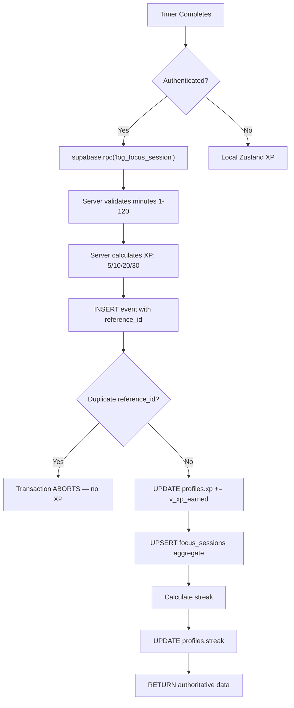

# PHASE 3 / STEP 3A — Focus Session Security Audit

> **Module**: Focus Sessions (Pomodoro Timer + XP Awards)
>
> **Date**: 2026-11-09
>
> **Mode**: AUDIT ONLY — No modifications made
>
> **Status**: All findings are migration-based inference unless stated otherwise.

---

## Table of Contents

1. [Executive Summary](#1-executive-summary)
2. [Live Database Findings](#2-live-database-findings)
3. [RLS Policy Analysis](#3-rls-policy-analysis)
4. [Table and Column Privilege Analysis](#4-table-and-column-privilege-analysis)
5. [RPC Security Analysis](#5-rpc-security-analysis)
6. [Frontend Implementation Analysis](#6-frontend-implementation-analysis)
7. [XP Integrity Analysis](#7-xp-integrity-analysis)
8. [Attack Scenario Assessment](#8-attack-scenario-assessment)
9. [Confirmed Vulnerabilities](#9-confirmed-vulnerabilities)
10. [Potential Regressions and Compatibility Risks](#10-potential-regressions-and-compatibility-risks)
11. [Recommended Remediation Plan](#11-recommended-remediation-plan)
12. [Affected Files and Database Objects](#12-affected-files-and-database-objects)
13. [Read-Only Verification Queries](#13-read-only-verification-queries)

---

## 1. Executive Summary

The Focus Sessions module is the core loop of FocusForge: a Pomodoro timer that awards XP and tracks streaks. The `log_focus_session` RPC is **well-designed** — it authenticates via `auth.uid()`, validates inputs, calculates XP server-side, and uses event idempotency to prevent replays.

**However, three critical and two medium-severity issues exist:**

| # | Severity | Finding | Impact |
|---|----------|---------|--------|
| **V1** | **CRITICAL** | Authenticated users can directly UPDATE `focus_sessions.minutes` and `sessions_count` | Inflates challenge c1/c4 verification data, corrupts analytics, manipulates streaks |
| **V2** | **CRITICAL** | Authenticated users can directly DELETE focus session records | Destroys streak history, enables session date manipulation |
| **V3** | **CRITICAL** | Authenticated users can directly INSERT fabricated focus session records | Creates fake history for streak inflation and challenge gaming |
| **V4** | MEDIUM | `FORCE ROW LEVEL SECURITY` is not enabled on `focus_sessions` | SECURITY DEFINER functions bypass RLS; if table owner changes, RLS can be bypassed |
| **V5** | MEDIUM | `log_focus_session` uses `search_path = public` (missing `pg_catalog`) | Search-path hijacking risk for SECURITY DEFINER functions |

> [!IMPORTANT]
> V1–V3 are currently **non-exploitable for XP** because daily challenge RPCs are disabled (Phase 3 / Step 2). However, they remain exploitable for **streak inflation**, **analytics corruption**, and **challenge verification data pre-positioning** (planting data before challenges are re-enabled).

---

## 2. Live Database Findings

> [!WARNING]
> No live database access is available. All findings below are **inferred from migration files**. The live database may differ, as documented in `20260802000000_consolidated_schema_sync.sql`. See [Section 13](#13-read-only-verification-queries) for verification queries.

### 2.1 Table Definition

**Source**: [`20260525174459_create_spendwise_tables.sql:123-130`](file:///d:/SWE%20Project/FocusForge%20Ad/supabase/migrations/20260525174459_create_spendwise_tables.sql#L123-L130)

```sql
CREATE TABLE IF NOT EXISTS focus_sessions (
  id uuid PRIMARY KEY DEFAULT gen_random_uuid(),
  user_id uuid NOT NULL REFERENCES auth.users(id) ON DELETE CASCADE,
  session_date date NOT NULL DEFAULT CURRENT_DATE,
  minutes integer NOT NULL DEFAULT 0,
  sessions_count integer DEFAULT 1,
  created_at timestamptz DEFAULT now()
);
```

| Column | Type | Nullable | Default | Security-Relevant |
|--------|------|----------|---------|-------------------|
| `id` | uuid | NOT NULL | `gen_random_uuid()` | PK |
| `user_id` | uuid | NOT NULL | — | FK → `auth.users(id)` ON DELETE CASCADE |
| `session_date` | date | NOT NULL | `CURRENT_DATE` | Used by streak calculation and challenges c1/c4 |
| `minutes` | integer | NOT NULL | 0 | Used by challenge c4 (60+ minutes) |
| `sessions_count` | integer | NULL | 1 | Used by challenge c1 (2+ sessions) |
| `created_at` | timestamptz | NULL | `now()` | Audit trail |

### 2.2 Unique Constraint

**Source**: [`20260706180000_focus_sessions_uniqueness.sql:47-49`](file:///d:/SWE%20Project/FocusForge%20Ad/supabase/migrations/20260706180000_focus_sessions_uniqueness.sql#L47-L49)

```sql
ALTER TABLE public.focus_sessions
  ADD CONSTRAINT focus_sessions_user_id_session_date_key
  UNIQUE (user_id, session_date);
```

**Significance**: One row per user per date. The `log_focus_session` RPC uses `ON CONFLICT ON CONSTRAINT focus_sessions_user_id_session_date_key` to atomically aggregate minutes and session counts.

### 2.3 RLS Status

- **ENABLE ROW LEVEL SECURITY**: ✅ Applied — [`20260525174459:132`](file:///d:/SWE%20Project/FocusForge%20Ad/supabase/migrations/20260525174459_create_spendwise_tables.sql#L132)
- **FORCE ROW LEVEL SECURITY**: ❌ **NOT found** in any migration

### 2.4 Table Ownership

No `ALTER TABLE focus_sessions OWNER TO` statement exists in any migration. Owner is the role that executed `CREATE TABLE` — on Supabase, this is typically `postgres` or `supabase_admin`.

### 2.5 Triggers

**No triggers** exist on `focus_sessions` in any migration file.

### 2.6 Indexes

Besides the PK index on `id` and the unique constraint `focus_sessions_user_id_session_date_key`, no additional indexes were found on `focus_sessions`.

---

## 3. RLS Policy Analysis

**Source**: [`20260525174459_create_spendwise_tables.sql:134-153`](file:///d:/SWE%20Project/FocusForge%20Ad/supabase/migrations/20260525174459_create_spendwise_tables.sql#L134-L153)

| Policy Name | Command | Roles | USING | WITH CHECK | Status |
|-------------|---------|-------|-------|------------|--------|
| `Users can view own focus sessions` | SELECT | authenticated | `auth.uid() = user_id` | — | ✅ Correct |
| `Users can insert own focus sessions` | INSERT | authenticated | — | `auth.uid() = user_id` | ⚠️ Direct INSERT allowed |
| `Users can update own focus sessions` | UPDATE | authenticated | `auth.uid() = user_id` | `auth.uid() = user_id` | ❌ **CRITICAL** |
| `Users can delete own focus sessions` | DELETE | authenticated | `auth.uid() = user_id` | — | ❌ **CRITICAL** |

**No subsequent migration drops or modifies these policies.**

### Assessment

- **SELECT**: Correct — users can only read their own sessions.
- **INSERT**: The RLS policy only checks `user_id = auth.uid()`, but it does not restrict column values. A user can insert a row with arbitrary `minutes`, `sessions_count`, and `session_date` values.
- **UPDATE**: **Full UPDATE** — no column restriction. Users can directly set `minutes = 99999`, `sessions_count = 99999`, or change `session_date` to any date.
- **DELETE**: Users can delete their own session records, enabling streak history destruction.

---

## 4. Table and Column Privilege Analysis

### 4.1 Table-Level Privileges (Migration-Based Inference)

No explicit `GRANT` or `REVOKE` on `focus_sessions` exists in any migration file. Supabase's `ALTER DEFAULT PRIVILEGES` applies:

```sql
ALTER DEFAULT PRIVILEGES FOR ROLE postgres IN SCHEMA public
  GRANT ALL ON TABLES TO anon, authenticated;
```

**Inferred effective privileges:**

| Role | SELECT | INSERT | UPDATE | DELETE | TRUNCATE | REFERENCES | TRIGGER |
|------|--------|--------|--------|--------|----------|------------|---------|
| `authenticated` | ✅ | ✅ | ✅ | ✅ | ✅ | ✅ | ✅ |
| `anon` | ✅ | ✅ | ✅ | ✅ | ✅ | ✅ | ✅ |
| `PUBLIC` | Depends | Depends | Depends | Depends | Depends | Depends | Depends |
| `service_role` | ✅ | ✅ | ✅ | ✅ | ✅ | ✅ | ✅ |

> [!WARNING]
> `authenticated` has **ALL** table-level privileges on `focus_sessions`. This is far more than needed — only SELECT should be retained (all writes should go through the `log_focus_session` RPC).

### 4.2 Column-Level Privileges

No column-level `GRANT` or `REVOKE` exists in any migration for `focus_sessions`. Supabase default is ALL columns at table level.

### 4.3 Effective Access Matrix (Combined RLS + Privileges)

With RLS enabled (but NOT forced), `authenticated` users can:

| Operation | Via PostgREST/Supabase Client | Via SECURITY DEFINER RPC |
|-----------|-------------------------------|--------------------------|
| SELECT own rows | ✅ (RLS filters) | ✅ (RLS bypassed) |
| INSERT own rows | ✅ (RLS allows, arbitrary column values) | ✅ (validated values) |
| UPDATE own rows | ✅ (RLS allows, **any column** including minutes, sessions_count) | ✅ (validated increments) |
| DELETE own rows | ✅ (RLS allows) | N/A |
| TRUNCATE | **Bypasses RLS** (but PostgREST doesn't expose) | N/A |

---

## 5. RPC Security Analysis

### 5.1 `public.log_focus_session(DATE, INTEGER, TEXT, DATE)`

**Latest definition**: [`20260708180000_fix_events_index_and_constraint.sql:27-164`](file:///d:/SWE%20Project/FocusForge%20Ad/supabase/migrations/20260708180000_fix_events_index_and_constraint.sql#L27-L164)

| Property | Value | Assessment |
|----------|-------|------------|
| Schema | `public` | ✅ |
| Language | `plpgsql` | ✅ |
| SECURITY DEFINER | ✅ Yes | ✅ |
| search_path | `public` | ⚠️ Missing `pg_catalog` — hijacking risk |
| Owner | Implicit (migration executor) | ⚠️ No explicit `OWNER TO` |
| EXECUTE | PUBLIC: REVOKED, authenticated: GRANTED | ✅ |
| Returns | TABLE(id, user_id, session_date, minutes, sessions_count, xp_earned, total_xp, current_streak, last_active_date) | ✅ |

#### Input Validation

| Parameter | Validation | Assessment |
|-----------|-----------|------------|
| `p_session_date` | NOT NULL, CURRENT_DATE ±1 day | ✅ Prevents future/historical dates beyond tolerance |
| `p_minutes` | NOT NULL, 1–120 range | ✅ Caps maximum session at 120 minutes |
| `p_reference_id` | NOT NULL, trimmed, 1–100 chars | ✅ |
| `p_today` | NOT NULL, CURRENT_DATE ±2 days | ⚠️ Client-supplied but bounded |
| `auth.uid()` | Used internally (NOT from parameter) | ✅ Cannot submit for another user |

#### Operation Sequence

```
1. Authenticate (auth.uid())
2. Validate inputs (minutes 1-120, date ±1 day, reference_id)
3. Verify profile exists
4. Calculate XP server-side (5/10/20/30 based on minutes)
5. INSERT event (idempotency via unique index)
6. UPDATE profiles.xp
7. UPSERT focus_sessions (aggregate: add minutes, increment sessions_count)
8. Calculate streak via calculate_streak()
9. UPDATE profiles.streak and last_active_date
10. RETURN aggregated result
```

#### Idempotency

The event INSERT on step 5 uses `events_focus_completion_reference_idx`:
```sql
UNIQUE (user_id, reference_id) WHERE reference_id IS NOT NULL AND type = 'focus_session_completed'
```

If the same `reference_id` is submitted twice, the INSERT fails with a unique violation, **aborting the entire transaction** (no partial award). This is correct.

**However**: The RPC does NOT catch `unique_violation` — it lets the exception propagate, which results in a PostgreSQL error returned to the client. The frontend's error handler catches this but shows a generic "Sync Failed" message.

#### XP Calculation

XP is calculated **server-side** based on `p_minutes`:

```sql
IF p_minutes >= 60 THEN v_xp_earned := 30;
ELSIF p_minutes >= 45 THEN v_xp_earned := 20;
ELSIF p_minutes >= 25 THEN v_xp_earned := 10;
ELSE v_xp_earned := 5;
```

**Evidence**: [`20260708180000:96-104`](file:///d:/SWE%20Project/FocusForge%20Ad/supabase/migrations/20260708180000_fix_events_index_and_constraint.sql#L96-L104)

The client also calculates XP locally ([`useTimerEngine.ts:129`](file:///d:/SWE%20Project/FocusForge%20Ad/src/hooks/useTimerEngine.ts#L129)) using the same formula, but **this value is NOT sent to the RPC** — it's only used for the guest path. The server's `v_xp_earned` is authoritative.

#### Client-Controlled XP Influence

`p_minutes` is client-supplied and directly influences XP:
- Client sends `p_minutes = 120` → server awards 30 XP
- Client sends `p_minutes = 1` → server awards 5 XP

**However**, `p_minutes` is validated to 1–120 range, and the maximum XP is 30 regardless of whether minutes is 60 or 120. The XP tier structure limits the impact:

| Minutes sent | XP awarded | Can the user exploit this? |
|-------------|-----------|---------------------------|
| 120 (max allowed) | 30 | Yes — user could send 120 after a 5-minute session |
| 60 | 30 | Same maximum tier |
| 25 | 10 | Normal |
| 1 (min allowed) | 5 | Undercounting (self-harm) |

**Vulnerability**: A user who completes a 5-minute timer can send `p_minutes = 120` to the RPC and receive 30 XP instead of 5 XP. The server has no way to verify the actual timer duration. Maximum excess XP per call: 25 (30 - 5).

**Mitigation**: Each call requires a unique `reference_id`, and the frontend uses `focus_${deadline}` where `deadline` is the timer's completion timestamp. Sending multiple calls with different reference_ids can award XP repeatedly, but each requires the timer to actually complete (the frontend guards via `lastCompletedDeadline` deduplication).

### 5.2 `public.calculate_streak(UUID, DATE)`

**Source**: [`20260707120000_streak_calculation_repair.sql:4-60`](file:///d:/SWE%20Project/FocusForge%20Ad/supabase/migrations/20260707120000_streak_calculation_repair.sql#L4-L60)

| Property | Value | Assessment |
|----------|-------|------------|
| SECURITY DEFINER | ✅ | ✅ |
| search_path | `public` | ⚠️ Missing `pg_catalog` |
| EXECUTE | `REVOKE ALL FROM PUBLIC, anon, authenticated` | ✅ Not callable by users |

This function counts consecutive days with focus sessions going backwards from `p_today`. It's called internally by `log_focus_session` and `get_current_streak`.

**Critical dependency**: `calculate_streak` queries `focus_sessions` rows. If a user can INSERT/UPDATE/DELETE `focus_sessions` rows directly, they can **inflate their streak** without completing actual focus sessions.

### 5.3 `public.get_current_streak(DATE)`

**Source**: [`20260707120000_streak_calculation_repair.sql:219-279`](file:///d:/SWE%20Project/FocusForge%20Ad/supabase/migrations/20260707120000_streak_calculation_repair.sql#L219-L279)

| Property | Value | Assessment |
|----------|-------|------------|
| SECURITY DEFINER | ✅ | ✅ |
| search_path | `public` | ⚠️ Missing `pg_catalog` |
| EXECUTE | PUBLIC: REVOKED, authenticated: GRANTED | ✅ |
| Input validation | `p_today` ±2 days of CURRENT_DATE | ✅ |

This function reads the current streak, recalculates it from `focus_sessions`, and **updates `profiles.streak`** if stale. The client calls it on app startup ([`useStore.ts:93`](file:///d:/SWE%20Project/FocusForge%20Ad/src/store/useStore.ts#L93)).

### 5.4 `private.award_xp_internal(UUID, INTEGER, TEXT, TEXT, TEXT, JSONB)`

**Source**: [`20260711120000_progression_xp_foundation.sql:46-144`](file:///d:/SWE%20Project/FocusForge%20Ad/supabase/migrations/20260711120000_progression_xp_foundation.sql#L46-L144)

| Property | Value | Assessment |
|----------|-------|------------|
| Schema | `private` | ✅ Not accessible by authenticated/anon |
| SECURITY DEFINER | ✅ | ✅ |
| search_path | `pg_catalog, public, private` | ✅ Correct |
| Owner | Explicitly `postgres` | ✅ |
| XP limit | 10,000 per call | ✅ |

**Note**: `log_focus_session` does **NOT** use `award_xp_internal`. It performs its own inline `UPDATE profiles SET xp = ...` and `INSERT INTO events`. This is a design inconsistency but not a vulnerability — both paths are SECURITY DEFINER and server-side.

---

## 6. Frontend Implementation Analysis

### 6.1 Timer Engine

**Source**: [`src/hooks/useTimerEngine.ts`](file:///d:/SWE%20Project/FocusForge%20Ad/src/hooks/useTimerEngine.ts)

The timer uses an absolute deadline system:

1. **Start** ([`Productivity.tsx:127-146`](file:///d:/SWE%20Project/FocusForge%20Ad/src/pages/Productivity.tsx#L127-L146)): Sets `timerDeadline = Date.now() + seconds * 1000` and captures `timerRunDurationSeconds` (the original duration for XP calculation).

2. **Tick** ([`useTimerEngine.ts:63-87`](file:///d:/SWE%20Project/FocusForge%20Ad/src/hooks/useTimerEngine.ts#L63-L87)): Every 1s, checks `Date.now() >= deadline`.

3. **Complete** ([`useTimerEngine.ts:108-319`](file:///d:/SWE%20Project/FocusForge%20Ad/src/hooks/useTimerEngine.ts#L108-L319)): Calls `handleTimerComplete(deadline)`.

#### Minutes Calculation

```typescript
// Line 123-126
const durationSecs = timerRunDurationSeconds !== null && timerRunDurationSeconds !== undefined 
  ? timerRunDurationSeconds 
  : (pomodoroMinutes * 60);
const mins = Math.max(1, Math.round(durationSecs / 60));
```

`timerRunDurationSeconds` is set when the timer starts and represents the configured duration (e.g., 25 minutes = 1500 seconds). It is **NOT the actual elapsed time** — it's the timer's configured length.

**Security implication**: If a user modifies `timerRunDurationSeconds` in the Zustand store via browser DevTools before the timer completes, they can send an arbitrary `p_minutes` value. However, the server caps it at 120.

#### RPC Call

```typescript
// Lines 138-143
const { data, error } = await supabase.rpc('log_focus_session', {
  p_session_date: today,       // formatLocalDate(new Date())
  p_minutes: mins,             // Client-calculated from timerRunDurationSeconds
  p_reference_id: referenceId, // `focus_${deadline}` — unique per timer completion
  p_today: today               // Same as p_session_date
});
```

#### Response Handling

```typescript
// Lines 160-173
state.upsertFocusSessionLocal({
  id: returned.id,
  session_date: returned.session_date,
  minutes: returned.minutes,
  sessions_count: returned.sessions_count
});

state.updateProfile({ 
  xp: returned.total_xp,           // ✅ Uses server value
  streak: returned.current_streak,  // ✅ Uses server value
  last_active_date: returned.last_active_date,
});
```

#### Previously Identified Discrepancy: `current_streak` vs `streak`

**Finding**: The SQL function returns `current_streak` as a column name:

```sql
-- 20260708180000:41
current_streak INTEGER,
```

The frontend reads `returned.current_streak` ([`useTimerEngine.ts:171`](file:///d:/SWE%20Project/FocusForge%20Ad/src/hooks/useTimerEngine.ts#L171)) and writes it to `profile.streak`.

**Status: RESOLVED** — The SQL `RETURNS TABLE` uses `current_streak` as the column name, the frontend reads `returned.current_streak`, and stores it as `profile.streak`. The naming is consistent across the interface boundary.

### 6.2 Idempotency Guard

The frontend uses `lastCompletedDeadline` to prevent double-processing the same timer completion:

```typescript
// Line 78
if (deadline !== state.lastCompletedDeadline) {
  useStore.setState({ lastCompletedDeadline: deadline, ... });
  handleTimerComplete(deadline);
}
```

This prevents the same timer from calling `handleTimerComplete` twice in the same session. Combined with the server-side `reference_id` uniqueness check, this provides two-layer idempotency protection.

### 6.3 Error Handling

On RPC failure ([`useTimerEngine.ts:215-232`](file:///d:/SWE%20Project/FocusForge%20Ad/src/hooks/useTimerEngine.ts#L215-L232)):

```typescript
catch (err: any) {
  console.error('Focus session logging failed:', err);
  state.showNotification({ ... message: 'Failed to save focus session. Please check connection.' });
  useStore.setState({ timerRunDurationSeconds: null });
  const resetSeconds = pomodoroMinutes * 60;
  state.setTimerSeconds(resetSeconds);
  state.setTimerRunning(false);
  useStore.setState({ timerDeadline: null });
  return;
}
```

**Assessment**: The timer resets on failure. No XP is awarded locally. No focus session is recorded locally. The `lastCompletedDeadline` has already been set (line 79), so **the timer completion is consumed even on failure** — the user would need to start a new timer.

**Potential issue**: If the server partially succeeded (e.g., event inserted, XP awarded, but the RETURN QUERY failed due to a network timeout), the server state is updated but the client doesn't know. A subsequent retry with a new `reference_id` would succeed and **double-award XP**. This is unlikely but theoretically possible.

### 6.4 Guest User Path

For unauthenticated users ([`useTimerEngine.ts:233-302`](file:///d:/SWE%20Project/FocusForge%20Ad/src/hooks/useTimerEngine.ts#L233-L302)):

- XP is calculated locally using the same formula
- Focus sessions are stored in Zustand (localStorage-persisted)
- No RPC is called
- No server-side validation

**Security**: Guest data is local-only and cannot affect the server database.

### 6.5 Direct Supabase Operations on focus_sessions

Frontend code referencing `focus_sessions` directly:

| File | Line | Operation | Purpose |
|------|------|-----------|---------|
| [`useStore.ts:82`](file:///d:/SWE%20Project/FocusForge%20Ad/src/store/useStore.ts#L82) | `.select('*')` | SELECT | Initial hydration |
| [`Analytics.tsx:120`](file:///d:/SWE%20Project/FocusForge%20Ad/src/pages/Analytics.tsx#L120) | `.select('id, session_date, minutes, sessions_count')` | SELECT | Analytics display |
| [`Reports.tsx:182`](file:///d:/SWE%20Project/FocusForge%20Ad/src/pages/Reports.tsx#L182) | `.select('*')` | SELECT | Reports display |
| [`friendService.ts:344`](file:///d:/SWE%20Project/FocusForge%20Ad/src/services/friendService.ts#L344) | `.select('minutes')` | SELECT | Friend profile view |

**No INSERT, UPDATE, DELETE, or UPSERT operations** on `focus_sessions` from the frontend. All writes go through `log_focus_session` RPC.

### 6.6 Dashboard Timer Quick-Start

**Source**: [`Dashboard.tsx:284-289`](file:///d:/SWE%20Project/FocusForge%20Ad/src/pages/Dashboard.tsx#L284-L289)

```typescript
const handleStartTimer = useCallback((mins: number) => {
  setTimerMode('focus');
  setTimerSeconds(mins * 60);
  setTimerRunning(true);
  setPage('productivity');
}, [...]);
```

**Issue**: This path does NOT set `timerDeadline` or `timerRunDurationSeconds`. The `useTimerEngine` effect detects `timerRunning` change, but `timerDeadline` is null. The effect guard at line 67-70 will immediately set `timerRunning = false`:

```typescript
if (!deadline) {
  state.setTimerRunning(false);
  return;
}
```

This appears to be a **functional bug** (not a security issue) — the Dashboard quick-start timer may not work correctly without the Productivity page's `handleStart` function setting the deadline. However, navigating to Productivity (via `setPage('productivity')`) would display the timer, and the user would likely interact with the Productivity page's start button.

---

## 7. XP Integrity Analysis

### 7.1 Focus Session XP Path



**XP Authority**: Server-side — the `v_xp_earned` value is computed in the function, not passed by the client.

**Idempotency**: Event-based — the `events_focus_completion_reference_idx` prevents duplicate `reference_id` values for `focus_session_completed` events.

### 7.2 Challenge Dependencies

| Challenge | Source Data | Direct Manipulation? | Status |
|-----------|------------|---------------------|--------|
| c1 (2 focus sessions) | `focus_sessions.sessions_count` | ✅ Users can UPDATE directly | **RPC DISABLED** (Phase 3 / Step 2) |
| c4 (60+ focus minutes) | `focus_sessions.minutes` | ✅ Users can UPDATE directly | **RPC DISABLED** (Phase 3 / Step 2) |

Challenge RPCs are disabled, so these are currently non-exploitable for XP. However, the **data is being pre-positioned** — if a user inflates their `sessions_count` or `minutes` today, those values will be immediately exploitable when challenges are re-enabled.

### 7.3 Streak Dependencies

The `calculate_streak` function counts consecutive days with focus session rows. If a user can:
- **INSERT** rows for past dates → inflate streak count
- **DELETE** rows → break streak and re-create with different dates
- **UPDATE** `session_date` → shift sessions to create artificial consecutive runs

All three operations are currently possible via direct Supabase client calls.

---

## 8. Attack Scenario Assessment

### Scenario 1: Directly Change Session from 25 to 120 Minutes

```javascript
await supabase.from('focus_sessions')
  .update({ minutes: 120 })
  .eq('user_id', myId)
  .eq('session_date', '2026-11-09');
```

- **RLS**: UPDATE policy allows (`auth.uid() = user_id`) ✅ passes
- **Table privilege**: UPDATE granted via Supabase default ✅ passes
- **Column restriction**: None ✅ succeeds
- **Result**: `minutes` changed to 120. Challenge c4 now shows completed.

**Verdict: VULNERABLE** (confirmed from migration analysis)

---

### Scenario 2: Set sessions_count to Artificially High Value

```javascript
await supabase.from('focus_sessions')
  .update({ sessions_count: 999 })
  .eq('user_id', myId)
  .eq('session_date', '2026-11-09');
```

- **RLS**: UPDATE policy allows
- **Result**: `sessions_count` set to 999. Challenge c1 now shows completed.

**Verdict: VULNERABLE** (confirmed from migration analysis)

---

### Scenario 3: Insert Fabricated Focus Session Record

```javascript
await supabase.from('focus_sessions')
  .insert({ user_id: myId, session_date: '2026-11-08', minutes: 60, sessions_count: 3 });
```

- **RLS**: INSERT policy allows (`auth.uid() = user_id`) ✅ passes
- **Unique constraint**: If no row exists for that date, INSERT succeeds
- **Result**: Fake session created with arbitrary minutes and sessions_count

**Verdict: VULNERABLE** (confirmed from migration analysis)

---

### Scenario 4: Submit Session for Another User's ID

```javascript
await supabase.rpc('log_focus_session', {
  p_session_date: today, p_minutes: 25,
  p_reference_id: 'attack_ref', p_today: today
});
// The RPC uses auth.uid() internally, NOT a client parameter
```

- **RPC**: `v_user_id := auth.uid()` — hardcoded to authenticated user
- **Direct INSERT**: RLS checks `auth.uid() = user_id` — would fail for other user's ID

**Verdict: PROTECTED** (confirmed from both RPC and RLS analysis)

---

### Scenario 5: Replay the Same log_focus_session Request

```javascript
// First call: succeeds
await supabase.rpc('log_focus_session', { p_reference_id: 'focus_123', ... });
// Second call: same reference_id
await supabase.rpc('log_focus_session', { p_reference_id: 'focus_123', ... });
```

- **events_focus_completion_reference_idx**: `UNIQUE(user_id, reference_id) WHERE reference_id IS NOT NULL AND type = 'focus_session_completed'`
- **Result**: Second INSERT into events fails with unique_violation, transaction aborts

**Verdict: PROTECTED** (confirmed from index definition)

---

### Scenario 6: Concurrent Duplicate Requests

Two simultaneous calls with the same `reference_id`:

- **PostgreSQL**: The unique index serializes the INSERTs. One succeeds, the other gets unique_violation.
- **No advisory lock** in `log_focus_session` (unlike the challenge RPCs' reference implementation)
- **UPSERT on focus_sessions**: Uses `ON CONFLICT ... DO UPDATE SET minutes = minutes + ...` — if somehow both events succeed, sessions_count and minutes would be double-incremented

**Verdict: PROTECTED** — The event unique index prevents both from succeeding. Only one transaction can insert the same `reference_id`.

---

### Scenario 7: Submit Future or Historical Session Date

```javascript
await supabase.rpc('log_focus_session', {
  p_session_date: '2026-12-25', // Future date
  p_minutes: 25, p_reference_id: 'ref1', p_today: '2026-11-09'
});
```

- **Validation**: `p_session_date` must be within CURRENT_DATE ±1 day
- **Result**: `RAISE EXCEPTION 'Invalid session date: 2026-12-25 is outside the timezone tolerance range'`

**Verdict: PROTECTED** (confirmed from RPC validation)

**However**: Direct INSERT via Supabase client bypasses the RPC validation:

```javascript
await supabase.from('focus_sessions')
  .insert({ user_id: myId, session_date: '2026-01-01', minutes: 60, sessions_count: 1 });
```

This succeeds because the INSERT RLS policy only checks `user_id`, not `session_date`.

**Verdict (direct INSERT): VULNERABLE**

---

### Scenario 8: Call RPC Without Authentication

```javascript
// Using anon key
await supabase.rpc('log_focus_session', { ... });
```

- **EXECUTE privilege**: `REVOKE ALL FROM PUBLIC` — anon cannot execute
- **auth.uid()**: Returns NULL for unauthenticated users → RAISE EXCEPTION

**Verdict: PROTECTED** (confirmed from both privilege revocation and authentication check)

---

### Scenario 9: Manipulate Frontend Timer State Before Completion

Via browser DevTools console:
```javascript
// Modify Zustand store to inflate reported minutes
useStore.setState({ timerRunDurationSeconds: 7200 }); // 120 minutes
```

- **Effect**: When timer completes, `mins = Math.round(7200 / 60) = 120` → sends `p_minutes: 120` to RPC
- **Server validation**: 120 ≤ 120, passes
- **XP awarded**: 30 instead of the actual timer duration's tier

**Verdict: VULNERABLE** — Client can inflate minutes within the 1-120 range. Maximum excess XP per session: 25.

---

### Scenario 10: Trigger XP Without Completing Timer

The timer completion requires:
1. `Date.now() >= deadline` (line 73)
2. `deadline !== lastCompletedDeadline` (line 78)

A user could set `timerDeadline` to `Date.now() - 1` via DevTools to trigger immediate completion. However:
- Each completion consumes the `deadline` by recording it as `lastCompletedDeadline`
- A new `deadline` must be different to trigger another completion
- Each completion generates a unique `reference_id = focus_${deadline}`
- The event idempotency index prevents the same `reference_id` from awarding XP twice

**Verdict: PARTIALLY PROTECTED** — A user can force an immediate completion, but only once per unique deadline. They can generate multiple completions by setting different fake deadlines, each awarding up to 30 XP with a unique reference_id.

---

## 8.1 Attack Scenario Summary

| # | Scenario | Verdict | Evidence Basis |
|---|----------|---------|----------------|
| 1 | Change minutes to 120 | **VULNERABLE** | Migration: UPDATE policy + no column restriction |
| 2 | Set sessions_count high | **VULNERABLE** | Migration: UPDATE policy + no column restriction |
| 3 | Insert fabricated session | **VULNERABLE** | Migration: INSERT policy, no value validation |
| 4 | Submit for another user | **PROTECTED** | RPC: `auth.uid()`, RLS: `auth.uid() = user_id` |
| 5 | Replay same request | **PROTECTED** | Index: `events_focus_completion_reference_idx` |
| 6 | Concurrent duplicates | **PROTECTED** | Index serialization |
| 7 | Future/historical date (RPC) | **PROTECTED** | RPC: ±1 day validation |
| 7b | Future/historical date (direct) | **VULNERABLE** | INSERT policy: no date check |
| 8 | Unauthenticated call | **PROTECTED** | REVOKE + `auth.uid()` check |
| 9 | Manipulate timer state | **VULNERABLE** | DevTools: client-side `timerRunDurationSeconds` |
| 10 | Force XP without timer | **PARTIALLY PROTECTED** | Unique reference_id per deadline, but fake deadlines possible |

---

## 9. Confirmed Vulnerabilities

### V1. Direct UPDATE on focus_sessions — CRITICAL

**Source**: [`20260525174459:144-148`](file:///d:/SWE%20Project/FocusForge%20Ad/supabase/migrations/20260525174459_create_spendwise_tables.sql#L144-L148) — UPDATE policy with no column restriction

**Impact**:
- Can set `minutes` and `sessions_count` to arbitrary values
- Corrupts challenge verification data (c1, c4)
- Corrupts analytics and reports
- Currently non-exploitable for XP (challenge RPCs disabled) but **pre-positions** data for future exploitation

**Evidence confidence**: CONFIRMED (migration-based)

### V2. Direct DELETE on focus_sessions — CRITICAL

**Source**: [`20260525174459:150-153`](file:///d:/SWE%20Project/FocusForge%20Ad/supabase/migrations/20260525174459_create_spendwise_tables.sql#L150-L153) — DELETE policy

**Impact**:
- Can destroy streak history
- Can delete and re-create sessions with manipulated dates
- Undermines `calculate_streak` integrity

**Evidence confidence**: CONFIRMED (migration-based)

### V3. Direct INSERT on focus_sessions — CRITICAL

**Source**: [`20260525174459:139-142`](file:///d:/SWE%20Project/FocusForge%20Ad/supabase/migrations/20260525174459_create_spendwise_tables.sql#L139-L142) — INSERT policy with no value validation

**Impact**:
- Can create sessions for any date (no date restriction in RLS)
- Can set arbitrary `minutes` and `sessions_count`
- Inflates streak by filling gaps in history

**Evidence confidence**: CONFIRMED (migration-based)

### V4. Missing FORCE ROW LEVEL SECURITY — MEDIUM

**Source**: No `ALTER TABLE focus_sessions FORCE ROW LEVEL SECURITY` in any migration

**Impact**: If the table owner role (e.g., `postgres`) queries the table directly, RLS is bypassed. This is expected for SECURITY DEFINER functions (which is correct behavior), but if the table owner changes or a non-DEFINER function with owner privileges is created, RLS would not apply.

**Evidence confidence**: CONFIRMED (migration-based)

### V5. search_path Missing pg_catalog — MEDIUM

**Source**: [`20260708180000:46`](file:///d:/SWE%20Project/FocusForge%20Ad/supabase/migrations/20260708180000_fix_events_index_and_constraint.sql#L46) — `SET search_path = public`

**Impact**: A malicious user who can create objects in the `public` schema could shadow built-in functions (e.g., create a `public.auth.uid()` that returns a different UUID). On Supabase, authenticated users cannot create functions, so this is currently low risk but violates best practice.

**Applies to**: `log_focus_session`, `calculate_streak`, `get_current_streak`

**Evidence confidence**: CONFIRMED (migration-based)

### V6. Client-Supplied Minutes — LOW-MEDIUM

**Source**: [`useTimerEngine.ts:123-126`](file:///d:/SWE%20Project/FocusForge%20Ad/src/hooks/useTimerEngine.ts#L123-L126) and [`useTimerEngine.ts:138-143`](file:///d:/SWE%20Project/FocusForge%20Ad/src/hooks/useTimerEngine.ts#L138-L143)

**Impact**: User can manipulate `timerRunDurationSeconds` via DevTools to send `p_minutes = 120` regardless of actual timer duration. Maximum excess XP: 25 per session (30 - 5).

**Mitigation factor**: Server validates 1–120 range, each call requires unique reference_id.

**Evidence confidence**: CONFIRMED (code analysis)

---

## 10. Potential Regressions and Compatibility Risks

### 10.1 If UPDATE Policy Is Removed

The frontend does **NOT** perform any `.update()` on `focus_sessions`. All writes go through `log_focus_session` RPC (which is SECURITY DEFINER and bypasses RLS). **Zero regression risk**.

### 10.2 If DELETE Policy Is Removed

The frontend does **NOT** perform any `.delete()` on `focus_sessions`. **Zero regression risk**.

### 10.3 If INSERT Policy Is Removed

The frontend does **NOT** perform any `.insert()` on `focus_sessions`. All inserts go through `log_focus_session` RPC. **Zero regression risk**.

### 10.4 If Table-Level UPDATE/DELETE/INSERT Is Revoked from authenticated

Same analysis — `log_focus_session` is SECURITY DEFINER, runs as the function owner (bypasses RLS and privilege checks). **Zero regression risk** for the RPC path.

Frontend `.select()` calls would still work as long as SELECT privilege is preserved.

### 10.5 friendService.ts

[`friendService.ts:344`](file:///d:/SWE%20Project/FocusForge%20Ad/src/services/friendService.ts#L344) uses `.from('focus_sessions').select('minutes')` — this is a read-only SELECT. No regression from revoking write privileges.

---

## 11. Recommended Remediation Plan

### Priority 1: Remove Direct Write Policies (CRITICAL)

Drop the UPDATE, DELETE, and INSERT RLS policies on `focus_sessions`:

```sql
DROP POLICY IF EXISTS "Users can update own focus sessions" ON public.focus_sessions;
DROP POLICY IF EXISTS "Users can delete own focus sessions" ON public.focus_sessions;
DROP POLICY IF EXISTS "Users can insert own focus sessions" ON public.focus_sessions;
```

**Rationale**: All legitimate writes go through `log_focus_session` RPC (SECURITY DEFINER), which bypasses RLS. No frontend code performs direct INSERT/UPDATE/DELETE on this table.

### Priority 2: Revoke Table-Level Write Privileges (CRITICAL)

```sql
REVOKE INSERT, UPDATE, DELETE ON public.focus_sessions FROM authenticated, anon, PUBLIC;
-- Also revoke unnecessary privileges:
REVOKE TRUNCATE, REFERENCES, TRIGGER ON public.focus_sessions FROM authenticated, anon, PUBLIC;
-- Preserve SELECT:
GRANT SELECT ON public.focus_sessions TO authenticated;
```

### Priority 3: Harden search_path (MEDIUM)

Update `log_focus_session`, `calculate_streak`, and `get_current_streak` to use:

```sql
SET search_path = pg_catalog, public, private
```

And add explicit ownership:

```sql
ALTER FUNCTION public.log_focus_session(DATE, INTEGER, TEXT, DATE) OWNER TO postgres;
ALTER FUNCTION public.calculate_streak(UUID, DATE) OWNER TO postgres;
ALTER FUNCTION public.get_current_streak(DATE) OWNER TO postgres;
```

### Priority 4: Add FORCE ROW LEVEL SECURITY (MEDIUM)

```sql
ALTER TABLE public.focus_sessions FORCE ROW LEVEL SECURITY;
```

### Priority 5: Address Client-Supplied Minutes (LOW-MEDIUM)

Options:
1. **Accept the risk** — XP is capped at 30, each call needs a unique reference_id, and the user needs a real timer to trigger completion. Maximum abuse is 25 XP per fake timer.
2. **Server-side timer validation** — Store timer start time and validate duration server-side. This requires a new table or column and is a larger architectural change.

**Recommendation**: Accept the risk for now. The 1–120 minute validation and event idempotency provide reasonable protection. Focus on the higher-priority direct-write vulnerabilities first.

### Dependency Note

Completing Priorities 1–2 is a **prerequisite for re-enabling daily challenge RPCs** (c1 and c4), as documented in the Phase 3 / Step 2 migration.

---

## 12. Affected Files and Database Objects

### Database Objects (would be modified by remediation)

| Object | Change |
|--------|--------|
| `public.focus_sessions` | Drop UPDATE, DELETE, INSERT policies; revoke write privileges; add FORCE RLS |
| `public.log_focus_session` | Update search_path; set owner |
| `public.calculate_streak` | Update search_path; set owner |
| `public.get_current_streak` | Update search_path; set owner |

### Source Files (no changes required)

| File | Reason |
|------|--------|
| [`src/hooks/useTimerEngine.ts`](file:///d:/SWE%20Project/FocusForge%20Ad/src/hooks/useTimerEngine.ts) | No direct writes; uses RPC only |
| [`src/store/useStore.ts`](file:///d:/SWE%20Project/FocusForge%20Ad/src/store/useStore.ts) | SELECT-only access |
| [`src/pages/Analytics.tsx`](file:///d:/SWE%20Project/FocusForge%20Ad/src/pages/Analytics.tsx) | SELECT-only access |
| [`src/pages/Reports.tsx`](file:///d:/SWE%20Project/FocusForge%20Ad/src/pages/Reports.tsx) | SELECT-only access |
| [`src/services/friendService.ts`](file:///d:/SWE%20Project/FocusForge%20Ad/src/services/friendService.ts) | SELECT-only access |

---

## 13. Read-Only Verification Queries

Execute in the Supabase SQL Editor to verify findings against the live database.

### Q1. RLS Status

```sql
SELECT
  relname AS table_name,
  relrowsecurity AS rls_enabled,
  relforcerowsecurity AS rls_forced
FROM pg_class
JOIN pg_namespace ON pg_namespace.oid = pg_class.relnamespace
WHERE nspname = 'public' AND relname = 'focus_sessions';

-- Expected: rls_enabled=true, rls_forced=false
```

### Q2. RLS Policies

```sql
SELECT policyname, cmd, permissive, roles, qual, with_check
FROM pg_policies
WHERE schemaname = 'public' AND tablename = 'focus_sessions'
ORDER BY cmd, policyname;

-- Expected: 4 policies (SELECT, INSERT, UPDATE, DELETE) all for {authenticated}
```

### Q3. Table-Level Privileges

```sql
SELECT grantee, privilege_type, is_grantable
FROM information_schema.table_privileges
WHERE table_schema = 'public'
  AND table_name = 'focus_sessions'
  AND grantee IN ('authenticated', 'anon', 'PUBLIC', 'service_role')
ORDER BY grantee, privilege_type;
```

### Q4. Effective Privileges

```sql
SELECT
  'authenticated' AS role,
  has_table_privilege('authenticated', 'public.focus_sessions', 'SELECT')   AS can_select,
  has_table_privilege('authenticated', 'public.focus_sessions', 'INSERT')   AS can_insert,
  has_table_privilege('authenticated', 'public.focus_sessions', 'UPDATE')   AS can_update,
  has_table_privilege('authenticated', 'public.focus_sessions', 'DELETE')   AS can_delete,
  has_table_privilege('authenticated', 'public.focus_sessions', 'TRUNCATE') AS can_truncate
UNION ALL
SELECT
  'anon',
  has_table_privilege('anon', 'public.focus_sessions', 'SELECT'),
  has_table_privilege('anon', 'public.focus_sessions', 'INSERT'),
  has_table_privilege('anon', 'public.focus_sessions', 'UPDATE'),
  has_table_privilege('anon', 'public.focus_sessions', 'DELETE'),
  has_table_privilege('anon', 'public.focus_sessions', 'TRUNCATE');
```

### Q5. Unique Constraints

```sql
SELECT conname, pg_get_constraintdef(oid) AS definition
FROM pg_constraint
WHERE conrelid = 'public.focus_sessions'::regclass
  AND contype IN ('u', 'p')
ORDER BY conname;

-- Expected: focus_sessions_pkey (PRIMARY KEY) and focus_sessions_user_id_session_date_key (UNIQUE)
```

### Q6. Function Metadata

```sql
SELECT
  n.nspname AS schema,
  p.proname AS function_name,
  pg_get_function_arguments(p.oid) AS arguments,
  p.proowner::regrole AS owner,
  p.prosecdef AS security_definer,
  array_to_string(p.proconfig, ', ') AS config
FROM pg_proc p
JOIN pg_namespace n ON p.pronamespace = n.oid
WHERE (n.nspname = 'public' AND p.proname IN ('log_focus_session', 'calculate_streak', 'get_current_streak'))
ORDER BY p.proname;
```

### Q7. Function EXECUTE Privileges

```sql
SELECT
  routine_schema,
  routine_name,
  grantee,
  privilege_type
FROM information_schema.routine_privileges
WHERE routine_schema = 'public'
  AND routine_name IN ('log_focus_session', 'calculate_streak', 'get_current_streak')
ORDER BY routine_name, grantee;

-- Expected: log_focus_session → authenticated, get_current_streak → authenticated
-- calculate_streak should have NO grantees (revoked from all)
```

### Q8. Table Ownership

```sql
SELECT
  c.relname AS table_name,
  r.rolname AS owner
FROM pg_class c
JOIN pg_namespace n ON n.oid = c.relnamespace
JOIN pg_roles r ON r.oid = c.relowner
WHERE n.nspname = 'public' AND c.relname = 'focus_sessions';
```

### Q9. Triggers

```sql
SELECT tgname, pg_get_triggerdef(oid) AS definition
FROM pg_trigger
WHERE tgrelid = 'public.focus_sessions'::regclass
  AND NOT tgisinternal
ORDER BY tgname;

-- Expected: no rows
```

---

*End of Phase 3 / Step 3A — Focus Session Security Audit*

