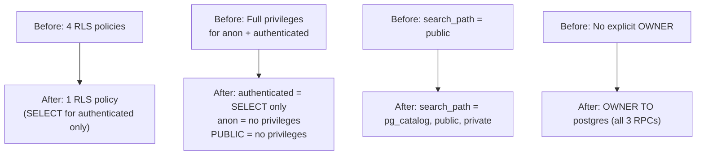

# Phase 3 / Step 3B — Focus Sessions Hardening Migration Review

**Migration:** `20261112000000_secure_focus_sessions.sql`  
**Date:** 2026-11-12 (corrected)  
**Status:** PREPARED — NOT APPLIED  
**Reviewer:** AI Agent (Antigravity)

---

## Executive Summary

This migration removes all direct client write access to `public.focus_sessions`, revokes all privileges from `anon` and `PUBLIC` (including SELECT), and hardens the `search_path` of the three focus-session RPCs. All focus-session writes are funneled through `log_focus_session()` (SECURITY DEFINER, owned by postgres). Only `authenticated` retains SELECT access.

The frontend has been confirmed to use only RPC calls for writes and SELECT queries for reads. **Regression risk is assessed as very low** — no frontend code performs direct INSERT, UPDATE, or DELETE against `focus_sessions`, and all SELECT queries are issued by authenticated users. However, this assessment is based on static code analysis and migration-file inference. Live post-application verification (P1–P10) is required to fully confirm zero functional regression.

---

## Verification Matrix

| # | Requirement | Status | Evidence |
|---|------------|--------|----------|
| 1 | INSERT policy dropped | **PASS** | `DROP POLICY IF EXISTS "Users can insert own focus sessions"` |
| 2 | UPDATE policy dropped | **PASS** | `DROP POLICY IF EXISTS "Users can update own focus sessions"` |
| 3 | DELETE policy dropped | **PASS** | `DROP POLICY IF EXISTS "Users can delete own focus sessions"` |
| 4 | SELECT policy preserved | **PASS** | No DROP for `"Users can view own focus sessions"` |
| 5 | Policy names match source | **PASS** | Verified against `20260525174459_create_spendwise_tables.sql:134-153` |
| 6 | Table-level INSERT/UPDATE/DELETE/TRUNCATE/REFERENCES/TRIGGER revoked from `authenticated` | **PASS** | Explicit REVOKE statement (line 45) |
| 7 | Table-level ALL privileges revoked from `anon` (including SELECT) | **PASS** | `REVOKE SELECT, INSERT, UPDATE, DELETE, TRUNCATE, REFERENCES, TRIGGER` (line 48) |
| 8 | Table-level ALL privileges revoked from `PUBLIC` (including SELECT) | **PASS** | `REVOKE SELECT, INSERT, UPDATE, DELETE, TRUNCATE, REFERENCES, TRIGGER` (line 51) |
| 9 | Column-level INSERT revoked (all 6 columns) | **PASS** | `REVOKE INSERT (id, user_id, session_date, minutes, sessions_count, created_at)` from all 3 roles |
| 10 | Column-level UPDATE revoked (all 6 columns) | **PASS** | `REVOKE UPDATE (...)` from all 3 roles |
| 11 | Column-level REFERENCES revoked (all 6 columns) | **PASS** | `REVOKE REFERENCES (...)` from all 3 roles |
| 12 | Column-level SELECT revoked from `anon` and `PUBLIC` (all 6 columns) | **PASS** | `REVOKE SELECT (...) FROM anon, PUBLIC` (line 69) |
| 13 | Column-level SELECT NOT revoked from `authenticated` | **PASS** | `authenticated` excluded from column-level SELECT revocation |
| 14 | Table-level SELECT preserved for `authenticated` | **PASS** | `GRANT SELECT ON public.focus_sessions TO authenticated` (line 75) |
| 15 | `service_role` privileges NOT modified | **PASS** | No REVOKE/GRANT targeting `service_role` |
| 16 | `log_focus_session` signature preserved | **PASS** | `(DATE, INTEGER, TEXT, DATE)` — matches source |
| 17 | `log_focus_session` return contract preserved | **PASS** | 9-column TABLE return — matches source |
| 18 | `log_focus_session` body identical | **PASS** | Byte-for-byte copy from `20260708180000:47-164` |
| 19 | `log_focus_session` SECURITY DEFINER | **PASS** | Present in CREATE statement |
| 20 | `log_focus_session` search_path hardened | **PASS** | `pg_catalog, public, private` (was `public`) |
| 21 | `log_focus_session` OWNER TO postgres | **PASS** | ALTER FUNCTION after CREATE |
| 22 | `log_focus_session` EXECUTE grant | **PASS** | REVOKE ALL FROM PUBLIC → GRANT TO authenticated |
| 23 | `calculate_streak` signature preserved | **PASS** | `(UUID, DATE)` — matches source |
| 24 | `calculate_streak` body identical | **PASS** | Byte-for-byte copy from `20260707120000:15-60` |
| 25 | `calculate_streak` SECURITY DEFINER | **PASS** | Present in CREATE statement |
| 26 | `calculate_streak` search_path hardened | **PASS** | `pg_catalog, public, private` (was `public`) |
| 27 | `calculate_streak` OWNER TO postgres | **PASS** | ALTER FUNCTION after CREATE |
| 28 | `calculate_streak` EXECUTE fully revoked | **PASS** | `REVOKE ALL ... FROM PUBLIC, anon, authenticated` |
| 29 | `get_current_streak` signature preserved | **PASS** | `(DATE)` — matches source |
| 30 | `get_current_streak` body identical | **PASS** | Byte-for-byte copy from `20260707120000:229-275` |
| 31 | `get_current_streak` SECURITY DEFINER | **PASS** | Present in CREATE statement |
| 32 | `get_current_streak` search_path hardened | **PASS** | `pg_catalog, public, private` (was `public`) |
| 33 | `get_current_streak` OWNER TO postgres | **PASS** | ALTER FUNCTION after CREATE |
| 34 | `get_current_streak` EXECUTE grant | **PASS** | REVOKE ALL FROM PUBLIC → GRANT TO authenticated |
| 35 | No existing data modified | **PASS** | No UPDATE/DELETE/TRUNCATE on data rows |
| 36 | No XP balances modified | **PASS** | No writes to `profiles.xp` or `events` |
| 37 | FORCE ROW LEVEL SECURITY not enabled | **PASS** | No `ALTER TABLE ... FORCE` |
| 38 | No unrelated tables/functions changed | **PASS** | Only `focus_sessions` table and 3 RPCs |
| 39 | Transaction boundaries correct | **PASS** | `BEGIN` / `COMMIT` wrapping all statements |
| 40 | PostgREST reload included | **PASS** | `NOTIFY pgrst, 'reload schema'` before COMMIT |
| 41 | RPC business logic unchanged | **PASS** | Only `SET search_path` clause differs |
| 42 | `award_xp_internal` not modified | **PASS** | Not referenced in migration |
| 43 | No credentials/secrets exposed | **PASS** | No hardcoded secrets |

---

## Source Migration Cross-Reference

| Function | Authoritative Source | Lines |
|----------|---------------------|-------|
| `log_focus_session` | `20260708180000_fix_events_index_and_constraint.sql` | 27–168 |
| `calculate_streak` | `20260707120000_streak_calculation_repair.sql` | 4–63 |
| `get_current_streak` | `20260707120000_streak_calculation_repair.sql` | 219–279 |
| Table + policies | `20260525174459_create_spendwise_tables.sql` | 123–153 |

---

## Pre-Application Verification Queries

Run these against the live database **before** applying the migration to confirm current state matches assumptions.

### V1. Confirm write policies exist

```sql
SELECT policyname, cmd, roles, qual, with_check
FROM pg_policies
WHERE tablename = 'focus_sessions'
  AND schemaname = 'public'
ORDER BY policyname;
```

**Expected:** Four policies exist — INSERT, UPDATE, DELETE, SELECT — all for `{authenticated}`.

### V2. Confirm current table privileges

```sql
SELECT grantee, privilege_type
FROM information_schema.table_privileges
WHERE table_schema = 'public'
  AND table_name = 'focus_sessions'
  AND grantee IN ('anon', 'authenticated')
ORDER BY grantee, privilege_type;
```

**Expected:** `authenticated` and `anon` both have INSERT, UPDATE, DELETE, SELECT, TRUNCATE, REFERENCES, TRIGGER.

### V3. Confirm current column-level privileges

```sql
SELECT grantee, column_name, privilege_type
FROM information_schema.column_privileges
WHERE table_schema = 'public'
  AND table_name = 'focus_sessions'
  AND grantee IN ('anon', 'authenticated')
ORDER BY grantee, column_name, privilege_type;
```

### V4. Confirm current function search_paths

```sql
SELECT
  p.proname,
  pg_get_function_arguments(p.oid) AS args,
  p.proowner::regrole AS owner,
  p.prosecdef AS security_definer,
  array_to_string(p.proconfig, ', ') AS config
FROM pg_proc p
JOIN pg_namespace n ON p.pronamespace = n.oid
WHERE n.nspname = 'public'
  AND p.proname IN ('log_focus_session', 'calculate_streak', 'get_current_streak')
ORDER BY p.proname;
```

**Expected:** All three show `search_path=public`, owner `postgres`, `security_definer = true`.

### V5. Confirm current EXECUTE grants

```sql
SELECT
  p.proname,
  pg_get_function_arguments(p.oid) AS args,
  r.rolname AS grantee,
  has_function_privilege(r.rolname, p.oid, 'EXECUTE') AS can_execute
FROM pg_proc p
JOIN pg_namespace n ON p.pronamespace = n.oid
CROSS JOIN (
  SELECT rolname FROM pg_roles 
  WHERE rolname IN ('anon', 'authenticated', 'service_role')
) r
WHERE n.nspname = 'public'
  AND p.proname IN ('log_focus_session', 'calculate_streak', 'get_current_streak')
ORDER BY p.proname, r.rolname;
```

**Expected:**

| Function | anon | authenticated | service_role |
|----------|------|---------------|--------------|
| `log_focus_session` | false | true | true |
| `calculate_streak` | false | false | true |
| `get_current_streak` | false | true | true |

### V6. Confirm focus_sessions columns

```sql
SELECT column_name, data_type, is_nullable
FROM information_schema.columns
WHERE table_schema = 'public'
  AND table_name = 'focus_sessions'
ORDER BY ordinal_position;
```

**Expected:** 6 columns — `id`, `user_id`, `session_date`, `minutes`, `sessions_count`, `created_at`.

---

## Post-Application Verification Queries

Run these **after** applying the migration to confirm changes took effect.

### P1. Confirm only SELECT policy remains

```sql
SELECT policyname, cmd, roles
FROM pg_policies
WHERE tablename = 'focus_sessions'
  AND schemaname = 'public'
ORDER BY policyname;
```

**Expected:** Only `"Users can view own focus sessions"` with `cmd = SELECT`.

### P2. Confirm table-level privileges — authenticated

```sql
SELECT grantee, privilege_type
FROM information_schema.table_privileges
WHERE table_schema = 'public'
  AND table_name = 'focus_sessions'
  AND grantee = 'authenticated'
ORDER BY privilege_type;
```

**Expected:** Only `SELECT`. No INSERT, UPDATE, DELETE, TRUNCATE, REFERENCES, or TRIGGER.

### P3. Confirm table-level privileges — anon has NONE

```sql
SELECT grantee, privilege_type
FROM information_schema.table_privileges
WHERE table_schema = 'public'
  AND table_name = 'focus_sessions'
  AND grantee = 'anon';
```

**Expected:** Zero rows — `anon` has no table-level privileges at all.

### P4. Confirm no residual column-level grants for anon, authenticated, or PUBLIC

```sql
SELECT grantee, column_name, privilege_type
FROM information_schema.column_privileges
WHERE table_schema = 'public'
  AND table_name = 'focus_sessions'
  AND grantee IN ('anon', 'authenticated', 'PUBLIC')
ORDER BY grantee, column_name, privilege_type;
```

**Expected:**
- `anon`: zero rows — no column-level grants of any type.
- `PUBLIC`: zero rows — no column-level grants of any type.
- `authenticated`: only SELECT rows (if column-level SELECT grants exist); no INSERT, UPDATE, or REFERENCES rows.

> [!NOTE]
> `information_schema.column_privileges` reports grants made directly to the named grantee. It does not surface privileges inherited through role membership (e.g., a role that is a member of `PUBLIC`). Use P5 to inspect direct ACL entries and P6 to check effective (inherited) privileges.

### P5. Inspect direct table-level ACL grants to PUBLIC via pg_class

This query decomposes the raw ACL array stored on `pg_class` to reveal direct grants made to `PUBLIC` (represented by `grantee = 0` in `aclexplode`). Unlike `has_table_privilege`, this shows only direct grants — not privileges inherited through role membership.

```sql
SELECT
  c.relname AS table_name,
  a.grantor::regrole AS grantor,
  CASE WHEN a.grantee = 0 THEN 'PUBLIC' ELSE a.grantee::regrole::text END AS grantee,
  a.privilege_type,
  a.is_grantable
FROM pg_class c
JOIN pg_namespace n ON c.relnamespace = n.oid
CROSS JOIN LATERAL aclexplode(c.relacl) AS a
WHERE n.nspname = 'public'
  AND c.relname = 'focus_sessions'
  AND a.grantee = 0
ORDER BY a.privilege_type;
```

**Expected (post-application):** Zero rows — no direct grants to `PUBLIC` remain on `public.focus_sessions`.

**Pre-application note:** Before applying the migration, this query will likely return rows for every privilege type granted to `PUBLIC` by default (SELECT, INSERT, UPDATE, DELETE, TRUNCATE, REFERENCES, TRIGGER — originating from `ALTER DEFAULT PRIVILEGES FOR ROLE postgres`). After the migration, the `REVOKE ... FROM PUBLIC` statements should remove all of these entries.

> [!IMPORTANT]
> This query inspects direct ACL entries only. Even if zero rows are returned, a role could still have effective access through membership in another role that retains privileges. P6 (`has_table_privilege`) checks effective access, which includes inherited privileges.

### P6. Confirm effective privileges via has_table_privilege

`has_table_privilege` checks **effective** access for a role, including privileges inherited through role membership (e.g., if `anon` or `authenticated` is a member of a role that retains grants). This complements P4 (column-level direct grants) and P5 (table-level direct ACL entries).

```sql
SELECT
  has_table_privilege('authenticated', 'public.focus_sessions', 'SELECT') AS auth_select,
  has_table_privilege('authenticated', 'public.focus_sessions', 'INSERT') AS auth_insert,
  has_table_privilege('authenticated', 'public.focus_sessions', 'UPDATE') AS auth_update,
  has_table_privilege('authenticated', 'public.focus_sessions', 'DELETE') AS auth_delete,
  has_table_privilege('authenticated', 'public.focus_sessions', 'TRUNCATE') AS auth_truncate,
  has_table_privilege('authenticated', 'public.focus_sessions', 'REFERENCES') AS auth_references,
  has_table_privilege('authenticated', 'public.focus_sessions', 'TRIGGER') AS auth_trigger,
  has_table_privilege('anon', 'public.focus_sessions', 'SELECT') AS anon_select,
  has_table_privilege('anon', 'public.focus_sessions', 'INSERT') AS anon_insert,
  has_table_privilege('anon', 'public.focus_sessions', 'UPDATE') AS anon_update,
  has_table_privilege('anon', 'public.focus_sessions', 'DELETE') AS anon_delete,
  has_table_privilege('anon', 'public.focus_sessions', 'TRUNCATE') AS anon_truncate,
  has_table_privilege('anon', 'public.focus_sessions', 'REFERENCES') AS anon_references,
  has_table_privilege('anon', 'public.focus_sessions', 'TRIGGER') AS anon_trigger;
```

**Expected:**

| Role | SELECT | INSERT | UPDATE | DELETE | TRUNCATE | REFERENCES | TRIGGER |
|------|--------|--------|--------|--------|----------|------------|---------|
| authenticated | true | false | false | false | false | false | false |
| anon | false | false | false | false | false | false | false |

### P7. Confirm hardened search_paths

```sql
SELECT
  p.proname,
  pg_get_function_arguments(p.oid) AS args,
  p.proowner::regrole AS owner,
  p.prosecdef AS security_definer,
  array_to_string(p.proconfig, ', ') AS config
FROM pg_proc p
JOIN pg_namespace n ON p.pronamespace = n.oid
WHERE n.nspname = 'public'
  AND p.proname IN ('log_focus_session', 'calculate_streak', 'get_current_streak')
ORDER BY p.proname;
```

**Expected:** All three show:
- `owner`: `postgres`
- `security_definer`: `true`
- `config`: `search_path=pg_catalog, public, private`

### P8. Confirm EXECUTE grants post-application

```sql
SELECT
  p.proname,
  r.rolname AS grantee,
  has_function_privilege(r.rolname, p.oid, 'EXECUTE') AS can_execute
FROM pg_proc p
JOIN pg_namespace n ON p.pronamespace = n.oid
CROSS JOIN (
  SELECT rolname FROM pg_roles 
  WHERE rolname IN ('anon', 'authenticated', 'service_role')
) r
WHERE n.nspname = 'public'
  AND p.proname IN ('log_focus_session', 'calculate_streak', 'get_current_streak')
ORDER BY p.proname, r.rolname;
```

**Expected:**

| Function | anon | authenticated | service_role |
|----------|------|---------------|--------------|
| `log_focus_session` | false | true | true |
| `calculate_streak` | false | false | true |
| `get_current_streak` | false | true | true |

### P8. Confirm service_role unchanged

```sql
SELECT
  has_table_privilege('service_role', 'public.focus_sessions', 'SELECT') AS sr_select,
  has_table_privilege('service_role', 'public.focus_sessions', 'INSERT') AS sr_insert,
  has_table_privilege('service_role', 'public.focus_sessions', 'UPDATE') AS sr_update,
  has_table_privilege('service_role', 'public.focus_sessions', 'DELETE') AS sr_delete;
```

**Expected:** All `true` — `service_role` not affected.

### P9. Smoke-test: authenticated direct INSERT should fail

```sql
-- Run as authenticated user (via Supabase client):
-- supabase.from('focus_sessions').insert({ session_date: '2026-01-01', minutes: 10 })
-- Expected: Permission denied (privilege revoked) or RLS violation
```

### P10. Smoke-test: RPC still works

```sql
-- Run as authenticated user (via Supabase client):
-- supabase.rpc('log_focus_session', { p_session_date: '...', p_minutes: 25, p_reference_id: 'test-...', p_today: '...' })
-- Expected: Success — returns 9-column result
```

> [!WARNING]
> P9 and P10 involve writes and must be tested in a staging environment or with a disposable test account — never against production data without authorization.

---

## Risk Assessment

| Risk | Likelihood | Mitigation |
|------|-----------|------------|
| Frontend direct INSERT/UPDATE breaks | **Very Low** | Static analysis confirms no frontend code does direct writes to `focus_sessions`. Based on codebase inspection — not live testing. |
| `log_focus_session` RPC breaks | **Very Low** | Body is byte-identical; only `search_path` changes. All table references are schema-qualified (`public.`). |
| `calculate_streak` breaks | **Very Low** | Same reasoning — body identical, references schema-qualified. |
| `get_current_streak` breaks | **Very Low** | Same reasoning. |
| `service_role` admin access breaks | **None** | No REVOKE targets `service_role`. |
| SELECT queries break in Analytics/Reports | **Very Low** | `GRANT SELECT TO authenticated` explicitly preserved. Frontend SELECT queries are issued by authenticated users. Confirm with P5. |
| `anon` SELECT loss causes regression | **Very Low** | No frontend code accesses `focus_sessions` as an unauthenticated user. All Supabase client calls are gated by auth state (checked in `useStore.ts`, `useTimerEngine.ts`). |
| Column-level grants survive table-level revoke | **Low** | Explicit column-level revocations (INSERT, UPDATE, REFERENCES, SELECT) act as defense-in-depth. Verify with P4. |

> [!NOTE]
> Risk assessments of "Very Low" (rather than "None") reflect that static code analysis cannot guarantee the absence of all edge cases. Live post-application verification is required to confirm zero functional regression.

---

## Changes Summary



---

## Post-Migration Privilege Summary

| Role | SELECT | INSERT | UPDATE | DELETE | TRUNCATE | REFERENCES | TRIGGER |
|------|--------|--------|--------|--------|----------|------------|---------|
| `authenticated` | ✅ | ❌ | ❌ | ❌ | ❌ | ❌ | ❌ |
| `anon` | ❌ | ❌ | ❌ | ❌ | ❌ | ❌ | ❌ |
| `PUBLIC` | ❌ | ❌ | ❌ | ❌ | ❌ | ❌ | ❌ |
| `service_role` | ✅ (unchanged) | ✅ (unchanged) | ✅ (unchanged) | ✅ (unchanged) | ✅ (unchanged) | ✅ (unchanged) | ✅ (unchanged) |

---

## Conclusion

**All 43 verification criteria: PASS**

The migration is ready for independent review and authorized application.

> [!IMPORTANT]
> This migration has been **PREPARED but NOT APPLIED**. Do not apply without explicit authorization. Run pre-application queries (V1–V6) to confirm live state matches assumptions, then post-application queries (P1–P10) to validate changes.
