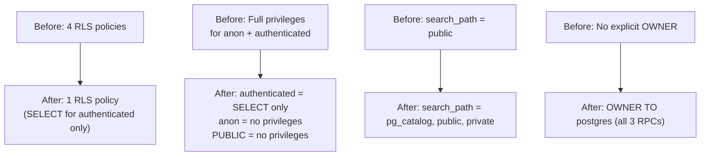

# Phase 3 / Step 3B — Focus Sessions Hardening Migration Review

**Migration:** `20261112000000_secure_focus_sessions.sql`  
**Date:** 2026-11-12 (reconciled against live schema)  
**Status:** PREPARED — NOT APPLIED  
**Reviewer:** AI Agent (Antigravity)

---

## Executive Summary

This migration removes all direct client write access to `public.focus_sessions`, revokes all privileges from `anon` and `PUBLIC` (including SELECT), and hardens the `search_path` of the three focus-session RPCs. All focus-session writes are funneled through `log_focus_session()` (SECURITY DEFINER, owned by postgres). Only `authenticated` retains SELECT access.

The frontend has been confirmed to use only RPC calls for writes and SELECT queries for reads. **Regression risk is assessed as very low** — no frontend code performs direct INSERT, UPDATE, or DELETE against `focus_sessions`, and all SELECT queries are issued by authenticated users. However, this assessment is based on static code analysis and migration-file inference. Live post-application verification (P1–P11) is required to fully confirm zero functional regression.

> [!CAUTION]
> This report verifies the **migration SQL** against its stated requirements. It does not prove the live database is secure. The live database state can only be confirmed by running pre-application queries (V1–V6) before applying the migration and post-application queries (P1–P11) after. Until the migration is applied and verified, the live database retains its current privilege configuration.

---

## Live Schema Reconciliation

Pre-application checks against the live Supabase database revealed discrepancies between the original migration assumptions and the actual live state. All have been corrected.

### Mismatches Found and Corrected

| # | Item | Original assumption | Live reality | Correction |
|---|------|---------------------|-------------|------------|
| M1 | INSERT policy name | `"Users can insert own focus sessions"` | `"Users can insert own sessions"` | DROP statement updated to match live name |
| M2 | UPDATE policy name | `"Users can update own focus sessions"` | `"Users can update own sessions"` | DROP statement updated to match live name |
| M3 | DELETE policy name | `"Users can delete own focus sessions"` | `"Users can delete own sessions"` | DROP statement updated to match live name |
| M4 | SELECT policy name (comment) | `"Users can view own focus sessions"` | `"Users can view own sessions"` | Comment updated |
| M5 | `created_at` column | Referenced in all 4 column-level REVOKEs | Column does **not exist** in live DB | Removed from all REVOKE statements |
| M6 | `session_date` type | Assumed `date` (matches CREATE TABLE migration) | Actually `text` in live DB | Explicit casts added: `to_char()` for DATE→TEXT comparisons, `::date` for TEXT→DATE assignment. V7 diagnostic required before application. |

> [!WARNING]
> **M1–M3 were critical failures.** `DROP POLICY IF EXISTS` with incorrect names would silently succeed without actually removing the live policies. The write policies would have survived the migration, leaving direct INSERT, UPDATE, and DELETE access open despite the privilege revocations.

> [!NOTE]
> **M5 would have caused a hard failure.** PostgreSQL raises an error when a `REVOKE ... (column_name)` references a column that does not exist. The entire transaction would have rolled back, applying none of the security changes.

### Root Cause

The policy names and column structure were changed outside of tracked migrations (likely via the Supabase Dashboard or manual SQL). No migration file in `supabase/migrations/` renames the policies or drops `created_at`. The original CREATE TABLE migration (`20260525174459`) defines policies with `"own focus sessions"` and includes `created_at timestamptz`.

### session_date Type Discrepancy

The CREATE TABLE migration defines `session_date date NOT NULL DEFAULT CURRENT_DATE`. The live column is `text`. This was changed outside of tracked migrations.

**RPC compatibility — explicit casts (corrected 2026-11-13):**

All implicit `text ↔ date` operations in the source RPCs have been replaced with explicit, deterministic conversions. These are **data-type compatibility changes**, not business logic changes — the streak algorithm, XP calculation, event insertion, and upsert behavior are identical to the source migrations.

| RPC | Expression (before) | Expression (after) | Rationale |
|-----|--------------------|--------------------|-----------|
| `log_focus_session` | `VALUES (..., p_session_date, ...)` | `VALUES (..., to_char(p_session_date, 'YYYY-MM-DD'), ...)` | Guarantees ISO format in TEXT column regardless of `DateStyle` |
| `calculate_streak` | `MAX(session_date) INTO v_max_date` | `MAX(session_date)::date INTO v_max_date` | Strict `::date` cast on the computed MAX value — rejects the result if it is not a valid date (unlike `to_date()` which silently wraps). Does not validate non-MAX rows; V7 is the all-row prerequisite. |
| `calculate_streak` | `session_date = p_today` | `session_date = to_char(p_today, 'YYYY-MM-DD')` | DATE→TEXT with guaranteed format; preserves index |
| `calculate_streak` | `session_date = p_today - 1` | `session_date = to_char(p_today - 1, 'YYYY-MM-DD')` | Same — date arithmetic then explicit cast |
| `calculate_streak` | `session_date = v_check_date` (loop) | `session_date = to_char(v_check_date, 'YYYY-MM-DD')` | Same — loop variable cast |

- `get_current_streak` has no direct `session_date` references — it delegates to `calculate_streak`.
- All frontend code uses `parseISO(s.session_date)` or string operations (`.slice(0, 10)`, `.startsWith()`) — fully compatible with `text` storage.

**Why `to_char()` for comparisons (not `::date` on the column):**
- `session_date::date = p_today` would cast every row's TEXT value, preventing index usage on `session_date`.
- `session_date = to_char(p_today, 'YYYY-MM-DD')` performs a TEXT = TEXT comparison, which can use the existing unique index on `(user_id, session_date)`.
- `to_char(date, 'YYYY-MM-DD')` always produces ISO 8601 format, regardless of the server's `DateStyle` setting.

**Why `::date` for TEXT→DATE assignment (not `to_date()`):**

PostgreSQL's `to_date(text, format)` is **not** strict format validation:
- `to_date('2026-02-30', 'YYYY-MM-DD')` → silently wraps to `2026-03-02` (no error)
- `to_date('2026-1-5', 'YYYY-MM-DD')` → parses leniently, may produce unexpected results

PostgreSQL's `::date` cast (the `date` type input parser) **is** strict:
- `'2026-02-30'::date` → **ERROR: date/time field value out of range**
- `'not-a-date'::date` → **ERROR: invalid input syntax for type date**
- ISO 8601 format ('YYYY-MM-DD') is always accepted unambiguously regardless of `DateStyle`

The `::date` cast is used for the `MAX()` assignment because it provides fail-fast behavior on the selected maximum value: if the lexicographically largest `session_date` for a user is not a valid date, the query errors rather than producing a silently incorrect streak. However, `MAX()` only casts one value per query execution — it does not scan or validate every row. An invalid value that sorts below the maximum would not be cast and would not trigger an error. **V7 is the all-row prerequisite** that ensures every stored value is valid before the migration is applied.

**Prerequisite — data integrity:**
The `MAX(session_date)::date` cast validates only the lexicographic maximum for the queried user — not every row. An invalid value that sorts below the maximum would go undetected at runtime. **V7 MUST be run before applying the migration** to confirm that *all* stored values are valid ISO 8601 dates. If V7 reports any invalid values, this migration MUST NOT be applied until the data is corrected.

**Conclusion:** The type discrepancy is now handled with explicit, deterministic casts. No implicit operator resolution or `DateStyle`-dependent behavior remains. The migration cannot be marked ready to apply until V7 confirms clean data. A separate future migration could normalize the column type to `date`, but that is out of scope for this security hardening step.

### Live Column Set (Confirmed)

| Column | Type | Exists in migration REVOKEs |
|--------|------|-----------------------------|
| `id` | uuid | ✅ |
| `user_id` | uuid | ✅ |
| `session_date` | text | ✅ |
| `minutes` | integer | ✅ |
| `sessions_count` | integer | ✅ |
| `created_at` | — | ❌ Removed (does not exist live) |

---

## Verification Matrix

| # | Requirement | Status | Evidence |
|---|------------|--------|----------|
| 1 | INSERT policy dropped | **PASS** | `DROP POLICY IF EXISTS "Users can insert own sessions"` — matches live name |
| 2 | UPDATE policy dropped | **PASS** | `DROP POLICY IF EXISTS "Users can update own sessions"` — matches live name |
| 3 | DELETE policy dropped | **PASS** | `DROP POLICY IF EXISTS "Users can delete own sessions"` — matches live name |
| 4 | SELECT policy preserved | **PASS** | No DROP for `"Users can view own sessions"` |
| 5 | Policy names match live DB | **PASS** | Reconciled against pre-application query results |
| 6 | Table-level INSERT/UPDATE/DELETE/TRUNCATE/REFERENCES/TRIGGER revoked from `authenticated` | **PASS** | Explicit REVOKE statement (line 63) |
| 7 | Table-level ALL privileges revoked from `anon` (including SELECT) | **PASS** | `REVOKE SELECT, INSERT, UPDATE, DELETE, TRUNCATE, REFERENCES, TRIGGER` (line 66) |
| 8 | Table-level ALL privileges revoked from `PUBLIC` (including SELECT) | **PASS** | `REVOKE SELECT, INSERT, UPDATE, DELETE, TRUNCATE, REFERENCES, TRIGGER` (line 69) |
| 9 | Column-level INSERT revoked (5 live columns) | **PASS** | `REVOKE INSERT (id, user_id, session_date, minutes, sessions_count)` — no `created_at` |
| 10 | Column-level UPDATE revoked (5 live columns) | **PASS** | `REVOKE UPDATE (...)` — no `created_at` |
| 11 | Column-level REFERENCES revoked (5 live columns) | **PASS** | `REVOKE REFERENCES (...)` — no `created_at` |
| 12 | Column-level SELECT revoked from `anon` and `PUBLIC` (5 live columns) | **PASS** | `REVOKE SELECT (...) FROM anon, PUBLIC` — no `created_at` |
| 13 | Column-level SELECT NOT revoked from `authenticated` | **PASS** | `authenticated` excluded from column-level SELECT revocation |
| 14 | Table-level SELECT preserved for `authenticated` | **PASS** | `GRANT SELECT ON public.focus_sessions TO authenticated` (line 95) |
| 15 | `service_role` privileges NOT modified | **PASS** | No REVOKE/GRANT targeting `service_role` |
| 16 | `log_focus_session` signature preserved | **PASS** | `(DATE, INTEGER, TEXT, DATE)` — matches source |
| 17 | `log_focus_session` return contract preserved | **PASS** | 9-column TABLE return — matches source |
| 18 | `log_focus_session` body preserves logic | **PASS** | Identical to source except `to_char(p_session_date, 'YYYY-MM-DD')` on INSERT — explicit cast for TEXT column |
| 19 | `log_focus_session` SECURITY DEFINER | **PASS** | Present in CREATE statement |
| 20 | `log_focus_session` search_path hardened | **PASS** | `pg_catalog, public, private` (was `public`) |
| 21 | `log_focus_session` OWNER TO postgres | **PASS** | ALTER FUNCTION after CREATE |
| 22 | `log_focus_session` EXECUTE grant | **PASS** | REVOKE ALL FROM PUBLIC → GRANT TO authenticated |
| 23 | `log_focus_session` INSERT uses explicit `to_char()` | **PASS** | `to_char(p_session_date, 'YYYY-MM-DD')` — guarantees ISO format in TEXT column regardless of DateStyle |
| 24 | `calculate_streak` signature preserved | **PASS** | `(UUID, DATE)` — matches source |
| 25 | `calculate_streak` body preserves logic | **PASS** | Identical streak logic; explicit `::date` cast for MAX assignment, `to_char()` for 4 comparisons — replaces all implicit casts |
| 26 | `calculate_streak` SECURITY DEFINER | **PASS** | Present in CREATE statement |
| 27 | `calculate_streak` search_path hardened | **PASS** | `pg_catalog, public, private` (was `public`) |
| 28 | `calculate_streak` OWNER TO postgres | **PASS** | ALTER FUNCTION after CREATE |
| 29 | `calculate_streak` EXECUTE fully revoked | **PASS** | `REVOKE ALL ... FROM PUBLIC, anon, authenticated` |
| 30 | `calculate_streak` MAX uses strict `::date` cast | **PASS** | `MAX(session_date)::date` — strict cast validates the computed maximum value; `to_date()` was avoided because it silently wraps invalid dates. V7 is the all-row prerequisite. |
| 31 | `calculate_streak` comparisons use explicit `to_char()` | **PASS** | All 4 WHERE clauses use `to_char(date_param, 'YYYY-MM-DD')` — preserves index, guarantees format |
| 32 | `get_current_streak` signature preserved | **PASS** | `(DATE)` — matches source |
| 33 | `get_current_streak` body identical | **PASS** | Byte-for-byte copy from source (no direct `session_date` references) |
| 34 | `get_current_streak` SECURITY DEFINER | **PASS** | Present in CREATE statement |
| 35 | `get_current_streak` search_path hardened | **PASS** | `pg_catalog, public, private` (was `public`) |
| 36 | `get_current_streak` OWNER TO postgres | **PASS** | ALTER FUNCTION after CREATE |
| 37 | `get_current_streak` EXECUTE grant | **PASS** | REVOKE ALL FROM PUBLIC → GRANT TO authenticated |
| 38 | No existing data modified | **PASS** | No UPDATE/DELETE/TRUNCATE on data rows |
| 39 | No XP balances modified | **PASS** | No writes to `profiles.xp` or `events` |
| 40 | FORCE ROW LEVEL SECURITY not enabled | **PASS** | No `ALTER TABLE ... FORCE` |
| 41 | No unrelated tables/functions changed | **PASS** | Only `focus_sessions` table and 3 RPCs |
| 42 | Transaction boundaries correct | **PASS** | `BEGIN` / `COMMIT` wrapping all statements |
| 43 | PostgREST reload included | **PASS** | `NOTIFY pgrst, 'reload schema'` before COMMIT |
| 44 | RPC business logic unchanged | **PASS** | Streak logic, XP calculation, event insertion, and upsert behavior are identical. Only `search_path` and date cast explicitness differ. |
| 45 | `award_xp_internal` not modified | **PASS** | Not referenced in migration |
| 46 | No credentials/secrets exposed | **PASS** | No hardcoded secrets |
| 47 | No `created_at` references remain | **PASS** | Removed from all 4 column-level REVOKE statements |

---

## Source Migration Cross-Reference

| Function | Authoritative Source | Lines |
|----------|---------------------|-------|
| `log_focus_session` | `20260708180000_fix_events_index_and_constraint.sql` | 27–168 |
| `calculate_streak` | `20260707120000_streak_calculation_repair.sql` | 4–63 |
| `get_current_streak` | `20260707120000_streak_calculation_repair.sql` | 219–279 |
| Table + policies (original) | `20260525174459_create_spendwise_tables.sql` | 123–153 |

> [!NOTE]
> The original CREATE TABLE migration defines policies as `"own focus sessions"` and includes `created_at timestamptz`. The live database differs from these definitions — changes were made outside of tracked migrations.

---

## Pre-Application Verification Queries

Run these against the live database **before** applying the migration to confirm current state matches assumptions.

### V1. Confirm write policies exist with live names

```sql
SELECT policyname, cmd, roles, qual, with_check
FROM pg_policies
WHERE tablename = 'focus_sessions'
  AND schemaname = 'public'
ORDER BY policyname;
```

**Expected:** Four policies with names matching `"Users can ... own sessions"` (not `"own focus sessions"`):
- `Users can delete own sessions` — DELETE
- `Users can insert own sessions` — INSERT
- `Users can update own sessions` — UPDATE
- `Users can view own sessions` — SELECT

All for role `{authenticated}`.

### V2. Confirm current table privileges

```sql
SELECT grantee, privilege_type
FROM information_schema.table_privileges
WHERE table_schema = 'public'
  AND table_name = 'focus_sessions'
  AND grantee IN ('anon', 'authenticated')
ORDER BY grantee, privilege_type;
```

**Expected:** `authenticated` and `anon` both have INSERT, UPDATE, DELETE, SELECT, TRUNCATE, REFERENCES, TRIGGER.

### V3. Confirm current column-level privileges and live columns

```sql
SELECT grantee, column_name, privilege_type
FROM information_schema.column_privileges
WHERE table_schema = 'public'
  AND table_name = 'focus_sessions'
  AND grantee IN ('anon', 'authenticated', 'PUBLIC')
ORDER BY grantee, column_name, privilege_type;
```

### V4. Confirm live columns (verify no created_at)

```sql
SELECT column_name, data_type, is_nullable
FROM information_schema.columns
WHERE table_schema = 'public'
  AND table_name = 'focus_sessions'
ORDER BY ordinal_position;
```

**Expected:** 5 columns — `id` (uuid), `user_id` (uuid), `session_date` (text), `minutes` (integer), `sessions_count` (integer). No `created_at`.

### V5. Confirm current function search_paths

```sql
SELECT
  p.proname,
  pg_get_function_arguments(p.oid) AS args,
  p.proowner::regrole AS owner,
  p.prosecdef AS security_definer,
  array_to_string(p.proconfig, ', ') AS config
FROM pg_proc p
JOIN pg_namespace n ON p.pronamespace = n.oid
WHERE n.nspname = 'public'
  AND p.proname IN ('log_focus_session', 'calculate_streak', 'get_current_streak')
ORDER BY p.proname;
```

**Expected:** All three show `search_path=public`, owner `postgres`, `security_definer = true`.

### V6. Confirm current EXECUTE grants

```sql
SELECT
  p.proname,
  pg_get_function_arguments(p.oid) AS args,
  r.rolname AS grantee,
  has_function_privilege(r.rolname, p.oid, 'EXECUTE') AS can_execute
FROM pg_proc p
JOIN pg_namespace n ON p.pronamespace = n.oid
CROSS JOIN (
  SELECT rolname FROM pg_roles 
  WHERE rolname IN ('anon', 'authenticated', 'service_role')
) r
WHERE n.nspname = 'public'
  AND p.proname IN ('log_focus_session', 'calculate_streak', 'get_current_streak')
ORDER BY p.proname, r.rolname;
```

**Expected:**

| Function | anon | authenticated | service_role |
|----------|------|---------------|--------------|
| `log_focus_session` | false | true | true |
| `calculate_streak` | false | false | true |
| `get_current_streak` | false | true | true |

### V7. Diagnostic — validate all session_date values (MANDATORY)

> [!CAUTION]
> This diagnostic **MUST** be run and its results reviewed before applying the migration. The `MAX(session_date)::date` cast in `calculate_streak` (migration line 291) validates only the lexicographic maximum for the queried user — not every stored row. An invalid value that sorts below the maximum would go undetected at runtime. V7 is the all-row prerequisite that ensures every value is a valid ISO 8601 date before the migration is applied.

**V7a. PostgreSQL version check:**

```sql
SELECT version();
```

Note the major version. `pg_input_is_valid()` is available in PostgreSQL 16+. This determines whether to use V7d/V7e (PG 16+, preferred) or V7f/V7g (older versions, safe fallback).

**V7b. Summary — format check (all PG versions):**

This counts rows by format category. It does **not** detect impossible calendar dates (e.g., `'2026-02-30'`) — those require V7d or V7f.

```sql
SELECT
  COUNT(*) AS total_rows,
  COUNT(CASE WHEN session_date IS NULL THEN 1 END) AS null_count,
  COUNT(CASE WHEN session_date = '' THEN 1 END) AS empty_count,
  COUNT(CASE WHEN session_date IS NOT NULL AND session_date <> ''
             AND session_date !~ '^\d{4}-\d{2}-\d{2}$' THEN 1 END) AS non_iso_format_count,
  COUNT(CASE WHEN session_date ~ '^\d{4}-\d{2}-\d{2}$' THEN 1 END) AS iso_format_count
FROM public.focus_sessions;
```

**Expected:** `null_count = 0`, `empty_count = 0`, `non_iso_format_count = 0`, `iso_format_count = total_rows`.

**V7c. Summary — non-format offenders (all PG versions):**

Lists every row that is NULL, empty, or does not match `YYYY-MM-DD` regex format. Does **not** catch impossible dates.

```sql
SELECT id, user_id, session_date,
  CASE
    WHEN session_date IS NULL THEN 'NULL'
    WHEN session_date = '' THEN 'EMPTY'
    ELSE 'NOT_ISO_FORMAT'
  END AS status
FROM public.focus_sessions
WHERE session_date IS NULL
   OR session_date = ''
   OR session_date !~ '^\d{4}-\d{2}-\d{2}$'
ORDER BY session_date;
```

**Expected:** Zero rows.

---

**Choose one of the following paths based on V7a results:**

#### Path A — PostgreSQL 16+ (preferred)

**V7d. Complete validity check — all categories including impossible dates (PG 16+):**

`pg_input_is_valid(text, type)` returns `false` for any value that would cause `::date` to error, without aborting the query. This catches NULL handling, empty strings, non-ISO formats, **and** impossible calendar dates like `'2026-02-30'` — all in one safe query.

```sql
SELECT
  COUNT(*) AS total_rows,
  COUNT(CASE WHEN session_date IS NULL THEN 1 END) AS null_count,
  COUNT(CASE WHEN session_date = '' THEN 1 END) AS empty_count,
  COUNT(CASE WHEN session_date IS NOT NULL AND session_date <> ''
             AND NOT pg_input_is_valid(session_date, 'date') THEN 1 END) AS invalid_date_count,
  COUNT(CASE WHEN session_date IS NOT NULL AND session_date <> ''
             AND pg_input_is_valid(session_date, 'date')
             AND session_date !~ '^\d{4}-\d{2}-\d{2}$' THEN 1 END) AS parseable_but_non_canonical_count,
  COUNT(CASE WHEN session_date ~ '^\d{4}-\d{2}-\d{2}$'
             AND pg_input_is_valid(session_date, 'date') THEN 1 END) AS valid_canonical_count
FROM public.focus_sessions;
```

**Expected:** `null_count = 0`, `empty_count = 0`, `invalid_date_count = 0`, `parseable_but_non_canonical_count = 0`, `valid_canonical_count = total_rows`.

**V7e. List every offending row with reason (PG 16+):**

```sql
SELECT id, user_id, session_date,
  CASE
    WHEN session_date IS NULL THEN 'NULL'
    WHEN session_date = '' THEN 'EMPTY'
    WHEN NOT pg_input_is_valid(session_date, 'date') THEN 'INVALID_DATE'
    WHEN session_date !~ '^\d{4}-\d{2}-\d{2}$' THEN 'PARSEABLE_BUT_NON_CANONICAL'
    ELSE 'UNKNOWN'
  END AS status
FROM public.focus_sessions
WHERE session_date IS NULL
   OR session_date = ''
   OR NOT pg_input_is_valid(session_date, 'date')
   OR session_date !~ '^\d{4}-\d{2}-\d{2}$'
ORDER BY status, session_date;
```

**Expected:** Zero rows. If any rows are returned, the `status` column identifies the category:
- `NULL` — session_date is NULL
- `EMPTY` — session_date is an empty string
- `INVALID_DATE` — cannot be cast to `date` (includes impossible dates like `'2026-02-30'`, garbage strings, etc.)
- `PARSEABLE_BUT_NON_CANONICAL` — parses as a valid date but is not in exact `YYYY-MM-DD` format (e.g., `'2026-1-5'`)

#### Path B — PostgreSQL < 16 (safe fallback)

**V7f. Safe impossible-date detection without pg_input_is_valid (PG < 16):**

This query uses a `CASE`-based approach that guarantees substring-to-integer casts are only evaluated after the regex confirms the value is in `YYYY-MM-DD` format. This avoids the PostgreSQL behavior where `OR` conditions in a `WHERE` clause may be evaluated in any order, which could cause a `CAST` to abort on a non-numeric substring before the regex branch excludes the row.

The query validates: NULL, empty, non-ISO format, year `0000` (PostgreSQL rejects `'0000-01-01'::date`), month range, day range per month, and leap-year rules (including century and 400-year exceptions).

> [!NOTE]
> This query cannot detect every edge case that `::date` would reject. For example, values with valid-looking components that `::date` rejects for other reasons (e.g., very large years outside PostgreSQL's supported range) would pass V7f but fail V7g. The PG 16+ path (V7d/V7e using `pg_input_is_valid`) is the only fully comprehensive safe check. If V7f returns zero rows but V7g still aborts, report the error and investigate manually.

```sql
SELECT id, user_id, session_date, status
FROM (
  SELECT id, user_id, session_date,
    CASE
      WHEN session_date IS NULL THEN 'NULL'
      WHEN session_date = '' THEN 'EMPTY'
      WHEN session_date !~ '^\d{4}-\d{2}-\d{2}$' THEN 'NOT_ISO_FORMAT'
      -- From here, regex guarantees YYYY-MM-DD shape, so substring casts are safe
      WHEN CAST(substring(session_date FROM 1 FOR 4) AS integer) = 0
        THEN 'INVALID_YEAR_ZERO'
      WHEN CAST(substring(session_date FROM 6 FOR 2) AS integer) NOT BETWEEN 1 AND 12
        THEN 'INVALID_MONTH'
      WHEN CAST(substring(session_date FROM 9 FOR 2) AS integer) < 1
        THEN 'INVALID_DAY_ZERO'
      -- 31-day months: 1,3,5,7,8,10,12
      WHEN CAST(substring(session_date FROM 6 FOR 2) AS integer) IN (1,3,5,7,8,10,12)
           AND CAST(substring(session_date FROM 9 FOR 2) AS integer) > 31
        THEN 'INVALID_DAY_FOR_MONTH'
      -- 30-day months: 4,6,9,11
      WHEN CAST(substring(session_date FROM 6 FOR 2) AS integer) IN (4,6,9,11)
           AND CAST(substring(session_date FROM 9 FOR 2) AS integer) > 30
        THEN 'INVALID_DAY_FOR_MONTH'
      -- February: max 29 in leap year, max 28 otherwise
      WHEN CAST(substring(session_date FROM 6 FOR 2) AS integer) = 2
           AND CAST(substring(session_date FROM 9 FOR 2) AS integer) > 29
        THEN 'INVALID_DAY_FOR_FEB'
      WHEN CAST(substring(session_date FROM 6 FOR 2) AS integer) = 2
           AND CAST(substring(session_date FROM 9 FOR 2) AS integer) = 29
           AND NOT (
             CAST(substring(session_date FROM 1 FOR 4) AS integer) % 4 = 0
             AND (CAST(substring(session_date FROM 1 FOR 4) AS integer) % 100 <> 0
                  OR CAST(substring(session_date FROM 1 FOR 4) AS integer) % 400 = 0)
           )
        THEN 'FEB_29_NON_LEAP_YEAR'
      ELSE NULL  -- valid
    END AS status
  FROM public.focus_sessions
) sub
WHERE status IS NOT NULL
ORDER BY status, session_date;
```

**Expected:** Zero rows.

**Limitations:** This query handles the most common classes of invalid dates but is **not equivalent** to `pg_input_is_valid()`. Edge cases it cannot detect include years outside PostgreSQL's supported range (4713 BC – 5874897 AD) and other inputs that `::date` rejects for implementation-specific reasons. If this query returns zero rows, V7g (guarded round-trip) provides a secondary confirmation. If V7g aborts despite V7f passing, the data contains a value that V7f's arithmetic did not cover — report the error and investigate manually.

**V7g. Guarded round-trip verification (PG < 16, run only if V7f returns zero rows):**

After V7f confirms no structurally impossible dates, this round-trip test safely verifies that every value survives `text → date → text` exactly. Run this **only** after V7f returns zero rows (otherwise `::date` may abort).

```sql
SELECT id, user_id, session_date,
  session_date::date AS parsed_date,
  to_char(session_date::date, 'YYYY-MM-DD') AS round_tripped
FROM public.focus_sessions
WHERE session_date <> to_char(session_date::date, 'YYYY-MM-DD')
ORDER BY session_date;
```

**Expected:** Zero rows. Any row returned has a `session_date` that does not round-trip to its original value.

> [!WARNING]
> V7g uses an unguarded `::date` cast. It will abort with an error if any value is not a valid date. Only run it after V7f confirms zero structurally invalid rows. If V7g aborts, there is a date value that V7f's range checks did not catch — report the error and STOP.

---

**Interpretation:**
- **PG 16+:** If V7b shows all zeros except `iso_format_count`, AND V7d shows `invalid_date_count = 0` and `parseable_but_non_canonical_count = 0` → data is clean. Migration may proceed.
- **PG < 16:** If V7b shows all zeros except `iso_format_count`, AND V7f returns zero rows, AND V7g returns zero rows → data is clean. Migration may proceed.
- If **any** diagnostic shows non-zero invalid counts or returns rows → **STOP. Do not apply the migration.** Report the offending rows (from V7e or V7f) for manual remediation.
- Do not claim V7 is clean until actual live results have been reviewed.

---

## Post-Application Verification Queries

Run these **after** applying the migration to confirm changes took effect.

### P1. Confirm only SELECT policy remains

```sql
SELECT policyname, cmd, roles
FROM pg_policies
WHERE tablename = 'focus_sessions'
  AND schemaname = 'public'
ORDER BY policyname;
```

**Expected:** Only `"Users can view own sessions"` with `cmd = SELECT`.

### P2. Confirm table-level privileges — authenticated

```sql
SELECT grantee, privilege_type
FROM information_schema.table_privileges
WHERE table_schema = 'public'
  AND table_name = 'focus_sessions'
  AND grantee = 'authenticated'
ORDER BY privilege_type;
```

**Expected:** Only `SELECT`. No INSERT, UPDATE, DELETE, TRUNCATE, REFERENCES, or TRIGGER.

### P3. Confirm table-level privileges — anon has NONE

```sql
SELECT grantee, privilege_type
FROM information_schema.table_privileges
WHERE table_schema = 'public'
  AND table_name = 'focus_sessions'
  AND grantee = 'anon';
```

**Expected:** Zero rows — `anon` has no table-level privileges at all.

### P4. Confirm no residual column-level grants for anon, authenticated, or PUBLIC

```sql
SELECT grantee, column_name, privilege_type
FROM information_schema.column_privileges
WHERE table_schema = 'public'
  AND table_name = 'focus_sessions'
  AND grantee IN ('anon', 'authenticated', 'PUBLIC')
ORDER BY grantee, column_name, privilege_type;
```

**Expected:**
- `anon`: zero rows — no column-level grants of any type.
- `PUBLIC`: zero rows — no column-level grants of any type.
- `authenticated`: only SELECT rows (if column-level SELECT grants exist); no INSERT, UPDATE, or REFERENCES rows.

> [!NOTE]
> `information_schema.column_privileges` reports grants made directly to the named grantee. It does not surface privileges inherited through role membership (e.g., a role that is a member of `PUBLIC`). Use P5 to inspect direct ACL entries and P6 to check effective (inherited) privileges.

### P5. Inspect direct table-level ACL grants to PUBLIC via pg_class

This query decomposes the raw ACL array stored on `pg_class` to reveal direct grants made to `PUBLIC` (represented by `grantee = 0` in `aclexplode`). Unlike `has_table_privilege`, this shows only direct grants — not privileges inherited through role membership.

```sql
SELECT
  c.relname AS table_name,
  a.grantor::regrole AS grantor,
  CASE WHEN a.grantee = 0 THEN 'PUBLIC' ELSE a.grantee::regrole::text END AS grantee,
  a.privilege_type,
  a.is_grantable
FROM pg_class c
JOIN pg_namespace n ON c.relnamespace = n.oid
CROSS JOIN LATERAL aclexplode(c.relacl) AS a
WHERE n.nspname = 'public'
  AND c.relname = 'focus_sessions'
  AND a.grantee = 0
ORDER BY a.privilege_type;
```

**Expected (post-application):** Zero rows — no direct grants to `PUBLIC` remain on `public.focus_sessions`.

**Pre-application note:** Before applying the migration, this query will likely return rows for every privilege type granted to `PUBLIC` by default (SELECT, INSERT, UPDATE, DELETE, TRUNCATE, REFERENCES, TRIGGER — originating from `ALTER DEFAULT PRIVILEGES FOR ROLE postgres`). After the migration, the `REVOKE ... FROM PUBLIC` statements should remove all of these entries.

> [!IMPORTANT]
> This query inspects direct ACL entries only. Even if zero rows are returned, a role could still have effective access through membership in another role that retains privileges. P6 (`has_table_privilege`) checks effective access, which includes inherited privileges.

### P6. Confirm effective privileges via has_table_privilege and has_any_column_privilege

This query checks **effective** access for a role, including privileges inherited through role membership (e.g., if `anon` or `authenticated` is a member of a role that retains grants). This complements P4 (column-level direct grants) and P5 (table-level direct ACL entries).

- `has_table_privilege()` checks effective **table-level** access — whether the role can perform the operation based on table-level grants (direct or inherited).
- `has_any_column_privilege()` checks effective **column-level** access — whether the role holds the privilege on at least one column, even if no table-level grant exists. A column-level grant that survives a table-level revocation would be detected here.

Both must be checked because PostgreSQL evaluates table-level and column-level grants independently. A table-level `REVOKE` does not remove column-level grants, and vice versa.

**P6a. Table-level effective privileges:**

```sql
SELECT
  has_table_privilege('authenticated', 'public.focus_sessions', 'SELECT') AS auth_select,
  has_table_privilege('authenticated', 'public.focus_sessions', 'INSERT') AS auth_insert,
  has_table_privilege('authenticated', 'public.focus_sessions', 'UPDATE') AS auth_update,
  has_table_privilege('authenticated', 'public.focus_sessions', 'DELETE') AS auth_delete,
  has_table_privilege('authenticated', 'public.focus_sessions', 'TRUNCATE') AS auth_truncate,
  has_table_privilege('authenticated', 'public.focus_sessions', 'REFERENCES') AS auth_references,
  has_table_privilege('authenticated', 'public.focus_sessions', 'TRIGGER') AS auth_trigger,
  has_table_privilege('anon', 'public.focus_sessions', 'SELECT') AS anon_select,
  has_table_privilege('anon', 'public.focus_sessions', 'INSERT') AS anon_insert,
  has_table_privilege('anon', 'public.focus_sessions', 'UPDATE') AS anon_update,
  has_table_privilege('anon', 'public.focus_sessions', 'DELETE') AS anon_delete,
  has_table_privilege('anon', 'public.focus_sessions', 'TRUNCATE') AS anon_truncate,
  has_table_privilege('anon', 'public.focus_sessions', 'REFERENCES') AS anon_references,
  has_table_privilege('anon', 'public.focus_sessions', 'TRIGGER') AS anon_trigger;
```

**Expected (table-level):**

| Role | SELECT | INSERT | UPDATE | DELETE | TRUNCATE | REFERENCES | TRIGGER |
|------|--------|--------|--------|--------|----------|------------|---------|
| authenticated | true | false | false | false | false | false | false |
| anon | false | false | false | false | false | false | false |

**P6b. Column-level effective privileges:**

```sql
SELECT
  has_any_column_privilege('authenticated', 'public.focus_sessions', 'SELECT') AS auth_col_select,
  has_any_column_privilege('authenticated', 'public.focus_sessions', 'INSERT') AS auth_col_insert,
  has_any_column_privilege('authenticated', 'public.focus_sessions', 'UPDATE') AS auth_col_update,
  has_any_column_privilege('anon', 'public.focus_sessions', 'SELECT') AS anon_col_select,
  has_any_column_privilege('anon', 'public.focus_sessions', 'INSERT') AS anon_col_insert,
  has_any_column_privilege('anon', 'public.focus_sessions', 'UPDATE') AS anon_col_update;
```

**Expected (column-level):**

| Role | SELECT | INSERT | UPDATE |
|------|--------|--------|--------|
| authenticated | true | false | false |
| anon | false | false | false |

> [!NOTE]
> `authenticated` showing `true` for column-level SELECT is expected — the migration explicitly grants table-level SELECT to `authenticated`, which implies column-level SELECT access. If `anon` shows `true` for any privilege, a residual column-level grant or inherited role membership is leaking access and must be investigated.

### P7. Confirm hardened search_paths

```sql
SELECT
  p.proname,
  pg_get_function_arguments(p.oid) AS args,
  p.proowner::regrole AS owner,
  p.prosecdef AS security_definer,
  array_to_string(p.proconfig, ', ') AS config
FROM pg_proc p
JOIN pg_namespace n ON p.pronamespace = n.oid
WHERE n.nspname = 'public'
  AND p.proname IN ('log_focus_session', 'calculate_streak', 'get_current_streak')
ORDER BY p.proname;
```

**Expected:** All three show:
- `owner`: `postgres`
- `security_definer`: `true`
- `config`: `search_path=pg_catalog, public, private`

### P8. Confirm EXECUTE grants post-application

```sql
SELECT
  p.proname,
  r.rolname AS grantee,
  has_function_privilege(r.rolname, p.oid, 'EXECUTE') AS can_execute
FROM pg_proc p
JOIN pg_namespace n ON p.pronamespace = n.oid
CROSS JOIN (
  SELECT rolname FROM pg_roles 
  WHERE rolname IN ('anon', 'authenticated', 'service_role')
) r
WHERE n.nspname = 'public'
  AND p.proname IN ('log_focus_session', 'calculate_streak', 'get_current_streak')
ORDER BY p.proname, r.rolname;
```

**Expected:**

| Function | anon | authenticated | service_role |
|----------|------|---------------|--------------|
| `log_focus_session` | false | true | true |
| `calculate_streak` | false | false | true |
| `get_current_streak` | false | true | true |

### P9. Confirm service_role unchanged

```sql
SELECT
  has_table_privilege('service_role', 'public.focus_sessions', 'SELECT') AS sr_select,
  has_table_privilege('service_role', 'public.focus_sessions', 'INSERT') AS sr_insert,
  has_table_privilege('service_role', 'public.focus_sessions', 'UPDATE') AS sr_update,
  has_table_privilege('service_role', 'public.focus_sessions', 'DELETE') AS sr_delete;
```

**Expected:** All `true` — `service_role` not affected.

### P10. Smoke-test: authenticated direct INSERT should fail

```sql
-- Run as authenticated user (via Supabase client):
-- supabase.from('focus_sessions').insert({ session_date: '2026-01-01', minutes: 10 })
-- Expected: Permission denied (privilege revoked) or RLS violation
```

### P11. Smoke-test: RPC still works

```sql
-- Run as authenticated user (via Supabase client):
-- supabase.rpc('log_focus_session', { p_session_date: '...', p_minutes: 25, p_reference_id: 'test-...', p_today: '...' })
-- Expected: Success — returns 9-column result
```

> [!WARNING]
> P10 and P11 involve writes and must be tested in a staging environment or with a disposable test account — never against production data without authorization.

---

## Risk Assessment

| Risk | Likelihood | Mitigation |
|------|-----------|------------|
| Frontend direct INSERT/UPDATE breaks | **Very Low** | Static analysis confirms no frontend code does direct writes to `focus_sessions`. Based on codebase inspection — not live testing. |
| `log_focus_session` RPC breaks | **Very Low** | Business logic identical to source. `to_char()` on INSERT guarantees ISO format in TEXT column. `search_path` hardened; all table references are schema-qualified (`public.`). Requires V7 clean data. |
| `calculate_streak` breaks | **Very Low** | Business logic identical to source. `to_char()` comparisons preserve index usage. `::date` cast on MAX validates only the computed maximum value, not every row — V7 is the all-row prerequisite. Requires V7 clean data. |
| `get_current_streak` breaks | **Very Low** | Body identical to source. Delegates to `calculate_streak` — no direct `session_date` references. |
| `service_role` admin access breaks | **None** | No REVOKE targets `service_role`. |
| SELECT queries break in Analytics/Reports | **Very Low** | `GRANT SELECT TO authenticated` explicitly preserved. Frontend SELECT queries are issued by authenticated users. Confirm with P6. |
| `anon` SELECT loss causes regression | **Very Low** | No frontend code accesses `focus_sessions` as an unauthenticated user. All Supabase client calls are gated by auth state (checked in `useStore.ts`, `useTimerEngine.ts`). |
| Column-level grants survive table-level revoke | **Low** | Explicit column-level revocations (INSERT, UPDATE, REFERENCES, SELECT) on all 5 live columns act as defense-in-depth. Verify with P4 and P6b. |
| Malformed `session_date` causes runtime error | **Unknown** | `MAX(session_date)::date` in `calculate_streak` (migration line 291) validates only the lexicographic maximum for the queried user — not every row. An invalid value sorting below the maximum would go undetected at runtime. V7 diagnostic (V7d/V7e on PG 16+, or V7f/V7g on PG < 16) MUST be run before application to confirm all rows contain valid ISO 8601 dates. Risk cannot be assessed until V7 results are reviewed. |

> [!NOTE]
> Risk assessments of "Very Low" (rather than "None") reflect that static code analysis cannot guarantee the absence of all edge cases. Live post-application verification is required to confirm zero functional regression.

---

## Changes Summary



---

## Post-Migration Privilege Summary

| Role | SELECT | INSERT | UPDATE | DELETE | TRUNCATE | REFERENCES | TRIGGER |
|------|--------|--------|--------|--------|----------|------------|---------|
| `authenticated` | ✅ | ❌ | ❌ | ❌ | ❌ | ❌ | ❌ |
| `anon` | ❌ | ❌ | ❌ | ❌ | ❌ | ❌ | ❌ |
| `PUBLIC` | ❌ | ❌ | ❌ | ❌ | ❌ | ❌ | ❌ |
| `service_role` | ✅ (unchanged) | ✅ (unchanged) | ✅ (unchanged) | ✅ (unchanged) | ✅ (unchanged) | ✅ (unchanged) | ✅ (unchanged) |

---

## Frontend Application References

All confirmed SELECT-only or RPC-only access (no direct writes):

| File | Access Pattern | Columns Referenced |
|------|---------------|-------------------|
| `useStore.ts:82` | `SELECT *` with `.gte('session_date', ...)` | All |
| `Analytics.tsx:120` | `SELECT id, session_date, minutes, sessions_count` | 4 of 5 |
| `Reports.tsx:182` | `SELECT *` with `.gte/.lt('session_date', ...)` | All |
| `friendService.ts:344-347` | `SELECT` with `.gte('session_date', ...)` | Subset |
| `useTimerEngine.ts:138-139` | `supabase.rpc('log_focus_session', {...})` | RPC only |
| `useStore.ts:93` | `supabase.rpc('get_current_streak', {...})` | RPC only |

**TypeScript types** (`src/store/slices/types.ts:168-173`): `FocusSession` has 4 fields: `id`, `session_date` (string), `minutes`, `sessions_count`. No `created_at`. No `user_id`.

**Supabase types** (`src/lib/supabase.ts:65-73`): `focus_sessions.Row` has 6 fields including `user_id` and `created_at`. This type definition is stale relative to the live schema — `created_at` does not exist in the live database. This is a pre-existing inconsistency and not introduced by this migration.

---

## Conclusion

**47 verification criteria: PASS** (migration SQL review only — not a claim about live database state or data integrity)

**1 prerequisite: PENDING** — V7 diagnostic must be run against the live database and its results independently reviewed before this migration can be applied.

The migration has been reconciled against the confirmed live schema. It is ready for independent review, but **not ready to apply** until:
1. V7 confirms all `session_date` values are valid ISO 8601 dates.
2. Pre-application queries V1–V6 confirm live state matches remaining assumptions.

> [!IMPORTANT]
> This migration has been **PREPARED but NOT APPLIED**. Do not apply without explicit authorization. Run V7 first to validate `session_date` data integrity. Then run V1–V6 to confirm live state. After application, run P1–P11 to validate changes. The live database is not secured until this migration is successfully applied and all post-application verification passes.

**No migration was applied. No database records were changed. No live schema was modified.**
