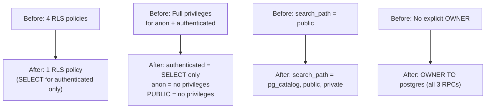

# Phase 3 / Step 3B — Focus Sessions Hardening Migration Review

**Migration:** `20261112000000_secure_focus_sessions.sql`  
**Date:** 2026-11-12 (reconciled against live schema)  
**Status:** PREPARED — NOT APPLIED  
**Reviewer:** AI Agent (Antigravity)

---

## Executive Summary

This migration removes all direct client write access to `public.focus_sessions`, revokes all privileges from `anon` and `PUBLIC` (including SELECT), and hardens the `search_path` of the three focus-session RPCs. All focus-session writes are funneled through `log_focus_session()` (SECURITY DEFINER, owned by postgres). Only `authenticated` retains SELECT access.

The frontend has been confirmed to use only RPC calls for writes and SELECT queries for reads. **Regression risk is assessed as very low** — no frontend code performs direct INSERT, UPDATE, or DELETE against `focus_sessions`, and all SELECT queries are issued by authenticated users. However, this assessment is based on static code analysis and migration-file inference. Live post-application verification (P1–P11) is required to fully confirm zero functional regression.

> [!CAUTION]
> This report verifies the **migration SQL** against its stated requirements. It does not prove the live database is secure. The live database state can only be confirmed by running pre-application queries (V1–V6) before applying the migration and post-application queries (P1–P11) after. Until the migration is applied and verified, the live database retains its current privilege configuration.

---

## Live Schema Reconciliation

Pre-application checks against the live Supabase database revealed discrepancies between the original migration assumptions and the actual live state. All have been corrected.

### Mismatches Found and Corrected

| # | Item | Original assumption | Live reality | Correction |
|---|------|---------------------|-------------|------------|
| M1 | INSERT policy name | `"Users can insert own focus sessions"` | `"Users can insert own sessions"` | DROP statement updated to match live name |
| M2 | UPDATE policy name | `"Users can update own focus sessions"` | `"Users can update own sessions"` | DROP statement updated to match live name |
| M3 | DELETE policy name | `"Users can delete own focus sessions"` | `"Users can delete own sessions"` | DROP statement updated to match live name |
| M4 | SELECT policy name (comment) | `"Users can view own focus sessions"` | `"Users can view own sessions"` | Comment updated |
| M5 | `created_at` column | Referenced in all 4 column-level REVOKEs | Column does **not exist** in live DB | Removed from all REVOKE statements |
| M6 | `session_date` type | Assumed `date` (matches CREATE TABLE migration) | Actually `text` in live DB | No change needed — PostgreSQL implicitly casts `text ↔ date`. RPCs function correctly. Noted in migration header for future reference. |

> [!WARNING]
> **M1–M3 were critical failures.** `DROP POLICY IF EXISTS` with incorrect names would silently succeed without actually removing the live policies. The write policies would have survived the migration, leaving direct INSERT, UPDATE, and DELETE access open despite the privilege revocations.

> [!NOTE]
> **M5 would have caused a hard failure.** PostgreSQL raises an error when a `REVOKE ... (column_name)` references a column that does not exist. The entire transaction would have rolled back, applying none of the security changes.

### Root Cause

The policy names and column structure were changed outside of tracked migrations (likely via the Supabase Dashboard or manual SQL). No migration file in `supabase/migrations/` renames the policies or drops `created_at`. The original CREATE TABLE migration (`20260525174459`) defines policies with `"own focus sessions"` and includes `created_at timestamptz`.

### session_date Type Discrepancy

The CREATE TABLE migration defines `session_date date NOT NULL DEFAULT CURRENT_DATE`. The live column is `text`. This was changed outside of tracked migrations.

**RPC compatibility — explicit casts (corrected 2026-11-13):**

All implicit `text ↔ date` casts have been replaced with explicit conversions:

| RPC | Expression (before) | Expression (after) | Rationale |
|-----|--------------------|--------------------|-----------|
| `log_focus_session` | `VALUES (..., p_session_date, ...)` | `VALUES (..., to_char(p_session_date, 'YYYY-MM-DD'), ...)` | Guarantees ISO format in TEXT column regardless of `DateStyle` |
| `calculate_streak` | `MAX(session_date) INTO v_max_date` | `to_date(MAX(session_date), 'YYYY-MM-DD') INTO v_max_date` | Explicit TEXT→DATE with format validation |
| `calculate_streak` | `session_date = p_today` | `session_date = to_char(p_today, 'YYYY-MM-DD')` | DATE→TEXT with guaranteed format; preserves index |
| `calculate_streak` | `session_date = p_today - 1` | `session_date = to_char(p_today - 1, 'YYYY-MM-DD')` | Same — date arithmetic then explicit cast |
| `calculate_streak` | `session_date = v_check_date` (loop) | `session_date = to_char(v_check_date, 'YYYY-MM-DD')` | Same — loop variable cast |

- `get_current_streak` has no direct `session_date` references — it delegates to `calculate_streak`.
- All frontend code uses `parseISO(s.session_date)` or string operations (`.slice(0, 10)`, `.startsWith()`) — fully compatible with `text` storage.

**Why `to_char()` for comparisons (not `::date` on the column):**
- `session_date::date = p_today` would prevent index usage on the `session_date` column.
- `session_date = to_char(p_today, 'YYYY-MM-DD')` performs a TEXT = TEXT comparison, which can use the existing unique index on `(user_id, session_date)`.
- `to_char(date, 'YYYY-MM-DD')` always produces ISO 8601 format, regardless of the server's `DateStyle` setting.

**Prerequisite — data integrity:**
The explicit `to_date(MAX(session_date), 'YYYY-MM-DD')` will raise an error if any stored `session_date` value is not a valid ISO date string. Run the diagnostic query V7 (below) before applying the migration to confirm all stored values are valid.

**Conclusion:** The type discrepancy is now handled with explicit, deterministic casts. No implicit operator resolution or `DateStyle`-dependent behavior remains. A separate future migration could normalize the column type to `date`, but that is out of scope for this security hardening step.

### Live Column Set (Confirmed)

| Column | Type | Exists in migration REVOKEs |
|--------|------|-----------------------------|
| `id` | uuid | ✅ |
| `user_id` | uuid | ✅ |
| `session_date` | text | ✅ |
| `minutes` | integer | ✅ |
| `sessions_count` | integer | ✅ |
| `created_at` | — | ❌ Removed (does not exist live) |

---

## Verification Matrix

| # | Requirement | Status | Evidence |
|---|------------|--------|----------|
| 1 | INSERT policy dropped | **PASS** | `DROP POLICY IF EXISTS "Users can insert own sessions"` — matches live name |
| 2 | UPDATE policy dropped | **PASS** | `DROP POLICY IF EXISTS "Users can update own sessions"` — matches live name |
| 3 | DELETE policy dropped | **PASS** | `DROP POLICY IF EXISTS "Users can delete own sessions"` — matches live name |
| 4 | SELECT policy preserved | **PASS** | No DROP for `"Users can view own sessions"` |
| 5 | Policy names match live DB | **PASS** | Reconciled against pre-application query results |
| 6 | Table-level INSERT/UPDATE/DELETE/TRUNCATE/REFERENCES/TRIGGER revoked from `authenticated` | **PASS** | Explicit REVOKE statement (line 53) |
| 7 | Table-level ALL privileges revoked from `anon` (including SELECT) | **PASS** | `REVOKE SELECT, INSERT, UPDATE, DELETE, TRUNCATE, REFERENCES, TRIGGER` (line 56) |
| 8 | Table-level ALL privileges revoked from `PUBLIC` (including SELECT) | **PASS** | `REVOKE SELECT, INSERT, UPDATE, DELETE, TRUNCATE, REFERENCES, TRIGGER` (line 59) |
| 9 | Column-level INSERT revoked (5 live columns) | **PASS** | `REVOKE INSERT (id, user_id, session_date, minutes, sessions_count)` — no `created_at` |
| 10 | Column-level UPDATE revoked (5 live columns) | **PASS** | `REVOKE UPDATE (...)` — no `created_at` |
| 11 | Column-level REFERENCES revoked (5 live columns) | **PASS** | `REVOKE REFERENCES (...)` — no `created_at` |
| 12 | Column-level SELECT revoked from `anon` and `PUBLIC` (5 live columns) | **PASS** | `REVOKE SELECT (...) FROM anon, PUBLIC` — no `created_at` |
| 13 | Column-level SELECT NOT revoked from `authenticated` | **PASS** | `authenticated` excluded from column-level SELECT revocation |
| 14 | Table-level SELECT preserved for `authenticated` | **PASS** | `GRANT SELECT ON public.focus_sessions TO authenticated` (line 85) |
| 15 | `service_role` privileges NOT modified | **PASS** | No REVOKE/GRANT targeting `service_role` |
| 16 | `log_focus_session` signature preserved | **PASS** | `(DATE, INTEGER, TEXT, DATE)` — matches source |
| 17 | `log_focus_session` return contract preserved | **PASS** | 9-column TABLE return — matches source |
| 18 | `log_focus_session` body preserves logic | **PASS** | Identical to source except `to_char(p_session_date, 'YYYY-MM-DD')` on INSERT — explicit cast for TEXT column |
| 19 | `log_focus_session` SECURITY DEFINER | **PASS** | Present in CREATE statement |
| 20 | `log_focus_session` search_path hardened | **PASS** | `pg_catalog, public, private` (was `public`) |
| 21 | `log_focus_session` OWNER TO postgres | **PASS** | ALTER FUNCTION after CREATE |
| 22 | `log_focus_session` EXECUTE grant | **PASS** | REVOKE ALL FROM PUBLIC → GRANT TO authenticated |
| 23 | `log_focus_session` INSERT uses explicit `to_char()` | **PASS** | `to_char(p_session_date, 'YYYY-MM-DD')` — guarantees ISO format in TEXT column regardless of DateStyle |
| 24 | `calculate_streak` signature preserved | **PASS** | `(UUID, DATE)` — matches source |
| 25 | `calculate_streak` body preserves logic | **PASS** | Identical streak logic; 5 expressions use explicit `to_char()`/`to_date()` instead of implicit casts |
| 26 | `calculate_streak` SECURITY DEFINER | **PASS** | Present in CREATE statement |
| 27 | `calculate_streak` search_path hardened | **PASS** | `pg_catalog, public, private` (was `public`) |
| 28 | `calculate_streak` OWNER TO postgres | **PASS** | ALTER FUNCTION after CREATE |
| 29 | `calculate_streak` EXECUTE fully revoked | **PASS** | `REVOKE ALL ... FROM PUBLIC, anon, authenticated` |
| 30 | `calculate_streak` MAX uses explicit `to_date()` | **PASS** | `to_date(MAX(session_date), 'YYYY-MM-DD')` — explicit TEXT→DATE |
| 31 | `calculate_streak` comparisons use explicit `to_char()` | **PASS** | All 4 WHERE clauses use `to_char(date_param, 'YYYY-MM-DD')` — preserves index, guarantees format |
| 32 | `get_current_streak` signature preserved | **PASS** | `(DATE)` — matches source |
| 33 | `get_current_streak` body identical | **PASS** | Byte-for-byte copy from source (no direct `session_date` references) |
| 33 | `get_current_streak` SECURITY DEFINER | **PASS** | Present in CREATE statement |
| 34 | `get_current_streak` search_path hardened | **PASS** | `pg_catalog, public, private` (was `public`) |
| 35 | `get_current_streak` OWNER TO postgres | **PASS** | ALTER FUNCTION after CREATE |
| 36 | `get_current_streak` EXECUTE grant | **PASS** | REVOKE ALL FROM PUBLIC → GRANT TO authenticated |
| 37 | No existing data modified | **PASS** | No UPDATE/DELETE/TRUNCATE on data rows |
| 38 | No XP balances modified | **PASS** | No writes to `profiles.xp` or `events` |
| 39 | FORCE ROW LEVEL SECURITY not enabled | **PASS** | No `ALTER TABLE ... FORCE` |
| 40 | No unrelated tables/functions changed | **PASS** | Only `focus_sessions` table and 3 RPCs |
| 41 | Transaction boundaries correct | **PASS** | `BEGIN` / `COMMIT` wrapping all statements |
| 42 | PostgREST reload included | **PASS** | `NOTIFY pgrst, 'reload schema'` before COMMIT |
| 44 | RPC business logic unchanged | **PASS** | Streak logic, XP calculation, event insertion, and upsert behavior are identical. Only `search_path` and date cast explicitness differ. |
| 44 | `award_xp_internal` not modified | **PASS** | Not referenced in migration |
| 45 | No credentials/secrets exposed | **PASS** | No hardcoded secrets |
| 46 | No `created_at` references remain | **PASS** | Removed from all 4 column-level REVOKE statements |

---

## Source Migration Cross-Reference

| Function | Authoritative Source | Lines |
|----------|---------------------|-------|
| `log_focus_session` | `20260708180000_fix_events_index_and_constraint.sql` | 27–168 |
| `calculate_streak` | `20260707120000_streak_calculation_repair.sql` | 4–63 |
| `get_current_streak` | `20260707120000_streak_calculation_repair.sql` | 219–279 |
| Table + policies (original) | `20260525174459_create_spendwise_tables.sql` | 123–153 |

> [!NOTE]
> The original CREATE TABLE migration defines policies as `"own focus sessions"` and includes `created_at timestamptz`. The live database differs from these definitions — changes were made outside of tracked migrations.

---

## Pre-Application Verification Queries

Run these against the live database **before** applying the migration to confirm current state matches assumptions.

### V1. Confirm write policies exist with live names

```sql
SELECT policyname, cmd, roles, qual, with_check
FROM pg_policies
WHERE tablename = 'focus_sessions'
  AND schemaname = 'public'
ORDER BY policyname;
```

**Expected:** Four policies with names matching `"Users can ... own sessions"` (not `"own focus sessions"`):
- `Users can delete own sessions` — DELETE
- `Users can insert own sessions` — INSERT
- `Users can update own sessions` — UPDATE
- `Users can view own sessions` — SELECT

All for role `{authenticated}`.

### V2. Confirm current table privileges

```sql
SELECT grantee, privilege_type
FROM information_schema.table_privileges
WHERE table_schema = 'public'
  AND table_name = 'focus_sessions'
  AND grantee IN ('anon', 'authenticated')
ORDER BY grantee, privilege_type;
```

**Expected:** `authenticated` and `anon` both have INSERT, UPDATE, DELETE, SELECT, TRUNCATE, REFERENCES, TRIGGER.

### V3. Confirm current column-level privileges and live columns

```sql
SELECT grantee, column_name, privilege_type
FROM information_schema.column_privileges
WHERE table_schema = 'public'
  AND table_name = 'focus_sessions'
  AND grantee IN ('anon', 'authenticated', 'PUBLIC')
ORDER BY grantee, column_name, privilege_type;
```

### V4. Confirm live columns (verify no created_at)

```sql
SELECT column_name, data_type, is_nullable
FROM information_schema.columns
WHERE table_schema = 'public'
  AND table_name = 'focus_sessions'
ORDER BY ordinal_position;
```

**Expected:** 5 columns — `id` (uuid), `user_id` (uuid), `session_date` (text), `minutes` (integer), `sessions_count` (integer). No `created_at`.

### V5. Confirm current function search_paths

```sql
SELECT
  p.proname,
  pg_get_function_arguments(p.oid) AS args,
  p.proowner::regrole AS owner,
  p.prosecdef AS security_definer,
  array_to_string(p.proconfig, ', ') AS config
FROM pg_proc p
JOIN pg_namespace n ON p.pronamespace = n.oid
WHERE n.nspname = 'public'
  AND p.proname IN ('log_focus_session', 'calculate_streak', 'get_current_streak')
ORDER BY p.proname;
```

**Expected:** All three show `search_path=public`, owner `postgres`, `security_definer = true`.

### V6. Confirm current EXECUTE grants

```sql
SELECT
  p.proname,
  pg_get_function_arguments(p.oid) AS args,
  r.rolname AS grantee,
  has_function_privilege(r.rolname, p.oid, 'EXECUTE') AS can_execute
FROM pg_proc p
JOIN pg_namespace n ON p.pronamespace = n.oid
CROSS JOIN (
  SELECT rolname FROM pg_roles 
  WHERE rolname IN ('anon', 'authenticated', 'service_role')
) r
WHERE n.nspname = 'public'
  AND p.proname IN ('log_focus_session', 'calculate_streak', 'get_current_streak')
ORDER BY p.proname, r.rolname;
```

**Expected:**

| Function | anon | authenticated | service_role |
|----------|------|---------------|--------------|
| `log_focus_session` | false | true | true |
| `calculate_streak` | false | false | true |
| `get_current_streak` | false | true | true |

---

## Post-Application Verification Queries

Run these **after** applying the migration to confirm changes took effect.

### P1. Confirm only SELECT policy remains

```sql
SELECT policyname, cmd, roles
FROM pg_policies
WHERE tablename = 'focus_sessions'
  AND schemaname = 'public'
ORDER BY policyname;
```

**Expected:** Only `"Users can view own sessions"` with `cmd = SELECT`.

### P2. Confirm table-level privileges — authenticated

```sql
SELECT grantee, privilege_type
FROM information_schema.table_privileges
WHERE table_schema = 'public'
  AND table_name = 'focus_sessions'
  AND grantee = 'authenticated'
ORDER BY privilege_type;
```

**Expected:** Only `SELECT`. No INSERT, UPDATE, DELETE, TRUNCATE, REFERENCES, or TRIGGER.

### P3. Confirm table-level privileges — anon has NONE

```sql
SELECT grantee, privilege_type
FROM information_schema.table_privileges
WHERE table_schema = 'public'
  AND table_name = 'focus_sessions'
  AND grantee = 'anon';
```

**Expected:** Zero rows — `anon` has no table-level privileges at all.

### P4. Confirm no residual column-level grants for anon, authenticated, or PUBLIC

```sql
SELECT grantee, column_name, privilege_type
FROM information_schema.column_privileges
WHERE table_schema = 'public'
  AND table_name = 'focus_sessions'
  AND grantee IN ('anon', 'authenticated', 'PUBLIC')
ORDER BY grantee, column_name, privilege_type;
```

**Expected:**
- `anon`: zero rows — no column-level grants of any type.
- `PUBLIC`: zero rows — no column-level grants of any type.
- `authenticated`: only SELECT rows (if column-level SELECT grants exist); no INSERT, UPDATE, or REFERENCES rows.

> [!NOTE]
> `information_schema.column_privileges` reports grants made directly to the named grantee. It does not surface privileges inherited through role membership (e.g., a role that is a member of `PUBLIC`). Use P5 to inspect direct ACL entries and P6 to check effective (inherited) privileges.

### P5. Inspect direct table-level ACL grants to PUBLIC via pg_class

This query decomposes the raw ACL array stored on `pg_class` to reveal direct grants made to `PUBLIC` (represented by `grantee = 0` in `aclexplode`). Unlike `has_table_privilege`, this shows only direct grants — not privileges inherited through role membership.

```sql
SELECT
  c.relname AS table_name,
  a.grantor::regrole AS grantor,
  CASE WHEN a.grantee = 0 THEN 'PUBLIC' ELSE a.grantee::regrole::text END AS grantee,
  a.privilege_type,
  a.is_grantable
FROM pg_class c
JOIN pg_namespace n ON c.relnamespace = n.oid
CROSS JOIN LATERAL aclexplode(c.relacl) AS a
WHERE n.nspname = 'public'
  AND c.relname = 'focus_sessions'
  AND a.grantee = 0
ORDER BY a.privilege_type;
```

**Expected (post-application):** Zero rows — no direct grants to `PUBLIC` remain on `public.focus_sessions`.

**Pre-application note:** Before applying the migration, this query will likely return rows for every privilege type granted to `PUBLIC` by default (SELECT, INSERT, UPDATE, DELETE, TRUNCATE, REFERENCES, TRIGGER — originating from `ALTER DEFAULT PRIVILEGES FOR ROLE postgres`). After the migration, the `REVOKE ... FROM PUBLIC` statements should remove all of these entries.

> [!IMPORTANT]
> This query inspects direct ACL entries only. Even if zero rows are returned, a role could still have effective access through membership in another role that retains privileges. P6 (`has_table_privilege`) checks effective access, which includes inherited privileges.

### P6. Confirm effective privileges via has_table_privilege and has_any_column_privilege

This query checks **effective** access for a role, including privileges inherited through role membership (e.g., if `anon` or `authenticated` is a member of a role that retains grants). This complements P4 (column-level direct grants) and P5 (table-level direct ACL entries).

- `has_table_privilege()` checks effective **table-level** access — whether the role can perform the operation based on table-level grants (direct or inherited).
- `has_any_column_privilege()` checks effective **column-level** access — whether the role holds the privilege on at least one column, even if no table-level grant exists. A column-level grant that survives a table-level revocation would be detected here.

Both must be checked because PostgreSQL evaluates table-level and column-level grants independently. A table-level `REVOKE` does not remove column-level grants, and vice versa.

**P6a. Table-level effective privileges:**

```sql
SELECT
  has_table_privilege('authenticated', 'public.focus_sessions', 'SELECT') AS auth_select,
  has_table_privilege('authenticated', 'public.focus_sessions', 'INSERT') AS auth_insert,
  has_table_privilege('authenticated', 'public.focus_sessions', 'UPDATE') AS auth_update,
  has_table_privilege('authenticated', 'public.focus_sessions', 'DELETE') AS auth_delete,
  has_table_privilege('authenticated', 'public.focus_sessions', 'TRUNCATE') AS auth_truncate,
  has_table_privilege('authenticated', 'public.focus_sessions', 'REFERENCES') AS auth_references,
  has_table_privilege('authenticated', 'public.focus_sessions', 'TRIGGER') AS auth_trigger,
  has_table_privilege('anon', 'public.focus_sessions', 'SELECT') AS anon_select,
  has_table_privilege('anon', 'public.focus_sessions', 'INSERT') AS anon_insert,
  has_table_privilege('anon', 'public.focus_sessions', 'UPDATE') AS anon_update,
  has_table_privilege('anon', 'public.focus_sessions', 'DELETE') AS anon_delete,
  has_table_privilege('anon', 'public.focus_sessions', 'TRUNCATE') AS anon_truncate,
  has_table_privilege('anon', 'public.focus_sessions', 'REFERENCES') AS anon_references,
  has_table_privilege('anon', 'public.focus_sessions', 'TRIGGER') AS anon_trigger;
```

**Expected (table-level):**

| Role | SELECT | INSERT | UPDATE | DELETE | TRUNCATE | REFERENCES | TRIGGER |
|------|--------|--------|--------|--------|----------|------------|---------|
| authenticated | true | false | false | false | false | false | false |
| anon | false | false | false | false | false | false | false |

**P6b. Column-level effective privileges:**

```sql
SELECT
  has_any_column_privilege('authenticated', 'public.focus_sessions', 'SELECT') AS auth_col_select,
  has_any_column_privilege('authenticated', 'public.focus_sessions', 'INSERT') AS auth_col_insert,
  has_any_column_privilege('authenticated', 'public.focus_sessions', 'UPDATE') AS auth_col_update,
  has_any_column_privilege('anon', 'public.focus_sessions', 'SELECT') AS anon_col_select,
  has_any_column_privilege('anon', 'public.focus_sessions', 'INSERT') AS anon_col_insert,
  has_any_column_privilege('anon', 'public.focus_sessions', 'UPDATE') AS anon_col_update;
```

**Expected (column-level):**

| Role | SELECT | INSERT | UPDATE |
|------|--------|--------|--------|
| authenticated | true | false | false |
| anon | false | false | false |

> [!NOTE]
> `authenticated` showing `true` for column-level SELECT is expected — the migration explicitly grants table-level SELECT to `authenticated`, which implies column-level SELECT access. If `anon` shows `true` for any privilege, a residual column-level grant or inherited role membership is leaking access and must be investigated.

### P7. Confirm hardened search_paths

```sql
SELECT
  p.proname,
  pg_get_function_arguments(p.oid) AS args,
  p.proowner::regrole AS owner,
  p.prosecdef AS security_definer,
  array_to_string(p.proconfig, ', ') AS config
FROM pg_proc p
JOIN pg_namespace n ON p.pronamespace = n.oid
WHERE n.nspname = 'public'
  AND p.proname IN ('log_focus_session', 'calculate_streak', 'get_current_streak')
ORDER BY p.proname;
```

**Expected:** All three show:
- `owner`: `postgres`
- `security_definer`: `true`
- `config`: `search_path=pg_catalog, public, private`

### P8. Confirm EXECUTE grants post-application

```sql
SELECT
  p.proname,
  r.rolname AS grantee,
  has_function_privilege(r.rolname, p.oid, 'EXECUTE') AS can_execute
FROM pg_proc p
JOIN pg_namespace n ON p.pronamespace = n.oid
CROSS JOIN (
  SELECT rolname FROM pg_roles 
  WHERE rolname IN ('anon', 'authenticated', 'service_role')
) r
WHERE n.nspname = 'public'
  AND p.proname IN ('log_focus_session', 'calculate_streak', 'get_current_streak')
ORDER BY p.proname, r.rolname;
```

**Expected:**

| Function | anon | authenticated | service_role |
|----------|------|---------------|--------------|
| `log_focus_session` | false | true | true |
| `calculate_streak` | false | false | true |
| `get_current_streak` | false | true | true |

### P9. Confirm service_role unchanged

```sql
SELECT
  has_table_privilege('service_role', 'public.focus_sessions', 'SELECT') AS sr_select,
  has_table_privilege('service_role', 'public.focus_sessions', 'INSERT') AS sr_insert,
  has_table_privilege('service_role', 'public.focus_sessions', 'UPDATE') AS sr_update,
  has_table_privilege('service_role', 'public.focus_sessions', 'DELETE') AS sr_delete;
```

**Expected:** All `true` — `service_role` not affected.

### P10. Smoke-test: authenticated direct INSERT should fail

```sql
-- Run as authenticated user (via Supabase client):
-- supabase.from('focus_sessions').insert({ session_date: '2026-01-01', minutes: 10 })
-- Expected: Permission denied (privilege revoked) or RLS violation
```

### P11. Smoke-test: RPC still works

```sql
-- Run as authenticated user (via Supabase client):
-- supabase.rpc('log_focus_session', { p_session_date: '...', p_minutes: 25, p_reference_id: 'test-...', p_today: '...' })
-- Expected: Success — returns 9-column result
```

> [!WARNING]
> P10 and P11 involve writes and must be tested in a staging environment or with a disposable test account — never against production data without authorization.

---

## Risk Assessment

| Risk | Likelihood | Mitigation |
|------|-----------|------------|
| Frontend direct INSERT/UPDATE breaks | **Very Low** | Static analysis confirms no frontend code does direct writes to `focus_sessions`. Based on codebase inspection — not live testing. |
| `log_focus_session` RPC breaks | **Very Low** | Body is byte-identical; only `search_path` changes. All table references are schema-qualified (`public.`). Implicit `date → text` cast confirmed working. |
| `calculate_streak` breaks | **Very Low** | Same reasoning — body identical, references schema-qualified. Implicit `text ↔ date` cast confirmed for `session_date` comparisons. |
| `get_current_streak` breaks | **Very Low** | Same reasoning. |
| `service_role` admin access breaks | **None** | No REVOKE targets `service_role`. |
| SELECT queries break in Analytics/Reports | **Very Low** | `GRANT SELECT TO authenticated` explicitly preserved. Frontend SELECT queries are issued by authenticated users. Confirm with P6. |
| `anon` SELECT loss causes regression | **Very Low** | No frontend code accesses `focus_sessions` as an unauthenticated user. All Supabase client calls are gated by auth state (checked in `useStore.ts`, `useTimerEngine.ts`). |
| Column-level grants survive table-level revoke | **Low** | Explicit column-level revocations (INSERT, UPDATE, REFERENCES, SELECT) on all 5 live columns act as defense-in-depth. Verify with P4 and P6b. |

> [!NOTE]
> Risk assessments of "Very Low" (rather than "None") reflect that static code analysis cannot guarantee the absence of all edge cases. Live post-application verification is required to confirm zero functional regression.

---

## Changes Summary



---

## Post-Migration Privilege Summary

| Role | SELECT | INSERT | UPDATE | DELETE | TRUNCATE | REFERENCES | TRIGGER |
|------|--------|--------|--------|--------|----------|------------|---------|
| `authenticated` | ✅ | ❌ | ❌ | ❌ | ❌ | ❌ | ❌ |
| `anon` | ❌ | ❌ | ❌ | ❌ | ❌ | ❌ | ❌ |
| `PUBLIC` | ❌ | ❌ | ❌ | ❌ | ❌ | ❌ | ❌ |
| `service_role` | ✅ (unchanged) | ✅ (unchanged) | ✅ (unchanged) | ✅ (unchanged) | ✅ (unchanged) | ✅ (unchanged) | ✅ (unchanged) |

---

## Frontend Application References

All confirmed SELECT-only or RPC-only access (no direct writes):

| File | Access Pattern | Columns Referenced |
|------|---------------|-------------------|
| `useStore.ts:82` | `SELECT *` with `.gte('session_date', ...)` | All |
| `Analytics.tsx:120` | `SELECT id, session_date, minutes, sessions_count` | 4 of 5 |
| `Reports.tsx:182` | `SELECT *` with `.gte/.lt('session_date', ...)` | All |
| `friendService.ts:344-347` | `SELECT` with `.gte('session_date', ...)` | Subset |
| `useTimerEngine.ts:138-139` | `supabase.rpc('log_focus_session', {...})` | RPC only |
| `useStore.ts:93` | `supabase.rpc('get_current_streak', {...})` | RPC only |

**TypeScript types** (`src/store/slices/types.ts:168-173`): `FocusSession` has 4 fields: `id`, `session_date` (string), `minutes`, `sessions_count`. No `created_at`. No `user_id`.

**Supabase types** (`src/lib/supabase.ts:65-73`): `focus_sessions.Row` has 6 fields including `user_id` and `created_at`. This type definition is stale relative to the live schema — `created_at` does not exist in the live database. This is a pre-existing inconsistency and not introduced by this migration.

---

## Conclusion

**All 46 verification criteria: PASS** (migration SQL review only — not a claim about live database state)

The migration has been reconciled against the confirmed live schema and is ready for independent review and authorized application.

> [!IMPORTANT]
> This migration has been **PREPARED but NOT APPLIED**. Do not apply without explicit authorization. Run pre-application queries (V1–V6) to confirm live state matches assumptions, then post-application queries (P1–P11) to validate changes. The live database is not secured until this migration is successfully applied and post-application verification passes.
